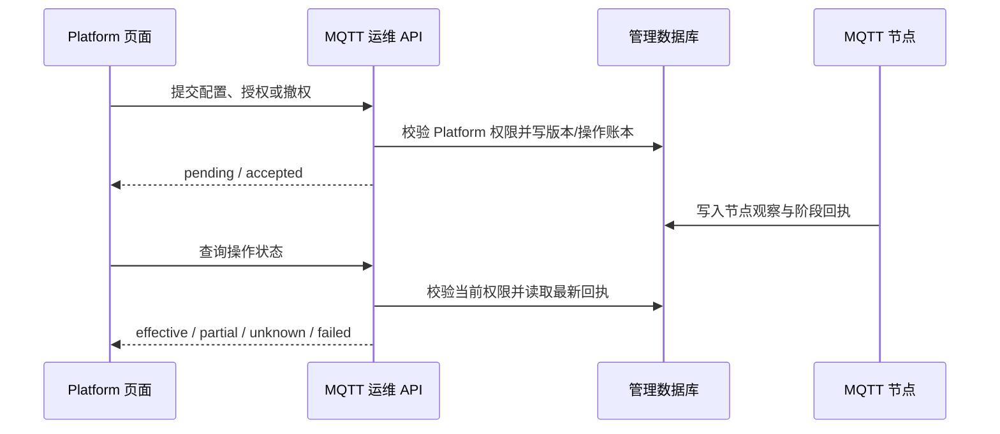

# Platform MQTT 运维

独立 Broker 人员后台已经退出。MQTT 运维统一由 Platform 管理，System 和 Center 只消费当前 Tenant 范围内的连接、授权和通信观察。协议节点、连接资源、授权发布、配额、运行配置、调试凭据和恢复状态使用 `platform_mqtt_*` 表及 Platform 权限。

## 页面与接口

| 功能 | Platform 入口 | Center 入口 | 权限 |
| --- | --- | --- | --- |
| 资源与连接 | `/platform/broker` | `/center/connections` | `platform.broker.read` / `center.connections.read` |
| 授权 | `/platform/broker/access` | 由接入应用页面管理当前 Tenant 授权 | `platform.broker.read/write`、`center.applications.authorize` |
| 配额 | `/platform/broker/quotas` | 无写入口 | `platform.broker.read/write` |
| 运行配置 | `/platform/broker/runtime` | 无写入口 | `platform.broker.read/write` |
| 调试凭据 | `/platform/broker/debug` | 无平台级入口 | `platform.broker.read/write` |
| 节点 | `/platform/broker/nodes` | 无平台级入口 | `platform.broker.read` |
| 审计 | `/platform/broker/audit` | Tenant 审计按 `system.audit.read` 过滤 | 对应审计权限 |

API 统一使用 `/platform/*`、`/center/*`。固定 Tenant 入口使用 `/t/{tenant_id}/platform/*` 或 `/t/{tenant_id}/center/*`；子域名直接使用对应模块路径。客户端不能提交 Tenant 头来改变范围。

## 运行与撤权

MQTT 协议连接、TLS、WebSocket、QoS、会话和持久交付由 TypePHP + Swoole + MQTT 组件承载。平台写操作先写入授权版本和操作账本，再等待节点回执；`pending`、`partial`、`unknown`、`failed` 与 `effective` 保留真实阶段，不能把管理接口返回成功解释成设备业务已经完成。

收紧权限（停用、吊销、轮换、收窄 Topic 或 QoS）必须记录撤权意图。节点确认后才清理完成状态；无法取得可靠回执时进入隔离，禁止页面重复签发或自动重试造成重复副作用。调试凭据、应用密钥和设备凭据只在签发或轮换响应中一次交付。



## 验证

```sh
php tests/tenant.php sqlite
pnpm --dir web typecheck
pnpm --dir web build
```

PostgreSQL 同步存储、真实 TLS MQTT、节点撤权、retained 和跨 Tenant 转配必须使用专用外部服务单独验收；SQLite 只证明身份、路由和基本授权闭环。
