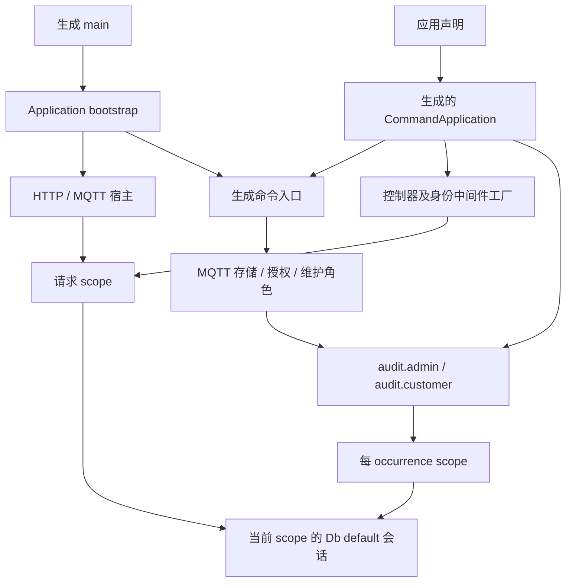

# 物联中心统一装配

物联中心的应用声明位于 `docs/build-config/type-app.json`。它登记命令、控制器依赖、固定身份域的中间件、原始通信入口和维护计划。开发准备与完整 AOT 消费同一声明；生成入口替代原 `app/main.php`，生产端不读取 PHP 注册文件或扫描类。

## 启动及资源归属

`ApplicationContext` 只保存启动路径、开发模式及配置快照，按需读取同一个 `Repository`，不持有连接、Model 或当前身份。控制器通过构造参数取得服务和固定配置；原来未使用的 `DatabaseManager` 参数与手写控制器工厂已删除。数据库管理器由角色创建并 `Db::configure()`，业务连接归当前执行作用域，角色退出再关闭管理器。

`serve`、`broker:serve`、`iot:mqtt`、`broker:run` 属于 bootstrap 宿主分派，继续列在应用 `help` 中。它们需要拥有 Swoole Server 的外层事件循环，不能注册成会自动进入命令协程的普通命令。`inspect` 的 commands 清单因此只表示生成命令图；HTTP 列表表示同一宿主登记的路由。此边界与应用模板一致。HTTP 业务工厂仍来自生成图，在实际 worker 的请求 scope 中解析，不把主线程活动对象传给线程。

其他现有管理及后台命令通过生成的命令服务执行。`check` 的内部登记名是 `app:check`，避免与框架离线检查保留名冲突；用户入口仍为 `check`。离线 `help` 不加载 Composer、运行配置或数据库，`check` 只核对配置而不建立外部连接。

开发命令由 `bin/typeapp` 调用构建器的 `loadConfiguration()`，它负责一次完整准备与加载；`bin/typeapp-prepare` 仍提供独立的准备入口。启动子进程不再先准备、再在加载时重复准备。代次仍核对完整源码、依赖、生成器和冻结快照摘要；Schema 候选文件只有同时包含属性起始与相关名称时才进入语法树解析，普通引用不会反复触发声明扫描。

## HTTP 输入与原有权限

双端登录使用 `LoginInput`；公开站点信息使用零参数动作；站点更新使用 `SiteUpdateInput`；产品的查询、创建、修改和删除使用路径参数及产品 DTO。其他上传、流和既有 PSR 动作继续使用原接口。

生成动作负责有界读取、分源解析和 Schema 校验。`JsonBody` 仅保留业务已有的 JSON 媒体类型与空正文错误，不再次消费正文。额外字段明确拒绝；PATCH 的 `Data::has()` 保留“未提供”，显式 null 依照字段规则拒绝。产品的版本不能省略，省略名称或描述不清空原值。

身份域仍由固定路由确定；客户路径租户必须匹配 `X-Tenant-Id`，当前权限、成员有效性、乐观版本和审计事务仍由原服务检查。输入 DTO 不承载可信身份，不允许覆盖数据源、配置或角色。站点公开投影与 `no-store` 响应保持原行为。

## 后台声明与恢复

| 角色 | 入口 | 所有权 |
| --- | --- | --- |
| 原始通信 | `iot:mqtt` | Broker 持有监听、会话与有界协议状态，认证和持久操作经受控 worker 执行 |
| 协议存储与授权 | `iot:mqtt-store` / `iot:mqtt-access` | 仅由当前宿主管理的内部命令，独立作用域借用数据库，退出时归还 |
| 审计维护 | `app:schedule`；`audit.admin` / `audit.customer` | 保留每 60 秒计划、skip 错过策略、Redis 游标及独立 occurrence scope |
| 升级与恢复 | `app:upgrade` / `iot:recovery` | 停写维护、分批可续跑、固定备份及当前授权证据 |

当前应用不再登记业务消息 Job。退出的通知、导出、遥测和统计角色不由计划任务重新拉起；框架的 Queue、Outbox、Job 注册和 Scheduler 机制仍由独立组件与教程消费。默认 profile 保留 `web,mqtt,iot,scheduler`，因维护调度仍使用 Redis 而保留相应原生依赖。

`APP_ENV=demo` 在外层命令与内部存储动作处分别限权；状态查询可用，写入消费与恢复操作必须在停服维护环境执行。配置、启动及预算保持同一个装配图。

## 验证入口与限制

`tests/iot-identity.php` 及三库控制器验证双端、分类、设备、资格、应用、转配、运维及 `--scheduler`；MQTT 使用独立 PostgreSQL 同步主备与 TLS 客户端。完整参数见[验收入口](test-entrypoints.md)。Redis 测试要求 `TYPE_REDIS_SERVER` 指向同平台受控服务。

HTTP 覆盖白名单、PATCH 缺失/null、跨客户、版本、审计故障回滚、重启与排空。原始通信覆盖凭据、逐设备授权、协议持久状态及撤权；恢复核对同时覆盖注册资格与应用。此前包含旧数据处理链的程序证据保留原身份，不能作为当前源码验收。最终 AOT、无源码与平台矩阵分别记录。
