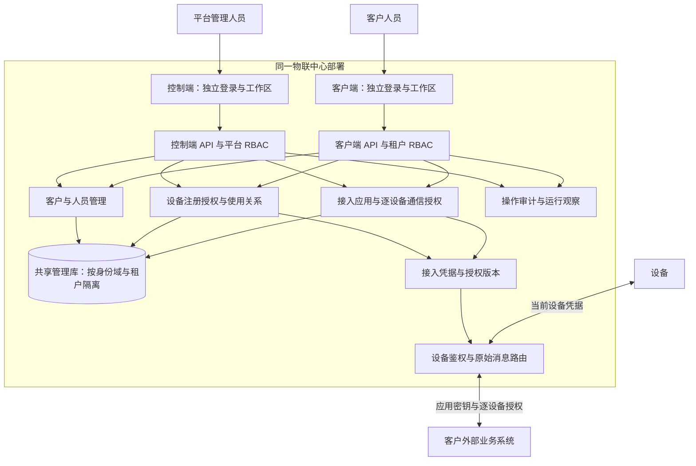
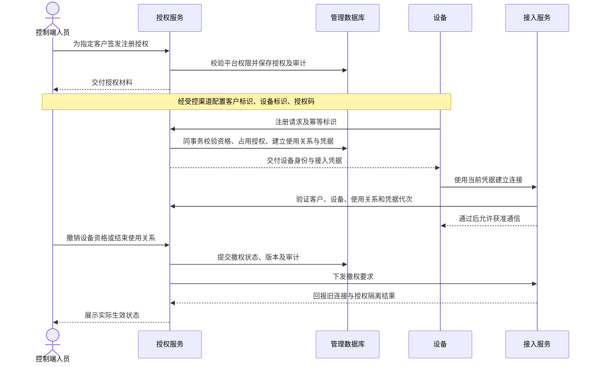
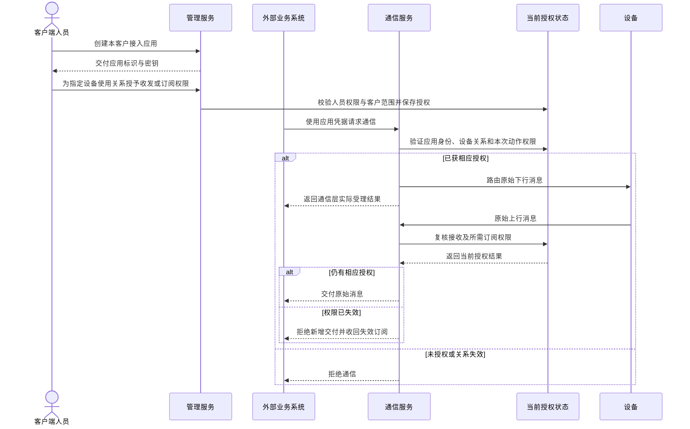

# 物联中心控制端与客户端设计

状态：架构范围已确认，尚待实施，2026-10-22。本文区分已确认要求、实施约束和当前代码；尚未实施或验收新的设备授权及通信合同。决策依据见[双端管理与设备通信授权](../adr/0026-control-client-device-authorization.md)，源码核对基线为 `db5731f`，现行使用说明仍见[物联网中心](../guide/iot-center.md)。

## 已确认范围

物联中心采用同一部署、两套独立后台与登录入口。控制端具备完整的平台 RBAC，管理平台及客户工作区；客户端具备租户内的人员、角色与设备管理能力。复用已有账号与会话域，不再建立一套人员账号体系。

控制端统一签发设备注册授权并分配给客户，设备以客户标识、设备标识和授权码完成注册。客户端管理已获授权设备，不能自行增加注册额度或扩大授权范围。

保留设备接入鉴权、连接状态与原始通信；移除处理器、遥测解析、历史数据、统计、告警及业务指令编排。人员与设备审计、连接观察和协议所需的持久状态仍属于管理及通信职责。

原始通信面向客户的外部业务系统开放。客户端管理独立的接入应用和应用密钥，逐台授予设备的接收、发送及订阅权限；后台人员账号、设备接入凭据和应用密钥分别管理。客户能够管理某台设备，不代表其全部接入应用自动获得该设备的通信权限。

## 当前实现与差距

| 范围 | 当前事实 | 设计调整 |
| --- | --- | --- |
| 人员身份 | 已有管理账号、客户账号、独立会话与完整双端 RBAC | 保留认证与授权机制，整理两端职责和页面入口 |
| 客户范围 | 客户账号通过成员关系进入一个或多个租户 | 保留组织与人员的区别，不把客户端后台当成独立部署实例 |
| 前端 | 共用一个 Vben 工程、路由树和布局，按身份域切换菜单与会话 | 分别组织控制端和客户端路由、导航与工作区，复用界面组件 |
| 设备注册 | 客户登记设备时强制绑定已发布物模型，并直接生成接入凭据 | 改为控制端签发注册资格；设备身份与物模型解耦 |
| 设备转移 | 关联归属阶段、模型匹配、待排空数据与未完成指令 | 重划为客户使用关系的结束、撤权与重新分配 |
| 通信授权 | 已有 Broker 接入主体、凭据、Topic 授权与版本化发布 | 复用底层机制，补齐面向设备注册与客户范围的业务合同 |
| 数据处理 | 当前包含接收、统计、告警、通知、导出和指令角色 | 从本案例移除对应业务链，保留框架通用组件 |

主要依据：[双端身份](iot-identity.md)、[角色服务](../../app/common/service/RoleService.php)、[身份表结构](../../app/common/database/Schema.php)、[前端路由](../../web/apps/web-antd/src/router.ts)、[前端会话](../../web/apps/web-antd/src/api.ts)、[设备服务](../../app/iot/service/DeviceService.php)、[设备接入](../../app/iot/service/DeviceAccess.php)及 [Broker 授权服务](../../app/broker/service/AccessService.php)。这些事实来自源码检查，不代表新方案已经通过运行验收。

## 两端职责

下表是目标职责划分；新增注册授权入口仍需实施。

| 能力 | 控制端 | 客户端 |
| --- | --- | --- |
| 人员与 RBAC | 平台人员、角色、权限分配和会话撤销 | 当前租户成员、角色与权限分配 |
| 客户管理 | 客户开通、状态、账号、最高管理员及客户工作区管理 | 查看所属工作区、选择当前租户 |
| 设备注册资格 | 签发、分配、期限、重置与停用 | 查看已分配资格及注册结果，不自行签发 |
| 设备管理 | 平台设备目录、客户归属、撤权及重新分配 | 管理本客户已授权设备的资料与获准操作 |
| 接入应用 | 依据平台权限管理客户应用、停用接入及核对审计 | 创建和维护本客户应用、轮换或撤销应用密钥 |
| 设备通信授权 | 核对客户授权范围并执行获准的管理及撤权操作 | 在本客户有效设备使用关系内，逐应用授予接收、发送及订阅权限 |
| 通信与观察 | 接入策略、Broker 运行状态、授权生效状态 | 本客户设备的连接状态及获准通信能力 |
| 审计 | 平台动作、跨客户管理来源与授权变更 | 本客户人员操作和设备授权记录 |
| 设置 | 站点、平台运行配置及统一默认值 | 个人偏好和获准的客户设置 |

控制端的“管理客户端”通过明确的平台动作完成，不能把平台令牌直接当客户令牌使用。现有模拟登录保留真实管理人员来源，采用目标客户的权限，不合并两个身份域。平台人员管理客户时显式指定目标客户并受平台权限检查，客户端请求则只能使用当前有效成员关系。

双方继续采用固定权限目录、多有效角色权限取并集、禁止越权授予，以及最高管理员和最后一位有效管理员保护。菜单和按钮按权限显示，所有服务端入口独立检查权限；域名、页面路径和请求中的租户编号都不构成授权。

## 部署与界面

继续交付一个对应平台和数据库 profile 的主程序与外置配置。两套前端编译进同一程序，安装后生成页面资源；不要求用户部署两套后台服务。TypePHP 是生产代码编译核心，Swoole 是静态链接的原生通信与并发运行库。

两端保留现有登录地址 `/#/admin/login` 和 `/#/login`，API 继续区分 `/admin` 与 `/customer`。同一前端工程内分别声明路由树、菜单和工作区；共享 Vben 基础布局、表格、表单和主题，避免复制整套前端。详情页、面包屑、退出后的返回地址及浏览器偏好都归属当前身份域。

当前会话域、租户切换与在途请求取消机制继续复用，切换时清空旧权限和页面数据。两端可在不同标签页分别登录；界面分开不替代服务端鉴权，也不声称同源页面具有浏览器级隔离。

物联后台只以控制端、客户端作为人员入口；Broker 运维功能放在相应授权范围内。独立 Broker 工具的已有账号与 API 不因本案例界面整理而被直接删除。

同一部署不限定为单进程：HTTP 与设备通信仍遵守各自的监听所有权、执行预算和停止流程，使用同一程序的受监督角色。数据库和按实际功能使用的其他外部服务仍需部署。当前 MQTT 持久存储明确要求 PostgreSQL 写入驱动及有界同步配置；管理 API 的 MySQL、PostgreSQL、SQLite 支持不等于三个 profile 都具备完整持久通信能力。本次复用该边界，不通过删除遥测业务或关闭持久性来声称另外两个 profile 已通过完整通信验收。

## 设备授权模型

人员权限、设备注册资格、客户使用关系和通信凭据分别表达不同事实。

| 概念 | 含义 | 约束 |
| --- | --- | --- |
| 客户 | 拥有独立管理范围的组织主体，沿用租户模型 | 不等于某个登录账号或客户端程序副本 |
| 设备标识 | 区分设备的稳定标识 | 不用名称、连接 ID 或当前凭据代替 |
| 注册授权 | 控制端发给某客户的设备注册资格 | 校验客户状态、期限、绑定对象和额度，禁止跨客户使用 |
| 授权码 | 设备证明注册资格的凭证 | 与后台密码及注册后的接入凭据分开，不视为硬件真实性证明 |
| 使用关系 | 设备在某个阶段归属于哪个客户 | 同一设备只存在一个当前使用关系；结束后保留归属与审计依据 |
| 接入凭据 | 设备建立连接时证明身份的秘密或证书 | 支持轮换和撤销；更新凭据不新建设备身份 |
| 接入应用 | 某客户的外部业务系统在中心的通信身份 | 独立密钥与启停状态，不使用人员登录会话或设备凭据 |
| 通信授权 | 限制某接入应用对某设备使用关系的接收、发送与订阅权限 | 仅在同一客户的有效设备范围内授予，不从人员登录权限隐式推导 |

注册授权的到期时间与设备使用关系的到期时间必须分别表达。注册期限限制何时可以注册，不能隐式解释为注册后的长期使用期限；客户停用、设备停用及当前使用关系失效则独立阻止接入。

建议注册流程如下，接入协议字段与状态码在实施规格中固定，不把图中的动作名当成现有可调用接口。

并发注册不能重复占用授权或创建多个当前使用关系。请求重试和响应丢失需要明确恢复方式，不能在普通查询中回显旧秘密。代码只保存适合验证的秘密摘要，并为注册入口设置尝试预算。

重新分配须先结束旧关系并完成旧连接、凭据及订阅隔离，再建立新关系和新凭据。不能只修改 `tenant_id` 就宣称移交成功；旧身份的待投递消息、持久会话和 retained 内容也不能自动变成新客户可访问的数据。业务状态、在线状态和授权生效状态分别展示，无法核实在线时显示未知。

撤权复用现有版本化发布机制，明确区分数据库已保存、执行中和已生效。节点不可达或未完成隔离时保留待处理状态，不能只因接口返回成功就宣称所有旧连接已经断开。

## 原始通信边界

通信层校验身份、范围、消息大小、频率及协议规则后路由载荷，不解析测点、不计算业务值、不生成业务告警，也不判断业务执行成功。

协议确认、通信投递结果和设备业务应答分别表达。断线重试、QoS、持久会话、消息有效期与必要队列按照协议合同处理；这些状态不是遥测历史库。不会因为去掉业务数据处理而删除协议需要的持久性，也不新增无限期保存、回放或业务必达承诺。

## 接入应用与逐设备授权

每个接入应用归属于一个客户，拥有独立凭据和启停状态；人员通过客户端的 RBAC 管理应用，外部业务系统通过应用凭据通信。应用属于客户，其通信不依赖创建者的登录会话；人员退出后台不会隐式撤销应用身份。

授权绑定应用和当前设备使用关系，三项权限分别表达：

| 权限 | 允许的行为 | 不包含的行为 |
| --- | --- | --- |
| 接收 | 接收获授权设备的原始消息 | 自动建立持续订阅、读取遥测历史或接收其他设备消息 |
| 发送 | 向获授权设备发送原始消息 | 自动取得接收权限、宣称设备已经执行成功 |
| 订阅 | 持续订阅获授权设备的原始消息，必须同时具有接收权限 | 跨客户订阅、绕过设备范围或自动订阅新注册设备 |

客户端人员只能在自身管理权限和客户设备范围内授权；控制端的跨客户管理仍按平台权限执行并记录真实人员来源。应用通过认证后，每次收发还须核对客户与应用状态、当前设备使用关系及相应通信权限，不能只校验一次密钥后永久放行。

应用密钥只通过受控入口交付，不在列表、审计或日志中回显；轮换凭据与修改设备权限分别维护其有效版本。设备转配、客户停用、应用停用或权限撤销后停止相应通信；新使用关系需要重新授权，旧授权与旧消息不能自动跨关系恢复。

权限收紧沿用授权发布与节点执行回执，不把管理保存成功当作全部连接已完成撤权。已经交付给对端的原始消息不能撤回，平台只报告能够观察到的通信结果。

## 移除与复用

| 对象 | 处理方向 |
| --- | --- |
| 处理器和设备数据解析 | 不引入处理器运行时，删除本案例的数据解析依赖 |
| 产品与物模型 | 设备注册不再要求发布物模型；设备分类可保留产品资料，模型版本及解析语义退出本案例主流程 |
| 遥测、历史、分钟统计、告警 | 移除业务 API、页面、权限与消费角色 |
| 告警通知、历史导出 | 随对应业务链退出；不顺带删除框架通知、队列、文件或导出基础能力 |
| 业务指令 | 移除编排、执行状态判断和数据对账；保留受授权的原始下行通信 |
| 设备归属与凭据 | 复用稳定身份和撤权机制，解耦物模型、采样与未完成业务指令 |
| TypeApp 通用组件 | 保留 HTTP、MQTT、WebSocket、ORM、队列、调度等可独立消费能力 |
| 构建 profile | 按新业务依赖重新核对闭包；有真实调用者的库保留，不能只凭页面移除就删运行依赖 |

## 迁移与验收

实施按可观察的业务路径组织：先整理双端入口与权限，再完成控制端签发、设备注册与客户端查询，随后打通接入应用、逐设备通信授权和撤权，最后退出旧数据处理链。每条路径一起调整 Model、服务、控制器、页面、文档与测试，不按前后端分别留下不可用中间态。

已有账号、角色、客户、设备和审计需要明确迁移映射。旧设备没有新注册授权记录，不能因此被静默删除或自动扩大权限；升级应产生可核对的迁移结果。数据处理角色先停止接纳新任务，保全旧数据和任务状态后再退出；本次设计不授权删除现场数据。

现有安装迁移把人员、设备和旧业务表编排在同一批次。已发布迁移的标识、语句及摘要保持不变，新增模型、字段与转换通过追加迁移实现；历史迁移中的旧表声明不因退出生产调用路径而被删除。新增角色权限须明确授予或通过可审计的迁移规则处理，不能把普通角色已有的设备查看权限自动扩为签发或应用授权权限。

`APP_ENV=dev/prod/demo` 规则保持不变。Demo 继续使用现有双端账号，仅允许登录、退出和查询；设备签发、绑定、轮换、应用创建、密钥变更、通信授权、原始发送及后台写入口同样受到限制，不另设 Demo 账号体系。

验收至少覆盖：

- 两端普通角色与最高管理员、跨域令牌拒绝、跨租户访问拒绝、角色收紧、最后管理员保护及模拟登录来源。
- 客户停用、授权到期或撤销、错误客户标识、重复设备标识、并发绑定、注册重试和凭据响应丢失恢复。
- 真实设备协议接入、原始上行与下行、客户端状态观察；确认没有进入遥测、统计、告警或指令处理链。
- 撤权后的新连接拒绝、旧连接隔离、旧持久消息不可跨关系投递，以及节点不可达时的真实待处理状态。
- 接入应用的无授权拒绝、分别收发与订阅、仅订阅而无接收权限的拒绝、应用停用、跨客户授权拒绝及设备转配后的旧授权失效。
- 人员令牌、设备凭据与应用密钥不能互换使用；密钥轮换与撤销后旧连接按实际生效状态隔离，人员退出不改变有效应用的独立身份。
- 同一最终程序的全量 AOT、对应数据库真实行为、无源码部署、前端安装和 `demo` 只读；保留现有发布的准确身份。

当前仅完成源码核对、术语整理与架构决策，不将静态检查计为新业务验收。使用教程随实际接口和迁移完成情况更新；历史发布证据保持原身份，演示站点在取得新产物并完成验收后再安排切换。
