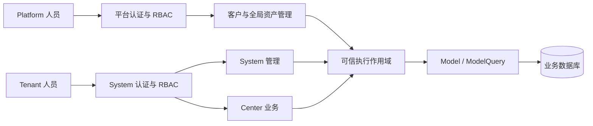

# Platform / System / Center 架构与界面

状态：已决定，当前开发源码重构及候选验收中，2026-11-14。本文记录职责和取舍，使用接口见[物联中心](../guide/iot-center.md)，身份合同见[身份与授权](iot-identity.md)，验证范围以同一候选的实际结果为准。

## 单程序与职责

应用保持一个主程序、多个运行角色和一个 Vben 前端工程。Platform 使用独立人员身份管理平台、Tenant、客户超管、菜单目录和全局 MQTT 运维；每个 Tenant 的 System 管理自己的人员、角色、会话、审计、品牌与默认主题，Center 共用该 System 身份处理设备及原始通信。

业务采用 Controller、Service、Model，复用核心组件的执行作用域、事务、模型和资源生命周期。字段默认用简洁模型配置声明，在构建时转换为同一受管对象；反向结构同步生成普通可编辑源码，保留业务方法和关系。框架不反向依赖物联业务，也不增加通用 Repository 或另一套运行时装配。

## 身份、入口与数据

Tenant 是客户组织，System 账号直接归属一个 Tenant，允许不同客户使用相同登录名。主域名先选择客户，登记子域名和固定路径直接确定客户；登录后不通过成员关系切换客户。域名及路径负责定位，当前会话、人员状态和角色决定授权，两者必须一致。

Platform 维护平台菜单和共用子系统菜单，页面与操作绑定已登记能力。普通角色不随新增菜单自动增权，超管覆盖所属域当前启用目录；隐藏只影响导航，停用撤销能力。模拟登录使用目标 Tenant 超管的实际权限，交接和后续动作保留真实平台操作者与来源会话，具体规则统一由[身份合同](iot-identity.md)维护。

新安装建立平台身份和公共目录，客户开通再原子创建客户设置、超管角色和初始账号。随机初始口令一次性交付。当前方案明确不维护旧人员入口、成员关系或数据转换，旧安装拒绝接入且不自动清库；这是简化身份和数据隔离边界的取舍，现场切换及外部 DNS/TLS 准备独立处理。

## MQTT 与原始通信

人员会话、设备凭据和接入应用密钥是不同身份。Platform 签发设备注册资格，Center 只查看当前客户已获配资格并管理设备和应用；接入应用按当前设备使用关系逐台取得接收、发送及订阅权限，订阅同时要求接收资格。

MQTT 保留精确 Topic、QoS、持久会话、retained 和资源预算。关系结束或跨客户转配时隔离旧连接及持久内容，新关系不继承旧应用授权；通信受理、节点执行和真实在线是不同事实。业务载荷由外部系统解释，平台不承诺设备已经执行业务动作。

独立 Broker 人员后台已退出：只通过 `app:install` 建立应用安装，HTTP 使用统一 `serve`，MQTT 运维采用 Platform 身份。`broker:run`、持久存储及节点隔离命令继续承担协议职责，共用统一恢复门和 Platform 审计。旧人员安装、账号、HTTP、迁移和恢复命令不再注册。框架原生适配和完整通信链路仍按当前候选分别验收。

## Vben 原生能力

| 能力 | 使用方式 |
| --- | --- |
| 登录及应用布局 | 复用认证布局、BasicLayout、原生用户入口与权限路由 |
| 查询和列表 | Vben Grid 内置查询表单、VXE 表格、标准工具栏及分页；未知总数保持游标语义 |
| 编辑与授权 | 原生表单、抽屉、弹窗、Tabs、Dropdown、Divider；秘密交付保留业务组件 |
| 主题和偏好 | 原生偏好面板、主题、字体、圆角、布局、侧栏、面包屑、标签页、动画及无障碍显示 |
| 日常工具 | 菜单搜索、时区、全屏、刷新、锁屏、动态标题与水印 |

页面保持统一的标题层级、字号、间距、表单宽度和响应布局，具体规则集中在[Web 标准](../standards/iot-web.md)。语言切换与通知需要完整翻译和真实数据源后开放，不能以空按钮或模拟通知表示能力已经交付。

平台配置自身品牌、公共登录缺省值和新客户初始值；Tenant 超管维护本系统品牌和默认主题。个人只保存显式覆盖字段，按端、Tenant、账号及模拟操作者隔离；恢复默认采用最新端配置，品牌与身份不由个人覆盖。

## 依赖与验收

Vben 同步官方 5.7.0 正式 Ant Design Vue 应用及必要工作区，第三方许可证保留。其余依赖、工具链和运行库使用当前锁文件中的准确身份；TypeScript SFC 检查仍须按实际检查器能力记录，不能把版本号等同于原生支持。

验收分别记录 PHP、真实三库、浏览器、完整 AOT、无源码运行、同步 PostgreSQL/TLS MQTT 及正式平台/profile 矩阵。当前已有前端类型检查和生产构建、本机三库身份与 Center 管理 HTTP、浏览器页面和弹层验证；全量产品验收仍受原生适配及完整通信验证约束。

历史候选的原生或四平台结果只证明原候选。当前固定依赖、源码实施、单独编译器探针以及一组浏览器截图，都不能替代最终程序的整体运行与隔离验证。
