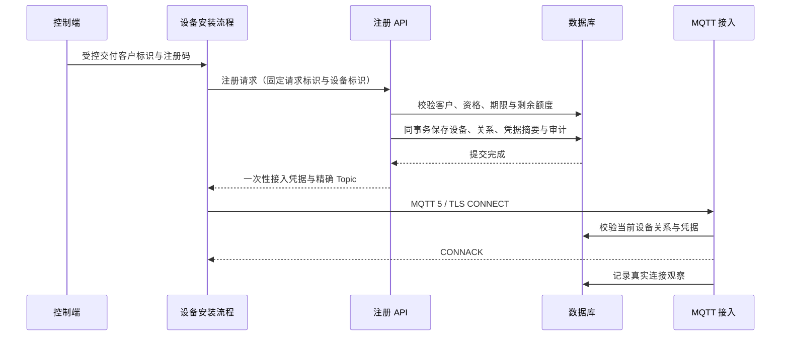

# 设备注册、生命周期与 MQTT 接入

## 使用控制端签发的资格注册

控制端在“设备注册授权”签发指定客户的注册码。设备安装流程通过 HTTPS 调用 `POST /public/devices/register`，提交客户标识、稳定设备标识、请求标识、设备名称及注册码。此入口不使用后台人员令牌，人员登录不能代替注册资格；`APP_ENV=demo` 返回 `403 demo_readonly`。

```json
{
  "id": "11111111111111111111111111111111",
  "tenant_id": "22222222222222222222222222222222",
  "device_id": "33333333333333333333333333333333",
  "name": "一号网关",
  "code": "<控制端本次签发的完整注册码>"
}
```

示例标识仅说明格式。实际设备使用独立的 32 位小写十六进制稳定标识，首次请求生成并保存另一个同格式的 `id`。`name` 为 1–100 个字符，不接受 `product_id`、`model_version` 或自行指定归属状态。秘密应通过请求体交付，不放入 URL、日志或前端持久存储。

首次成功返回 `201`，`data` 包含 `device`、`credential` 和 `replayed:false`。设备、唯一当前使用关系、资格绑定、额度和审计在同一事务提交；新设备未关联分类，公开投影不包含历史物模型字段，连接状态为 `unknown`。`credential` 只在这次响应返回，安装方须安全保存。响应丢失时使用相同 `id` 和请求内容重试，返回 `200`、原设备关系及 `replayed:true`，`credential` 为 `null`。需要恢复交付时，由有权人员使用下述凭据轮换入口，不查询或重新导出旧秘密。



| 拒绝结果 | 含义与处理 |
| --- | --- |
| `401 registration_credentials_invalid` | 客户不可用或注册码无效；不泄露其他客户归属 |
| `409 recovery_reconciliation_required` | 资格恢复后未获当前证据批准；先由维护者完成授权核对 |
| `409 enrollment_unavailable` | 资格停用、过期或耗尽；不创建部分设备 |
| `409 registration_request_conflict` | 相同请求标识用于不同意图；核对原请求 |
| `409 device_already_registered` | 稳定设备已存在；查询原关系并受控恢复凭据 |
| `409 registration_ownership_changed` | 原注册对应的使用关系已改变；不得沿用旧结果 |
| `429 registration_rate_limited` | 同一来源每 60 秒最多 60 次有效形状的尝试，失败也计数 |

来源使用经过可信代理校验的地址，不接受任意转发头；最多保留 1024 个活动来源，预算耗尽时明确拒绝。注册码重置保留已用额度和绑定；注册截止时间只限制新的注册，不代表已注册设备使用期到期。

新设备只发布 `iot/{tenant}/devices/{device}/epochs/{ownership}/raw/up`，只订阅对应的 `/raw/down`，准确值以交付响应为准。载荷保持原字节，不解释为遥测，也不进入旧 `/up` 消费链。MQTT 确认只代表协议接管，不代表业务执行成功。应用必须取得当前关系的逐设备授权；[应用通信教程](../guide/iot-center.md#应用设备授权与原始通信)展示实际字段和操作。

升级追加 `103_iot_device_registration`，不改写历史迁移摘要。SQLite 在维护窗口重建设备表并验证外键，保留旧设备、使用关系和引用；MySQL/PostgreSQL 解除模型列的非空约束。三库支持注册管理，完整持久 MQTT 仍限定 PostgreSQL 同步后端。

## HTTP与设备契约

设备只能通过上述资格注册，不再提供人员直接登记模型设备的接口。普通列表和详情不返回凭据或验证值。

`GET /customer/tenants/{tenant}/devices` 支持 `name,product_id,lifecycle,page,per_page`，默认 20、最多 100 条，要求 `customer.devices.read`；详情追加 `/{device}`，包含资料、当前关系、连接与原始 Topic。平台通过 `/admin/devices` 和 `admin.devices.read` 查看全局资产，平台投影不交付设备秘密或通信 Topic。

两端设备详情的 PATCH 接受 `name`、可选的 `product_id` 与必需的 `version`，分别要求本域 `devices.update`。分类省略保持，null 清除，只能选择设备当前客户下的分类；不能借资料更新变更归属、凭据或生命周期。首次完整成功 CONNACK 已输出且连接仍归本实例时，设备从 `inactive` 变为 `enabled`；认证失败和 HTTP 刷新不激活设备。

注册结果、列表项和详情均含以下字段：

```ts
connection: {
  status: 'unknown' | 'online' | 'offline';
  observed_at: number | null;
  broker_observed_at: number | null;
}
```

时间是UTC Unix秒。`observed_at` 是最后一次连接建立或关闭的真实观察时间；从未连接为null。`broker_observed_at` 是所属Broker节点最近一次循环活性或停止观察时间。在线需要同一运行代次且活性未过期；每五秒只写一条节点活性，十五秒无新活性或节点运行代次改变后返回 `unknown`，保留最后连接观察时间。正常观察到关闭返回 `offline`，以后节点活性丢失不撤销已知关闭事实。HTTP读取失败按错误响应返回，不能伪造离线，也不写设备状态。连接观察是有新鲜度边界的事实，不是遥测新鲜度、业务持久接收证明或跨节点所有权隔离。

| 接入字段 | 值 |
| --- | --- |
| Client ID | `device.id` |
| Username | `device.id + ':' + credential.id` |
| Password | 256位随机秘密编码为64位小写hex；服务端只保存其SHA-256验证值。 |
| 协议与传输 | MQTT 5，TLS必需，客户端验证证书链和主机名。 |
| Keep Alive / Session Expiry | 30 / 86400秒；应用策略拒绝其他设备参数，不改变独立Broker的标准行为。 |
| 发布 | `iot/{tenant}/devices/{device}/epochs/{ownership}/raw/up` |
| 订阅 | `iot/{tenant}/devices/{device}/epochs/{ownership}/raw/down` |

载荷保持原字节，业务格式和结果由设备与外部业务系统约定。CONNECT校验秘密；每次发布、订阅、恢复及遗嘱到期都按Broker已认证的设备/凭据身份重查当前凭据状态、生命周期及归属阶段，授权不依赖密码或连接仍存活。遗嘱持久恢复不保存秘密及其验证值；凭据身份不可变，轮换须生成新身份并撤销旧凭据。只允许精确的本设备方向Topic，其他设备、租户、旧阶段或方向拒绝。共享订阅按实际过滤器授权，因此本设备精确下行可以加入共享组，跨设备和含通配符的过滤器仍拒绝。

列表和详情通过同一次SQL查询读取生命周期与连接观察，避免首次激活在两次查询之间提交时拼出未激活但在线的状态；观察所属阶段不匹配时不向当前阶段泄露旧观察时间。

## 生命周期与持久撤权

复用状态机。客户使用 `POST /customer/tenants/{tenant}/devices/{device}/{action}`，平台使用 `POST /admin/devices/{device}/{action}`；动作是 `rotate/revoke/disable/enable/retire`，分别要求本域的 `devices.{action}` 固定节点，请求携带当前 `version` 与精确的 `confirm_device_id`。复用授权事务锁重验当前身份、角色和模拟来源，再锁定设备读取准确版本；等待期间撤权或设备变化返回明确拒绝。已知准确目标的写操作不隐式要求查询节点，平台操作不伪装客户成员。

每台设备最多一个有效凭据。轮换永久撤销旧凭据并生成新主体，秘密只在本次响应显示且仅保存不可逆摘要。禁用与退役同时吊销旧凭据；启用不会复活旧凭据，须显式轮换后重新配置。退役是终态，阻止新接入、上报与控制，不提供硬删除或普通恢复；历史原件按升级备份保全，不恢复旧业务查询和清理角色。

全新安装直接创建最终设备表和 `iot_authorization_invalidations`，每设备保存一项精确旧主体的持久失效意图，不走旧数据转换。管理事务提交后返回 HTTP 202，设备投影的 `authorization.status=pending` 表示Broker尚未完成隔离；无旧主体需要隔离时为HTTP 200。投影同时提供 `id/requested_at/completed_at/node_id`，详情另有 `credential_active`。未完成期间禁止第二个管理动作，防止旧意图被新动作覆盖；已完成行可供后续动作复用。连接状态与授权生效状态分别取自实际观察。

意图冻结租户、真实管理人员或客户、会话及模拟来源，提交与审计在同一事务内完成。Broker完成时使用冻结来源写入对应新审计域；来源退出不能撤回已提交的隔离。重复完成回调不重复写完成审计。MQTT接入、发布、订阅和服务的精确设备Topic授权同时检查租户启用状态。

`DeviceAccess` 通过新增的可选 `AuthorizationInvalidations` 公共契约提供旧主体，沿用已有有界子进程。Broker停止该主体的网络读写，丢弃尚未输出的数据，并等待相关持久工作结束；取得精确旧会话终止的同步提交证明后，才保存 `enforced` 完成状态。会话终止清理订阅、未完成交换、离线待投递与遗嘱。迟到旧意图不能终止轮换后不同主体的会话。已交给网络的字节不能撤回，页面不会在持久意图提交时提前声称网络隔离完成。

撤权来源异常、持久结果未知或后端未证明终止时，Broker停止服务并保留未完成意图；重启后重新完成同步隔离。单节点与集群分别使用各自运行代次及回执证明；重新分配还须完成所有相关旧关系隔离，不能以一条设备状态替代。服务退出统计含 `invalidated/invalidationPending/invalidationFailures`，失败不能被正常连接观察覆盖。

管理端复用设备列表和公共抽屉，危险操作确认设备标识；保存中禁重复提交和关闭。响应丢失时提示明确刷新核对，不自动重试生成凭据，也不能找回已经显示过的秘密。切租户、关闭凭据抽屉或会话失效会清除秘密。

## 启动与所有权

设备转配由平台发起，先撤销旧使用关系并隔离会话、订阅、retained 和待投递，再由目标客户确认，见[使用期限与转配](../guide/iot-center.md#设备使用期限与转配)。分类在新关系中清空，应用权限不自动继承。

HTTP与公开注册支持真实MySQL、PostgreSQL、SQLite；设备持久MQTT接入按ADR0010仅使用PostgreSQL同步后端。配置沿用 `DB_*`，新增项见 `.env.example` 的 `IOT_MQTT_*`。生产选择已验收的锁定 AOT 产物，`IOT_MQTT_COMMAND` 为同一应用入口的JSON参数数组；相对命令按启动工作目录解析，证书及私钥相对 `APP_BASE_PATH`。示例开发入口可配置为 `["php","bin/typeapp"]`，原生部署使用自己的单程序入口。不得把PHP开发入口配置为生产回退。

先在空库完成 `app:install`，参数与受控口令环境见[应用初始化](typeapp.md#准备与初始化)。已有安装按应用升级流程维护，不能重复安装或使用已关闭的 `migrate run`。PostgreSQL 同步后端、TLS 和各设备/应用凭据准备后，再执行：

```sh
php bin/typeapp iot:mqtt-install
php bin/typeapp iot:mqtt
```

原生产物使用同名角色。安装角色通过已有持久worker取得同步证明，运行角色不自动迁移；备库名默认 `iot_sync`，沿用组件对 `FIRST 1`、`remote_apply`、WAL刷盘及备库重放的要求。TLS不提供明文开关。一个稳定 `node_id` 由一个进程独占监听，不同节点使用不同标识；不声明跨节点接管或高可用已经验收。

同名节点的资源观察仍有效时，新运行会被拒绝。强杀或观察失败退出后，须先确认旧进程已停止，再等待 `broker_resource_runs.expires_at` 自然到期（最后一次成功心跳后15秒），然后启动同名节点恢复持久意图；不能通过删除观察行或更改完成状态跳过保护。正常停止会结束本次观察有效期，无需固定延时。

应用默认物理连接10100、设备10000、服务预留100、持久会话20000。配置键见 `.env.example` 的 `IOT_MQTT_MAXIMUM_*`，只能调低。Broker在 `DeviceAccess` 校验真实TLS、Client ID和独立应用密钥之后才把服务身份计入 `application`；客户端自报属性不能申请服务额度。同Client ID接管沿用分类名额，并在持久容量预留成功后完成接管。已持久保存的分类在普通恢复时不能改变。

持久预算同时约束条数和逻辑字节，先满者生效：每设备10000条/16 MiB，应用会话或共享组1000000条/2 GiB，全局待投递2000000条/4 GiB。订阅仍每会话最多100个，替换不重复计数。Broker 允许完整 1 MiB 协议包；持久队列额度不代表能存放全部设备的24小时缓存。

首次启动的配额快照同时采用外置配置中的连接、会话和持久队列额度。快照建立后，以管理端已发布的配额版本为准；修改 `.env` 并重启不会覆盖已有版本，也不会删除已确认的积压。

`iot:mqtt-statistics` 复用持久worker返回同步证明后的聚合JSON，包括配置额度、会话分类、订阅和分类积压，不输出身份或载荷。Broker结束时输出连接、分类拒绝、持久拒绝、缓冲及资源回收计数；持久统计中的已连接会话只表示数据库所有者事实，不能替代实时网络在线观察。降低额度不能删除已确认未完成消息，恢复已有会话和交付继续使用原持久事实。

`DeviceAccess` 实现应用策略及可选连接观察。每次策略或观察在协程中等待一个受控子进程，输入至多397306字节、输出1KiB、硬截止3秒；父子共用输入预算，按单条标准65535字节过滤器的最坏JSON转义加4KiB信封计算，避免合法长共享组在已订阅后被观察通道拒绝。工作角色在自己的协程作用域内配置 `Db`，数据库租约由 `DatabaseManager/ExecutionScope` 管理并在退出时归还，不会让空闲设备持有数据库连接。参数数组直接启动同一应用程序，Unix 使用 Swoole PROC hook 管道，Windows 使用 Swoole Coroutine Socket 的回环通道。双方使用不同角色标签的 HMAC 互验一次性密钥，认证前不发送业务请求，密钥仅由子进程环境传入；监听、连接和消息都有明确所有者及预算。凭据以验证值进入私有 IPC，进程参数和日志没有秘密。启动即用 `PGAPPNAME` 标识具体数据库操作；异常或超时后复用 `PendingCommit/PostgresStore` 的有界精确后端清理，停止当前策略实例及Broker，不重试未知写入。未证明清理成功的后端需要运维处理，不能无限重建工作进程。该串行有界策略尚未作万台连接或吞吐验收，平台结果以同一候选的实际验收为准。

每台设备仅在真实连接变化时写一行观察；节点心跳不全表更新设备。关闭同时匹配连接owner和运行代次，旧连接迟到关闭不覆盖新连接；在线写入还检查当前节点代次、活性及设备归属。`AuditLog` 记录 `device.connected,device.disconnected,device.connection_denied,device.topic_denied`，设备详情可复用当前租户审计的 `subject_id` 筛选。未知身份拒绝以无租户审计保留，不创建设备；审计只含稳定身份、动作及允许的原因，不含密码、验证值、任意Topic或载荷。

## 验证入口

运行中的节点采样、持久积压、故障与客户设备观察由[运行概览](iot-operations.md)提供，保持观察、同步证明和页面读取失败分别表达。

```sh
php tests/iot-identity.php --php sqlite --devices --lifecycle
php tests/iot-device-mqtt.php --php
php tests/iot-device-mqtt.php --php --lifecycle-mqtt
php vendor/bin/type build docs/build-config/type-app.json
php tests/iot-device-mqtt.php build/app/type-app --no-source
php tests/iot-device-mqtt.php build/app/type-app --no-source --lifecycle-mqtt
```

`TYPE_PGSQL_TOOLS` 指向已验证的本机PostgreSQL工具根，`TYPE_MQTT_CLIENT_ROOT` 指向已安装 `mqtt@5.15.0` 的测试依赖根。测试复用真实HTTP注册、独立主库及同步备库、临时TLS证书和标准客户端，分别记录PHP、全量AOT及原生无源码结果；`--no-source` 当前使用 macOS 内核拒读策略，并分别验证父、子进程不能读取生产源码。应用由受保护入口启动，内部工作角色继承内核策略后直接执行同一运行包；从测试控制器独立启动的角色仍经过受保护入口。只清理自己创建的进程和测试秘密，不停止其他HTTP/Broker。覆盖正确/错误/跨设备凭据、设备状态及归属、会话恢复重授权、CONNACK失败、在线/关闭/接管、崩溃未知、观察依赖失败及审计脱敏。原生与独立组件回归的实际完成范围以最终验收记录为准。

容量、集群、生命周期、应用通信及转配使用各自专项入口和独立数据。当前参数见[验收入口](test-entrypoints.md)；未执行专项不计为通过。旧遥测、指令及模拟固件夹具已退出，通用协议的 QoS、长过滤器、持久性和故障义务继续保留。
