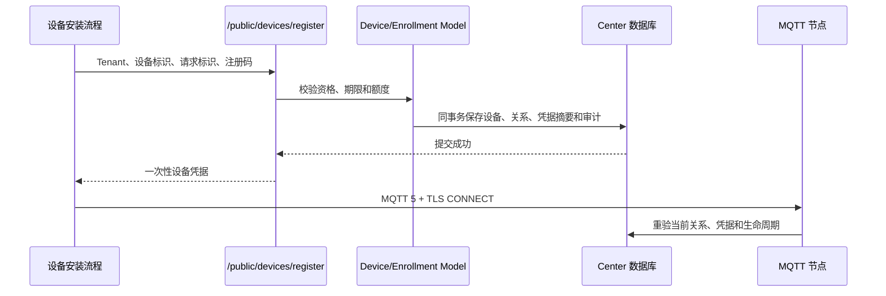
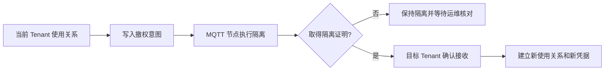

# Center 设备注册、生命周期与 MQTT 接入

## 注册资格

Platform 为指定 Tenant 签发注册资格，设备通过 `POST /public/devices/register` 提交 Tenant 标识、稳定设备标识、请求标识、设备名称和一次性注册码。此接口不接受后台人员令牌；`APP_ENV=demo` 拒绝写入。

```json
{
  "id": "11111111111111111111111111111111",
  "tenant_id": "22222222222222222222222222222222",
  "device_id": "33333333333333333333333333333333",
  "name": "一号网关",
  "code": "<一次性交付的注册码>"
}
```

注册事务同时创建 `center_device`、`center_device_ownership`、`center_device_credential`、资格绑定和审计。重复请求只返回原设备关系，不重新交付秘密；凭据仅在注册或轮换响应中出现一次。



关键错误包括 `registration_credentials_invalid`、`enrollment_unavailable`、`registration_request_conflict`、`device_already_registered` 和 `registration_rate_limited`。注册期限只限制新注册，不能自动结束已建立的 Tenant 使用关系。

## HTTP 管理接口

客户入口使用 `/t/{tenant_id}/center/*`，子域名直接使用 `/center/*`；Platform 使用 `/platform/*`。路径或登记域名建立 Tenant 上下文，请求头不能授予或切换范围。

| 功能 | Center | Platform |
| --- | --- | --- |
| 列表与详情 | `GET /t/{tenant_id}/center/devices[/{device}]` | `GET /platform/devices[/{device}]` |
| 资料更新 | `PATCH /t/{tenant_id}/center/devices/{device}` | `PATCH /platform/devices/{device}` |
| 生命周期与凭据 | `POST /t/{tenant_id}/center/devices/{device}/{action}` | `POST /platform/devices/{device}/{action}` |
| 使用关系与转配 | `GET/POST /t/{tenant_id}/center/reassignments` | `GET/POST /platform/reassignments` |

普通列表不返回凭据或验证值。设备资料只接受名称、可选 `product_id` 和 `version`；分类必须属于当前 Tenant，不能借资料更新变更归属或绕过生命周期保护。所有写动作由 Service 重验当前身份、角色、来源和对象版本。

设备输出中的连接状态是受时间边界的观察事实：`online`、`offline` 或 `unknown`。观察过期、节点代次变化或读取失败不会伪造离线，也不会写入业务状态。

## MQTT 接入合同

设备使用稳定 `device_id`、当前凭据和当前 `ownership_id` 生成精确 Topic：

- 发布：`iot/{tenant_id}/devices/{device_id}/epochs/{ownership_id}/raw/up`
- 订阅：`iot/{tenant_id}/devices/{device_id}/epochs/{ownership_id}/raw/down`

MQTT 5、TLS、Keep Alive 30 秒和 Session Expiry 86400 秒属于本案例接入合同。载荷保持原字节，服务端不把它解释为遥测。每次 CONNECT、发布、订阅和恢复都重验 Tenant、设备关系、凭据代次和精确 Topic；通配符、跨 Tenant、旧关系和错误方向拒绝。

## 生命周期与转配

每台设备最多一个有效凭据。轮换生成新凭据并永久吊销旧凭据；禁用和退役同时撤销接入，启用不会复活旧凭据。退役是终态，不提供普通恢复。

撤权先写 `center_authorization_invalidation`，再等待 MQTT 节点确认；`pending`、`unknown` 和 `completed` 必须如实展示。转配先结束旧 Tenant 使用关系、隔离旧凭据及 retained/待投递，再由目标 Tenant 确认建立新关系；旧应用授权不会自动继承。



## 模型和表

设备领域使用 `Device`、`DeviceOwnership`、`DeviceEnrollment`、`ApplicationGrant` 和 `DeviceReassignment` Model；持久表均采用 `center_` 前缀。业务读取和写入优先使用模型对象，MQTT 运行观察、批量撤权和恢复扫描属于基础设施投影并登记受限查询例外。

## 验证

```sh
php tests/tenant.php sqlite
php tests/model-sync.php <MySQL工具根目录>
pnpm --dir web typecheck
pnpm --dir web build
```

真实 MySQL、PostgreSQL、AOT、TLS MQTT、节点撤权和转配必须按发布批次独立验收；SQLite 只证明身份、路由和基本设备授权闭环。
