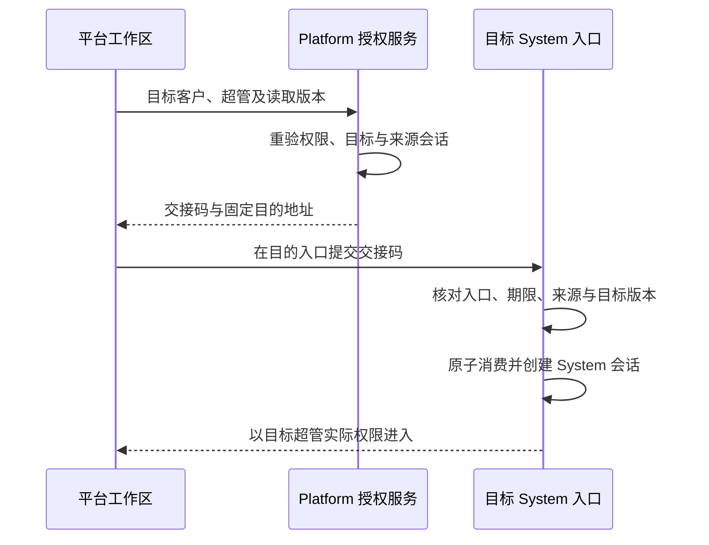

# Platform / System 身份与授权

物联中心使用两个独立账号域。Platform 管理平台配置、客户开通、客户超管、菜单目录及全局物联与 MQTT 运维；System 管理当前 Tenant 的用户、角色、会话、审计和系统品牌。Center 使用当前 Tenant 的 System 身份，负责设备及接入应用业务。框架提供作用域、ORM、事务和通信机制，业务身份规则由应用维护。

## 模型与数据归属

业务采用 Controller → Service → Model。Service 通过模型查询和对象属性完成实体读写；连接由当前 Swoole 执行作用域管理，授权修改和审计参与同一主库事务。声明、严格字段及自动隔离规则见[数据库与模型](../guide/database.md)。

| 数据表 | 模型或关系 | 范围 |
| --- | --- | --- |
| `platform_installation` | `PlatformInstallation` | 安装身份与授权互斥 |
| `platform_tenant` | `Tenant` | 平台客户目录，稳定 32 位小写十六进制标识 |
| `platform_user/role/session` | `PlatformUser/PlatformRole/PlatformSession` | 独立平台账号域 |
| `system_user/role/session` | `SystemUser/SystemRole/SystemSession` | 带 `tenant_id` 的独立客户账号域 |
| `platform_menu/system_menu` | `PlatformMenu/SystemMenu` | 平台维护的两套公共目录 |
| `platform_setting/system_setting` | `PlatformSetting/SystemSetting` | 平台及当前 Tenant 的品牌和默认主题 |
| `platform_user_role/system_user_role` | `User.roles`、`Role.users` | 人员与角色的多对多关系 |
| `platform_role_permission/system_role_permission` | `Role.menus` | 角色与菜单稳定权限值的关联 |
| `platform_handoff` | `PlatformHandoff` | 一次性交接记录，目的客户使用 `target_tenant_id` |

Platform 模型位于 `app/platform/model`，System 模型位于 `app/system/model`。`SystemMenu` 是全客户共用目录，其余客户身份、设置及 Center 业务由可信 Tenant 上下文隔离；System 账号直接归属一个客户，登录名按 `(tenant_id, login)` 唯一。不存在跨客户成员关系或登录后切换客户。

人员角色和角色菜单使用 `BelongsToMany`，System 中间表同时绑定 `tenant_id` 并建立复合外键。角色与菜单的关联由 `RoleService` 在授权事务内维护；客户不能修改菜单目录。已迁移身份链路的 Model 边界以 `tests/fixtures/model-first-boundary.json` 检查；公共菜单删除前核对全部客户角色引用，是按具体方法登记的全局只读例外。其他 Center、恢复及协议存储的迁移和验证范围另行记录。

## 登录入口与可信上下文

| 访问入口 | 登录行为 |
| --- | --- |
| 主域名根目录 | 默认 `/#/system/login`；搜索、分页选择启用客户后填写账号与密码 |
| 登记客户子域名 | 加载该客户品牌和主题，只填写账号与密码 |
| `/t/{tenant_id}/` | 固定客户，刷新和深链接保留范围 |
| `/#/platform/login` | 平台账号与密码，身份独立 |

主域名选定客户后请求 `/t/{tenant_id}/system/auth/login`，成功进入该固定路径工作区；子域名保持当前域名。切换客户会清空账号、密码和错误，并取消旧配置请求，防止响应乱序覆盖当前客户。

`GET /public/tenants` 只提供启用客户的标识与名称。`GET /public/context`、`GET /t/{tenant_id}/public/context` 和平台的 `/platform/public/context` 仅返回登录展示白名单。认证接口为各域的 `POST /{realm}/auth/login`、`GET /{realm}/auth/me`、`POST /{realm}/auth/logout`，令牌通过 Bearer 头传递；System 与 Center API 必须位于匹配的客户入口下。

请求先经过可信代理与 Host 规范化，再由 `TenantContext` 核对登记子域名或固定路径。未知子域名、停用客户、域名/路径冲突、会话与入口客户不一致均拒绝；客户端请求头不能授予 Tenant 身份。只有通过平台授权的管理操作，才在目标客户子作用域内访问 System 模型，退出后恢复外层绑定。

## 初始化与 RBAC

新安装只接受空数据库，建立平台安装身份、初始平台超管及两套菜单目录：

```sh
APP_PLATFORM_PASSWORD='本地受控初始口令' php bin/typeapp app:install platform-root '平台管理员'
```

口令由受控进程环境提供，不进入命令参数或审计。已有安装拒绝接入，不自动清库。客户开通在一个事务中建立客户目录、系统设置、受保护超管角色和初始账号，随机初始口令一次性交付；平台可以维护、替换及重置客户超管。

权限采用 `platform.*`、`system.*`、`center.*`。`MenuService` 将构建期登记的页面和操作绑定到平台维护的目录，导航、按钮及服务端使用同一授权事实。隐藏仅影响导航，节点或祖先停用会撤销能力；所有客户共用启用的子系统菜单。

多个有效角色取权限并集，普通授权员不能授予自身没有的权限。受保护超管覆盖所属域当前启用的登记权限，普通角色不会因为新增菜单自动增权；受保护角色及最后一位有效超管受事务保护。授权操作先获取安装互斥并重新检查来源会话、账号、角色和目标版本，业务变更与审计共同提交；停用、撤权和会话撤销在后续请求重新生效。

## 模拟登录与审计

`platform.tenants.impersonate` 允许平台人员选定目标 Tenant 的有效超管。服务端只依据部署来源和登记入口计算目的地址，签发绑定来源会话、目标版本与准确地址的交接码；有效期最多 60 秒，数据库只保存摘要。



过期、重放、地址错配、来源撤销及目标失效均拒绝。模拟会话使用目标超管的实际权限，持续记录真实平台操作者、来源会话和目标账号；退出模拟只撤销模拟会话，保留平台本人会话。密码、令牌、交接码和设备秘密不进入审计。

人员会话与设备凭据、接入应用密钥分别管理。通信核对设备状态、凭据、当前使用关系及精确 Topic，应用不会因创建者退出管理端而失效，也不继承其人员权限。通信合同见[物联中心](../guide/iot-center.md)。

## 验证边界

人员身份恢复复用 `center:recovery` 的快照、隔离、核对和恢复状态机。System 账号、角色及关联直接绑定 Tenant；角色指纹包含公共菜单启停与祖先目录，客户主体指纹包含当前 Tenant 归属和状态。权威清单缺失或指纹不匹配的主体保持隔离，旧会话与未消费模拟交接码不会恢复。MQTT 节点使用同一恢复门，不维护独立 Broker 人员库。

`php tests/tenant.php sqlite` 验证全新安装、入口冲突、同名账号、RBAC、超管保护、品牌、交接码重放及来源撤销等真实 HTTP 行为，并在停止 HTTP 后验证统一身份恢复及重启后的旧会话拒绝。MySQL 与 PostgreSQL 分别追加对应原生工具根目录参数，由测试创建并清理专用数据库实例。该恢复验证不包含物理备份或复制故障。模型反向同步另用 `php tests/model-sync.php <MySQL工具根目录>`。

PHP 三库、浏览器、TypePHP 全量 AOT、无源码运行、TLS MQTT 及正式平台矩阵是独立结果。历史版本的原生证据不能证明当前重构完成，当前候选必须按对应入口重新验收后才能用于发布。
