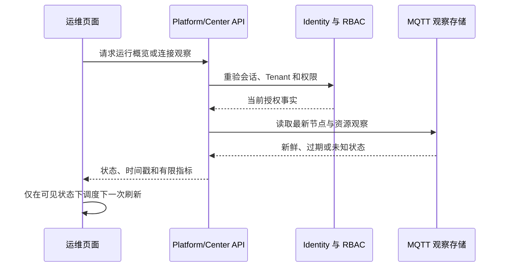

# Platform 运维观察与审计

MQTT 运维统一归 Platform；Center 只展示当前 Tenant 的连接观察。页面使用 Vben 的卡片、表格、分页表单和详情抽屉，运行观察失败保留未知状态，不把浏览器刷新失败解释为设备离线。

## 入口与权限

- `GET /platform/operations`：Platform 运行概览，需要 `platform.operations.read`。
- `GET /platform/broker/resources/{resource}`：Platform MQTT 全局资源，需要 `platform.broker.read`。
- `GET /center/connections`：当前 Tenant 连接观察，需要 `center.connections.read`。
- `GET /platform/audit`：平台审计，需要 `platform.audit.read`。
- `GET /t/{tenant_id}/system/audit`：当前 Tenant 审计，需要 `system.audit.read`。

固定路径、子域名和会话必须指向同一 Tenant；请求头不能授予范围。所有响应使用 `Cache-Control: no-store`，权限变化或入口切换会清空页面状态、取消在途请求和标签页。

## 状态语义

`health.http_alive` 只表示 HTTP 请求成功；持久 MQTT 存储使用 `available`、`unavailable` 或 `unsupported` 表示本次同步证明。`unavailable` 和未知计数保持 `null`，不能转成零值。节点观察只覆盖最近采样到的实例，过期节点显示为不可达；正常停止、隔离完成和未知提交分别保留自己的事实。

页面可见时按五秒周期刷新，隐藏、离开或上下文变化立即取消请求；新请求不会覆盖旧 Tenant 的响应。协议资源使用绑定身份、筛选条件和页大小的游标，筛选变化先重置游标。



## 审计

审计记录真实操作者、Tenant、来源会话、目标账号、操作阶段和结果。模拟登录的业务操作仍记录平台操作者与目标 System 账号；退出模拟只撤销模拟会话。审计清理按 `platform` 或 `system` 域分批执行，保留恢复、撤权和未知结果依据。

### 验证入口

```sh
php tests/tenant.php sqlite
pnpm --dir web typecheck
pnpm --dir web build
```

真实 MySQL、PostgreSQL、AOT、TLS MQTT 和正式平台矩阵必须按发布批次独立执行，页面构建通过不代表运行观察或持久接收已经通过。
