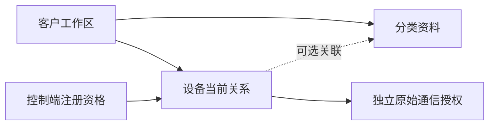

# 产品分类资料

产品在当前物联中心表示租户内的设备分类，只保存名称、说明及版本，不决定注册资格或消息载荷。设备可以不选择分类，也可在资料编辑时关联或清除本客户分类。分类表与历史模型原件仍保留，不能用删除分类间接清除历史。

## 客户权限与数据边界

入口为 `/customer/tenants/{tenant}/products`，`X-Tenant-Id` 必须与路径租户一致。`customer.products.read` 允许查询，`customer.products.manage` 允许维护；菜单和按钮不代替服务端权限。领域 `Product` Model 在当前租户作用域完成 CRUD，授权写锁内重验账号、角色、模拟来源与表单版本，审计失败回滚同一事务。

| 方法及路径 | 输入与结果 |
| --- | --- |
| `GET /customer/tenants/{tenant}/products` | `name,page,per_page`，默认 20、最多 100 条 |
| `POST /customer/tenants/{tenant}/products` | `{name,description?}`，成功 201 |
| `GET /customer/tenants/{tenant}/products/{product}` | 读取本客户资料，越界按不存在处理 |
| `PATCH /customer/tenants/{tenant}/products/{product}` | `{version,name?,description?}`；省略保持原值，null 拒绝 |
| `DELETE /customer/tenants/{tenant}/products/{product}` | `{version}`；当前设备或历史模型引用时返回 `409 product_referenced` |

响应只含 `id,tenant_id,name,description,version,created_at,updated_at`。同值保存仍消耗表单版本，旧表单 `409 stale_version`。设备资料 PATCH 接受 `name`、`product_id` 和必需的 `version`；分类 null 表示显式解除，省略表示保持。服务和复合外键共同拒绝跨客户分类；平台资料编辑同样受目标设备客户范围限制。



模型草稿、发布、校验与设备模型切换入口已退出，旧路径不映射为新分类操作。已发布 SQL 摘要保持不变，分类外键通过追加迁移建立。

## 验证入口

```sh
php tests/iot-identity.php --php sqlite --products --devices
php tests/iot-identity-databases.php --php "$TYPE_MYSQL_TOOLS" "$TYPE_PGSQL_TOOLS" --products --devices
php tests/iot-identity-databases.php build/app/type-app "$TYPE_MYSQL_TOOLS" "$TYPE_PGSQL_TOOLS" --products --devices --no-source
```

测试覆盖真实 HTTP、权限撤销、跨客户、缺失/null、同值保存、版本竞争、审计失败回滚、当前与历史引用保护及重启持久性；设备夹具经控制端资格和公开注册创建，不直接写入新设备。PHP、原生与无源码结果分别记录。
