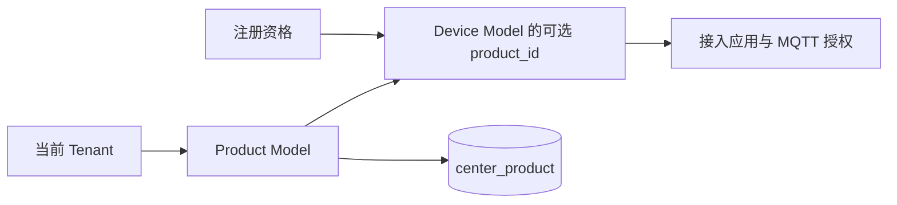

# Center 分类资料

Center 的分类资料属于当前 Tenant，只保存名称、说明和版本，不解释设备载荷，也不替代注册资格。设备可以不关联分类；删除分类前必须确认没有设备引用。

## 接口与权限

客户入口使用 `/t/{tenant_id}/center/*`，子域名直接使用 `/center/*`。Tenant 来自可信路径或登记域名，客户端请求头不能建立或切换范围。查询需要 `center.products.read`，新增、修改和删除需要 `center.products.manage`；菜单显示不代替后端授权。

| 方法 | 入口 | 结果 |
| --- | --- | --- |
| `GET` | `/t/{tenant_id}/center/products` | 按名称分页，默认20条，最多100条 |
| `POST` | `/t/{tenant_id}/center/products` | 创建分类，返回一次性业务结果 |
| `GET` | `/t/{tenant_id}/center/products/{product}` | 返回当前 Tenant 的分类 |
| `PATCH` | `/t/{tenant_id}/center/products/{product}` | 按 `version` 乐观更新名称和说明 |
| `DELETE` | `/t/{tenant_id}/center/products/{product}` | 有设备引用时返回 `409 product_referenced` |

响应只公开 `id、tenant_id、name、description、version、created_at、updated_at`。Service 通过 `Product` Model 完成查询、对象修改、版本推进和持久化；ORM 从可信执行作用域自动补入 Tenant 条件。审计与业务变更在同一授权事务内提交。



分类不携带物模型草稿、发布历史或消息解析配置。需要载荷建模的业务应在独立业务模块中声明自己的 Model、Service 和迁移，不向 Center 分类增加隐式字段。

## 验证

```sh
php tests/tenant.php sqlite
php tests/model-sync.php <MySQL工具根目录>
```

真实 MySQL 反向同步会读取表注释和字段注释，生成 `Product` 的类型提示；模型同步只修改源码，不执行 DDL。MySQL、PostgreSQL、AOT 及真实 MQTT 的结果分别记录，不能用 SQLite 静态检查代替。
