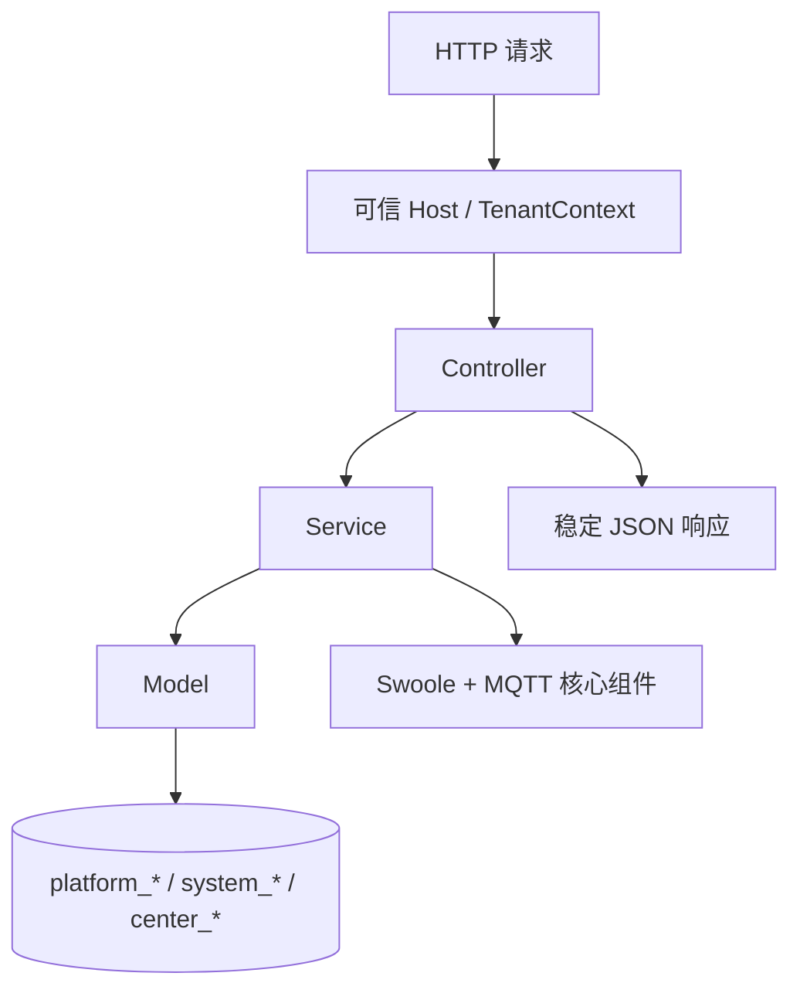

# 标准物联应用

`app` 是 TypeApp 的成品物联中心案例。TypeApp 提供 TypePHP 编译、Swoole 原生运行库和可组合 Plugins；应用自身负责 Platform、System、Center 的业务规则、Tenant 隔离和权限装配。

## 代码分层

- `app/platform`：平台配置、Tenant 开通、超管维护、模拟登录、平台菜单与 MQTT 运维。
- `app/system`：Tenant 用户、角色、会话、品牌、主题和系统菜单模型。
- `app/center`：分类、设备、注册资格、接入应用、通信授权和转配模型。
- `app/common`：启动装配、可信 Tenant 上下文、认证、RBAC、审计、页面资源和共享输入。

Controller 处理 HTTP 输入与响应，Service 负责授权、事务和业务规则，Model 负责字段、Tenant 约束、关系和对象读写。普通 CRUD 优先使用 ORM Model；迁移、审计、恢复、MQTT 观测和跨 Tenant 聚合才允许受限底层查询。



## 安装与运行

新安装只接受空数据库，创建平台安装身份和平台超管；Tenant 由 Platform 在事务内开通，并一次性交付随机 System 超管口令：

```sh
APP_PLATFORM_PASSWORD='受控初始口令' php bin/typeapp app:install platform-root '平台管理员'
php bin/typeapp serve
```

登录入口和 API 约定见 [Tenant 三端架构](../guide/tenant-architecture.md) 与 [身份与授权](iot-identity.md)。平台、System 和 Center 共用一个 HTTP/Swoole 入口；生产构建由 `type-build` 生成应用声明，再交给 TypePHP 全量编译。

## 数据与模型

持久表按模块前缀命名：`platform_menu`、`platform_user`、`platform_role`、`system_menu`、`system_user`、`system_role`、`center_device`、`center_application`。模型声明包含字段类型、可空性、可见性、赋值策略和中文注释，构建期展开为 IDE 可识别的属性。

MySQL 结构反向同步使用：

```sh
php vendor/bin/type model:sync type-app.json 'app\center\model\Product' \
  --table=center_product --connection=/private/mysql.json
php vendor/bin/type model:sync type-app.json 'app\center\model\Product' \
  --table=center_product --connection=/private/mysql.json --write
```

该命令默认只预览；`--write` 才更新源码，`--drop-missing` 才允许确认删除字段。它不执行 DDL，结构变更仍由迁移管理。

## 验收边界

本地开发至少执行 PHP lint、CS-Fixer、TypePHP 应用声明检查、前端类型检查与生产构建、`tests/tenant.php sqlite` 和模型同步测试。真实 MySQL、PostgreSQL、AOT、无源码运行、TLS MQTT、跨 Tenant 转配和正式平台矩阵必须按发布批次独立记录；未执行的检查不能以“框架支持”代替。
