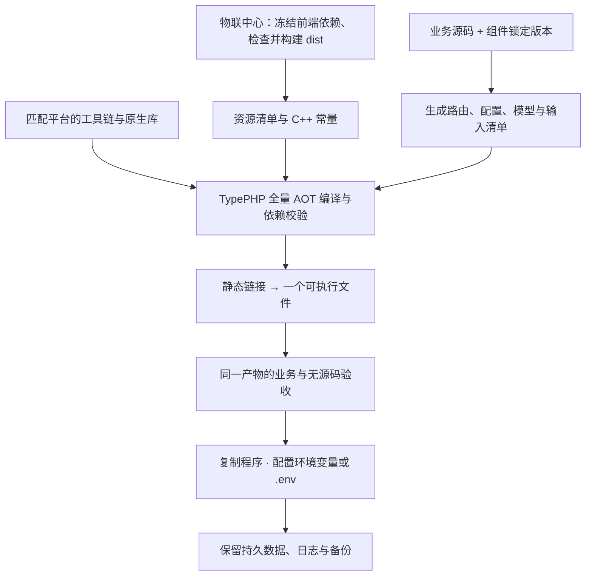
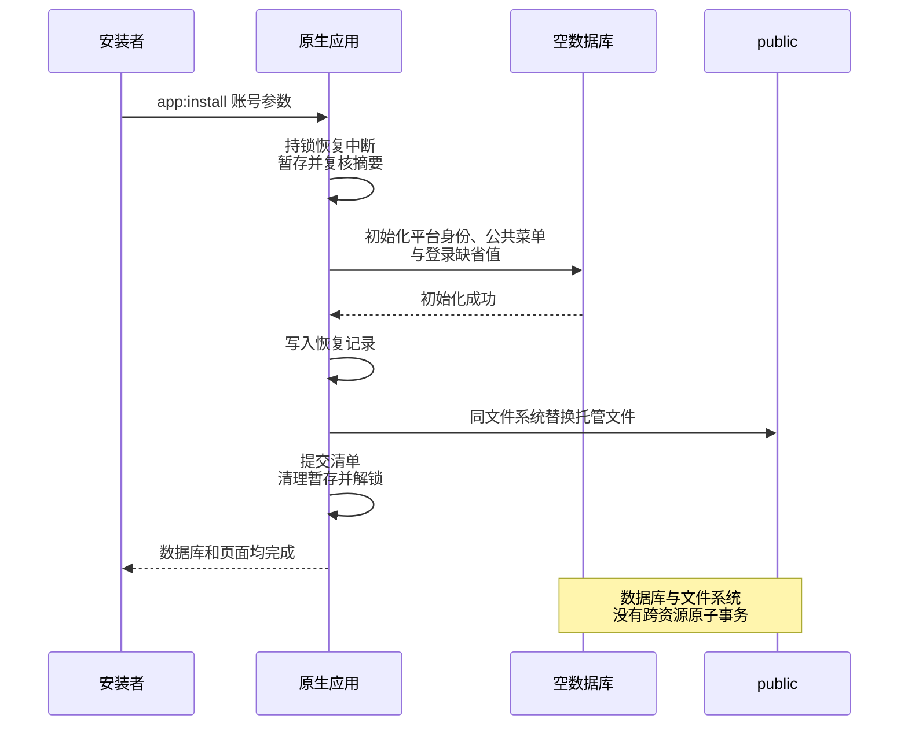
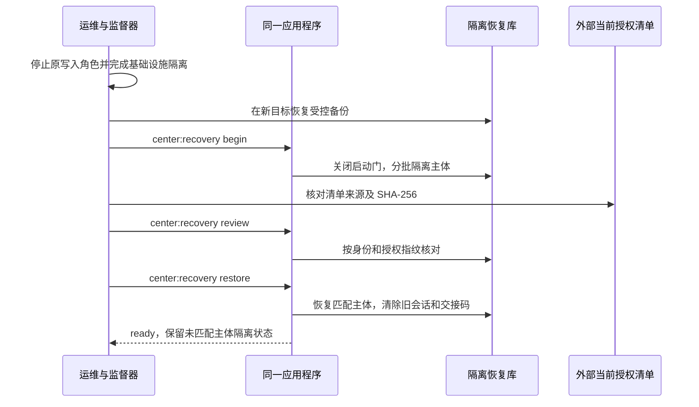

# 构建与部署

构建把应用源码、组件和原生运行依赖组织成可验收的产物。部署维护程序版本、外置配置与持久数据；开发工具及源码留在构建端。

本仓库的 Composer 脚本面向物联中心成品案例，其他应用在自己的项目根执行模板提供的命令。环境准备见[环境与依赖](environment.md)。

## 单程序交付约定

**交付约定：一个主程序文件，配置由部署环境维护，启动不释放运行库。** 每个平台分别构建自己的程序，配置可由环境变量或外置 `.env` 提供。PHP、PHPX、Swoole 及其他非系统原生依赖在构建期静态链接；允许使用操作系统自带的库。Swoole 是程序内部的通信与并发运行库，无需人工安装或启动独立 Swoole 服务。

| 项目 | 交付和维护方式 |
| --- | --- |
| 程序文件 | 包含已编译应用、生产组件、资源及所需原生运行库；Windows 使用 `.exe` |
| 外置配置 | 与程序分开维护，保存部署参数和秘密；升级不覆盖 |
| 数据、上传和日志 | 运行时按需创建，路径以应用目录或明确的数据根为准；切换工作目录不改变目标 |
| 内部运行库 | 构建期核对版本、ABI、许可证和摘要后静态链接；启动不释放 `.so`、`.dylib` 或 `.dll` |

一个程序可按入口运行 HTTP、MQTT 或后台角色，角色间通信与进程/线程/协程仍采用 Swoole。程序文件数量与运行角色数量是不同概念，进程不可用时的执行选择见[系统架构](architecture.md#运行方式与平台)。

## 当前构建状态

RC19 候选固定到 `b485f0bbc8d7578749a1dce98d7586897f9e00fe`，目标为 Linux x64、Linux ARM64、macOS ARM64 × `sqlite`、`mysql`、`pgsql`，共 9 个 profile；Windows x64 当前只保留诊断。RC19 已创建为预发布 GitHub Release，当前公开 Linux x64 与 Linux ARM64 的 6 个 profile；macOS ARM64 三个附件仍待补齐。每个程序只包含对应数据库驱动和已启用功能；`DB_DRIVER` 不匹配时在启动或迁移前返回 `runtime_profile_database_mismatch`。每次部署选择一个匹配程序，不能在同一程序中切换数据库。

| 已实现路径 | 验收与边界 |
| --- | --- |
| 静态 SDK、目标头文件和归档摘要校验 | RC19 的 9 个候选 profile 需要用同一最终程序完成 SDK 探针与应用验收；历史共享模块不能作为静态输入 |
| 全量 AOT、内置 PHP 配置、静态运行身份 | 普通入口和线程应用分别验收；不读部署机 PHP 配置 |
| 页面和许可原文内嵌 | 页面显式安装；`licenses` 直接读取许可材料，不释放运行库 |
| 单文件输出、搬迁、只读目录、无源码隔离 | 每个平台/profile 都必须用最终待发布程序完成对应数据库行为检查；公开下载摘要须与候选一致 |

旧 `v1.0.0-rc.7` 是历史目录归档，须完整解压运行；其附件和验收身份保持不变。当前发布门禁只接受 9 个 RC19 候选程序和对应 profile 回执，任一组合未完成就阻止主仓 Release 公开。静态 SDK、源码和重建配方只保存在 Actions Artifact，不混入公开下载列表，见[版本下载](releases.md#下载程序)。

## 构建与交付流程



构建端使用 Composer 与 TypePHP；部署端只使用目标平台已验证的程序。源码、编译器、SDK、Node.js 和 Composer 留在构建端。

## 检查构建环境

工具链版本以当前项目的 `toolchain.lock.json` 为准，生产依赖以 `composer.lock` 为准。准备与目标 OS、架构一致的 SDK 和扩展，再检查构建环境。

单程序构建通过 `TYPE_STATIC_RUNTIME` 选择目标 SDK 清单，并校验 PHP ABI、目标头文件、归档、源码适配与许可材料。构建组件内按平台提供的 [Swoole 共享模块](plugins/type-build.md#内置-swoole-与运行依赖)仅继续用于共享库开发及历史回归，不能放进程序冒充静态链接。构建宿主 PHP 与目标静态 PHP 分开校验。

构建维护者可使用以下静态 SDK 制备入口；工作目录须为尚不存在的绝对路径，宿主 `PHP_HOME` 使用锁定的 PHP 8.5.12 ZTS。SDK 仅供构建，不随程序部署。

| 目标 | 制备入口与依赖选择 |
| --- | --- |
| Linux x64 / ARM64，Ubuntu 24.04 | `tools/prepare-static-linux.sh <新工作目录> <sqlite\|mysql\|pgsql>`；固定源码制备 PHP、PHPX、Swoole、curl 与 c-ares，仅按功能加入 Redis、按数据库加入 libpq 或 SQLite，逐项记录归档版本和许可材料 |
| macOS ARM64 | `tools/prepare-static-macos.sh <新工作目录> <sqlite\|mysql\|pgsql>`；pgsql 从固定源码构建 libpq，也可在 profile 前提供经过核对的 PostgreSQL17.11 静态 SDK 目录。其他非系统依赖使用已校验的 Homebrew 静态库 |
| Windows x64，Windows 2022 / MSVC | `tools/prepare-static-windows-dependencies.ps1` 固定第三方静态依赖，`tools/probe-static-windows.ps1 -WithPhpx -Profile <sqlite\|mysql\|pgsql>` 选择目标扩展与链接归档；完整参数与顺序以 `static-windows.yml` 的 `scope=phpx` 为准 |

这些入口保留所选数据库与对应协程 hook，并拒绝摘要或 ABI 不符的输入；兼容参数 `all` 仅供全驱动开发回归，不能用于新的 profile 发布。macOS 的 `TYPE_STATIC_MINIMUM_MACOS` 默认 `15.0`，所有依赖归档也必须支持该版本；依赖若要求更高系统版本，不能把输出标为 macOS 15 可用。制备成功后仍须完成真实 embed、全量 AOT 和同一程序的部署验收，具体入口见[原生验证](https://github.com/zoujingli/typeapp/blob/main/docs/development/native-command.md)。

独立应用根执行：

```bash
php vendor/bin/type doctor type-app.json development
php vendor/bin/type doctor type-app.json build
```

本仓库使用 `docs/build-config/type-app.json` 作为构建配置。doctor 检查所选范围的前置条件，不连接业务服务；检测通过不等于应用已编译或运行验收通过。

RC19 候选按三平台 × 三 profile 进行对应数据库隔离部署；历史 RC14 的四平台结果只保留在历史段。Linux 使用 bubblewrap，macOS 使用系统沙箱，Windows 使用受限令牌和访问控制，禁止读取构建源码、SDK 和执行开发工具。主应用、独立组件和模板各有验收入口，详见[平台支持表](platforms.md#当前平台状态)。自己的应用仍须在目标环境验证数据库、角色和停止语义；Docker 或 WSL 的 Linux 结果不替代 Windows/macOS 原生结果。

构建维护者为目标平台准备匹配的 SDK 与扩展，并以同一产物完成应用、通信、数据库和无源码部署验收。部署者使用对应平台经过验证的包，具体范围见[平台与验收](platforms.md)。

## 全量编译

物联中心成品案例在本仓库根执行：

```bash
: "${TYPE_STATIC_RUNTIME:?先设置本平台已校验的静态SDK清单路径}"
export TYPEAPP_BUILD_PROFILE=sqlite # 必须与 SDK 的 profile 一致
composer typeapp:build
build/app/type-app check
```

独立模板在应用根执行：

```bash
composer build
```

构建将框架、业务、生成配置/路由/模型、经过声明转换的原 Service 及实际生产依赖一起交给 TypePHP。新增路由、声明或生产代码都需要重新构建。100% 指完整生产实现的编译覆盖，不等于全部平台已验证。

物联中心的 `composer typeapp:build` 先冻结安装前端依赖，执行类型检查与构建，再校验入口、许可及资源摘要，最后全量 AOT。`web/dist` 以 `web/` 前缀编入程序；Node.js 与 pnpm 只用于构建。版本发布中前端只构建一次，三个目标平台消费同一份已校验资源，流程见[版本发布与安装](releases.md)。独立模板与组件不携带这份业务前端。

## 输出一个程序文件

物联中心提供以下入口，目标文件必须尚不存在。打包不重新编译，输出字节与已验收程序一致：

```bash
composer typeapp:package
build/typeapp-iot verify-runtime
build/typeapp-iot help
build/typeapp-iot licenses
```

独立模板用 `composer package`，输出 `build/type-project-release`。Windows 文件保留 `.exe` 后缀，必须使用已校验的静态 SDK；共享 DLL 产物不能通过单程序验收。模板与物联中心分别记录实际平台和数据库结果。

部署只复制程序文件；外置配置与业务数据另行维护。校验摘要由交付渠道提供，`type verify-package <程序文件> <受信SHA256>` 用于构建端离线校验。程序内的 `licenses` 命令输出材料索引，`licenses notices/texts/…` 读取其中登记的原文。许可证声明完整不替代分发方履行相应源码或重链接材料义务。

`package-directory` 和 `archive` 保留给历史共享库产物的回归及维护。这些产物需要完整目录，不能只复制 `bin/app`；不进入新的单程序发布候选。主仓 `tools/build-application.php --shared-development` 显式选择旧开发构建，默认生产构建缺少静态 SDK 时直接失败。

独立教程使用同一单程序交付与隔离入口，按 SQLite、MySQL、PostgreSQL 分别封存程序。每个程序只接受匹配的数据库配置，外置配置、业务服务与可写数据目录由部署者管理。维护者的[教程验收入口](https://github.com/zoujingli/typeapp/blob/main/docs/development/distribution-batches.md#教程的固定候选与公开消费)同时核对默认 Packagist 版本、完整生产编译清单与搬迁后公开业务断言；PHP、原生构建、原生运行和新版本公开消费各自报告，缺少任一项不能记为完整交付。

## 首次启动

本文的 `dev/prod/demo` 环境值针对 RC19 候选和当前开发版；历史 RC14 使用旧环境值。升级前先核对[环境迁移规则](environment.md#运行环境)，不要只替换配置而继续运行旧程序。

将已验收的单程序放到匹配 OS/架构和最低系统版本的服务器，下文将程序命名为 `app`。默认应用根是程序所在目录；需要分离数据时，在进程环境中指定已存在的绝对目录 `APP_BASE_PATH`。程序从应用根读取 `.env`，不依赖调用者的工作目录。

物联中心使用 SQLite 起步时，在应用根新建 `.env`，填写以下配置即可，不需要下载源码中的配置文件：

```dotenv
APP_ENV=prod
APP_DEBUG=false
APP_LISTEN=127.0.0.1
APP_PORT=9501
APP_ALLOWED_HOSTS=127.0.0.1:9501,localhost:9501
DB_DRIVER=sqlite
DB_SQLITE_FILE=var/typeapp.sqlite
```

这份示例仅监听本机。对外提供服务时填写实际监听地址、端口与允许的 Host；使用 MySQL/PostgreSQL、可信代理或其他业务角色时，按[配置说明](configuration.md)补齐所需参数。已有配置应保留并核对，不能用示例覆盖。随后执行：

```bash
./app verify-runtime
./app help
```

`verify-runtime` 检查运行身份与实际依赖，不替代业务验收。服务运行前，按应用自己的入口初始化或迁移：通用模板使用 `./app migrate run`；物联中心首次空库使用 `./app app:install`，已有安装使用内嵌的 `./app app:upgrade [--force|--dry-run]`，参数与受控口令环境见[初始化人员账号](iot-center.md#准备后端与人员账号)。`app:upgrade` 先执行编译进程序的数据库迁移，再提交内嵌页面资源；`migrate run` 不能代替首次身份安装，也不自动清理已有数据库。

## 只读演示部署

先在维护期间以 `APP_ENV=prod` 完成初始化或升级、安装内嵌前端并准备演示数据，再关闭业务写入角色，将外置配置设为 `APP_ENV=demo` 并重启 HTTP 服务。确认进程管理器没有注入旧的 `APP_ENV` 覆盖 `.env`；运行 `./app check` 核对实际环境。


演示模式允许控制端和客户端的普通登录、退出及必要认证、安全审计，禁止业务 CRUD、改密、模拟登录、配置修改、设备注册、授权变更及上传。沿用现有账号、密码校验和角色权限；演示账号由运维在维护期间配置，浏览仍检查租户隔离。

HTTP 路由和命令分别执行只读限制。命令仅允许服务启动、帮助、校验及状态查询；内部存储 worker 只允许资源读取和自身精确清理，不能绕过限制提交通信写入。演示部署暂停 MQTT 接入、`app:schedule once/work` 及外部业务计划任务，保留独立备份和日志轮转。安装、升级和维护写入须停服并显式切换环境。演示模式不重置数据，也不把数据库整体设为只读：登录会话和安全审计仍须持久保存。

更新程序或恢复数据时，先进入维护状态、停止服务和任务、核对备份，再由运维切回 `prod` 执行维护。恢复对外访问前重新启用 `demo` 并验证写入拒绝。环境只能通过受控外置配置调整，后台页面不能关闭只读限制。

静态程序核对内置扩展、实际加载映像与资源摘要，只允许目标系统库。历史目录包的 macOS 审计另外绑定 dyld 共享缓存；该旧限制及排障方式见[环境检查](environment.md#检查与定位)。

完成初始化后执行 `./app serve` 启动 HTTP；后台角色按应用装配独立运行。数据库、日志、上传与秘密配置放在部署环境维护的数据位置。

物联中心首次安装示例（在已配置的空库和应用数据根执行）：

```sh
APP_PLATFORM_PASSWORD='至少12字节的受控平台口令' \
./app app:install platform-root '平台管理员'
./app serve
```

安装完成后访问平台登录页 `/#/platform/login`，由平台开通客户并一次性交付随机初始口令。主域名客户入口为 `/#/system/login`，登记子域名及 `/t/{tenant_id}/` 固定客户身份。页面与 API 由同一 Swoole HTTP 入口提供，继续执行 Host 和路径校验。部署端不需要另外启动前端开发服务器。

数据库主机名按部署网络的 DNS 规则解析。若容器网络已注册明确别名 `database`，可设置 `DB_HOST=database.`，末尾点表示不追加 DNS 搜索域；依赖搜索域补全的服务名则保留原有配置。框架不会自动改写主机名。当前 Linux 验收所用的 c-ares 1.27 在带搜索域的封闭网络中可能使短名称连接失败，因此无源码部署验收显式覆盖带搜索域的环境，并使用绝对 DNS 名称连接本轮数据库。

物联中心命令因数据库连接或初始化失败返回 `internal_error` 时，可在受控排障进程中设置 `TYPE_APP_TRACE=1` 后重试。诊断会追加底层 PDO 的 `sqlstate` 和 `driver_code`，用于区分认证、连接与数据库文件错误；不展开 PDO 原始消息、SQL 或连接参数。排障完成后移除该环境变量，HTTP 错误响应仍遵守公开错误契约。

对外提供服务时配置对应的系统服务或监督进程，保留正常排空和资源回收时间，并设置停止的总截止。TLS 可在前置反向代理终止，只信任真实受控代理。

## 前端安装与更新

物联中心把已构建页面编入程序，**只在显式安装时写出静态文件，普通启动不释放资源**。目标固定为应用根的 `public/`，可通过既有 `APP_BASE_PATH` 选择持久运行根，切换当前工作目录不改变目标。`var/web-install/` 保存私有清单、互斥锁和恢复记录，不作为静态目录公开。

| 命令 | 行为 |
| --- | --- |
| `./app app:install …` | 校验并暂存页面，初始化空库、平台账号与公共菜单，再提交页面安装 |
| `./app app:upgrade` | 使用二进制内嵌迁移和页面资源升级已有安装 |
| `./app app:upgrade --dry-run --force` | 只预览迁移状态和强制页面更新，不写入数据库或页面 |
| `./app web:install` | 只安装页面；相同内容重复执行成功，不同内容拒绝覆盖 |
| `./app web:install --dry-run` | 输出 `actions.add/replace/delete` 和 `conflicts`，不写目录、锁或文件 |
| `./app web:install --dry-run --force` | 预览强制更新的新增、替换与删除 |
| `./app web:install --force` | 更新内置路径，清理旧清单中的过期资源，保留上传等非托管内容 |

历史 RC7 目录包将 `./app` 换为 `./run`，Windows 旧包使用 `run.cmd`；不要混用两种产物布局。升级先停止旧 HTTP 服务、核对新运行包和数据库兼容，再预览、更新页面并启动新程序；避免升级期间旧页面与新 API 混用。

在新运行包目录中执行页面更新，沿用原应用根与外置配置：

```bash
set -eu
./app verify-runtime
./app web:install --dry-run
# 核对变更路径后，预览并执行强制更新。
./app web:install --dry-run --force
./app web:install --force
./app serve
```

安装命令输出 JSON。`actions.add`、`actions.replace`、`actions.delete` 分别列出新增、替换和删除的托管路径；`generation` 标识程序内的这一组资源。未加 `--force` 的预览通过 `conflicts` 列出已有但内容不同的文件，**预览成功不表示没有冲突，也不表示已经安装**。实际安装成功才返回 `ready: true`；相同内容再次安装时，三类变更列表为空。



写入前保全旧文件，不先清空 `public/`。中断后下一次安装持锁恢复；发现恢复记录之外的文件变动会停止并保留现场。若数据库已完成而页面失败，命令明确报告部分完成，执行 `web:install --force` 修复，不重复初始化数据库。只读目录需在安装阶段由部署者提供正确写权限，服务启动不会自动改权或修复页面。

| 安装反馈 | 处理方式 |
| --- | --- |
| 已有文件内容不同 | 用 `web:install --dry-run` 核对路径；确认更新托管页面后执行 `web:install --force` |
| 前端安装正在进行 | 等待当前安装进程结束后重试；保留安装锁文件，由程序管理互斥 |
| 有待恢复事务 | 保留 `var/web-install/` 及其暂存内容，先执行 `web:install`；恢复后若仍有版本冲突，再按预览结果强制更新 |
| 数据库初始化已完成，前端安装失败 | 修复目录权限或文件冲突后，只执行 `web:install --force`；不再次运行 `app:install` |
| 暂存与公开目录不在同一文件系统 | 调整应用根的挂载布局，使 `public/` 与 `var/web-install/` 位于同一文件系统，再重试 |
| 内嵌资源摘要不一致 | 停止安装，核对 Release 下载摘要并恢复完整、匹配版本的运行包；`--force` 不会跳过摘要校验 |

静态服务仅允许程序清单登记的文件，支持 GET/HEAD、MIME、ETag 和缓存：入口页要求重新校验，`assets/` 使用长缓存。Hash 路由由浏览器处理，API 和未知路径不会回退成首页；`public/uploads` 中的非托管文件也不会因此自动公开。缺少页面或版本不匹配时，启动提示安装修复命令。

## 物联网角色部署

本仓库的物联中心共用完整应用构建，但 HTTP、MQTT Broker 和审计维护调度分别管理，单个 `serve` 命令不启动全部角色。当前案例不运行遥测处理、统计、告警、通知或导出链。具体角色、环境键和管理端构建见[物联网中心](iot-center.md)。`type-project` 模板不默认包含这些业务与 Web 资源。

物联中心的控制器、普通命令与维护计划使用同一应用声明。HTTP 和 MQTT 监听宿主由启动入口持有原生服务循环；每请求、消息和计划执行仍有独立作用域。接线、资源归属及停止流程见[物联中心统一装配](https://github.com/zoujingli/typeapp/blob/main/docs/development/iot-application-assembly.md)。

设备 MQTT 原始通信要求 PostgreSQL 严格同步主备和真实 TLS。先完成业务迁移及 `center:mqtt-install`，再启动 Broker；`IOT_MQTT_COMMAND` 明确指向同一已验证应用产物。设备与接入应用各自认证，逐设备通信权限由当前 Tenant 的 Center 或获授权的 Platform 管理。Swoole 原生能力由同一构建提供。管理 API 三库通过不构成 MQTT 三种存储后端或高可用通过证明。

Broker 接入、持久工作和设备授权均使用 Swoole 官方 Process、Thread 或 Coroutine 管道与网络能力；平台按实际构建能力选择执行方式，不按操作系统名称拒绝通信入口。完整角色隔离、停止和原生验收仍以对应平台产物证据为准，详见[平台与执行方式](communications.md#平台与执行方式)。

每个 Broker 配置唯一稳定节点名，并保留本次运行身份。`center:mqtt-fence` 只登记精确旧实例已完成的基础设施硬隔离，不能代替断开网络或停止旧主。WAL、备份、秘密和保全的旧业务文件与 Web 静态目录分开管理；所有角色保留有界停止、失败日志与未知结果。

## 升级与恢复

当前 Platform/System/Center 采用全新安装，不提供旧身份、旧人员入口或旧数据转换分支。`app:install` 只接受空库；旧安装拒绝接入且不自动清库。历史版本的升级流程和回执只证明原版本，不适用于当前架构。现场数据切换、外部 DNS/TLS 准备与发布由部署计划单独处理。

初始化失败后先查看 `migrate status/history`。MySQL 的部分 DDL 不会自动回滚，只有核对实际状态后才使用 `migrate recover <版本> <retry|applied> <核对说明>`；首次空库仍必须使用 `app:install`，已有安装使用二进制内嵌的 `app:upgrade`，回退使用 `migrate rollback [步数]`。源码模式可以提供外部包装脚本，但生产单程序不依赖脚本。`migrate generate` 仅供开发入口生成只读草稿，不能作为发布时的隐式结构变更。

当前安装的灾难恢复继续使用受控备份与 `center:recovery`：先停止并隔离原系统的全部写入角色，在隔离的新目标恢复备份，再使用备份之外的当前授权清单核对。状态机的快照、隔离、核对及恢复每批有界且可续跑，未匹配主体保持隔离；旧人员会话及未消费交接码清除，不把数据库回滚当作重新授权。Platform 管理 HTTP 和 MQTT 协议节点共用该恢复门，管理页面只显示进度。



恢复门限制新角色启动，不能替代停止旧进程或隔离旧主库。设备状态、凭据及当前使用关系仍按实际事实核对；恢复不自动启用已停用设备或复活已撤销秘密。恢复状态机的三库 PHP 验证与真实物理备份、同步复制、MQTT/TLS、全量 AOT 及正式平台验收分别记录，实际边界见[验收入口](https://github.com/zoujingli/typeapp/blob/main/docs/development/test-entrypoints.md)。

备份应覆盖管理数据库、协议持久存储、配置及应用持久数据，并在隔离目标验证可恢复。保留原备份、程序和核对凭据，不通过手改完成状态跳过未知外部结果。页面使用 `web:install --dry-run --force` 核对后显式更新，不与数据库形成跨资源原子事务。

发布文件摘要需从受信渠道取得。`type verify-package` 对单程序接收程序 SHA-256，对历史目录包接收 `release.json` SHA-256；程序和同一不受信来源的摘要不能互相证明来源可信。

## 运行探针与诊断

同一个主程序可分别启动 HTTP、MQTT 和审计维护调度，每个角色使用自己的进程/线程及连接份额。由系统监督器管理所需角色；单文件交付不意味着所有角色自动启动。配置和份额计算见[部署连接预算](configuration.md#部署连接预算)。

| HTTP 入口 | 行为与使用方式 |
| --- | --- |
| `GET /livez` | 宿主存活返回 200，不查询数据库；供进程存活检查使用 |
| `GET /readyz` | 接单额度、迁移状态/摘要、安装身份、兼容代次与恢复门全部可用返回 200，否则 503；供流量切换使用 |
| 业务 API | 仍执行自己的授权、事务和恢复校验，探针通过不授予业务权限 |

两种探针都检查 Host/可信代理，响应不缓存。每个 HTTP 执行者最多每两秒刷新一次依赖状态，单次作用域预算为一秒；并发检查期间最多采用五秒内的已完成结果，过期撤销就绪。故障撤销就绪，依赖恢复后可重新就绪，不把数据库故障转成反复重启进程。HTTP 不探测只被后台角色使用的 Redis；后台角色应按自身退出、任务和存储状态监控。

生产内部 500 返回稳定错误码和服务端生成的 `X-Request-Id`。受控日志记录同一请求 ID、构建身份、异常类型及代码位置，不记录原始异常消息、SQL、参数或凭据；开发调试仅增加有限代码栈。请求完成记录含耗时、状态码和结果类别，可按请求 ID 关联原因。

`app:schedule work <次数> <间隔毫秒>` 的最大轮询间隔为 60000 毫秒，停止通知不会等待整段间隔。收到停止通知后不接新计划，在途任务按有限排空预算收尾并持久记录结果；失锁或中断保留待核对状态，不把未知副作用写成“未执行”。本轮实际平台验收范围见[实现规划](roadmap.md#启动与运行收口)。

## 验收自己的应用

先执行对应项目的开发检查，再用准确的原生产物运行相同业务行为。核对 HTTP、输入校验、事务、错误与资源清理，并在所选数据库和目标平台完成无源码部署验证。

独立模板提供 `composer test`；它会创建测试用户，须在专用测试数据库运行。开发检查、编译成功和原生业务验收分别记录，不能互相替代。

[返回快速开始](quickstart.md) · [查看组件参考](components.md)。
