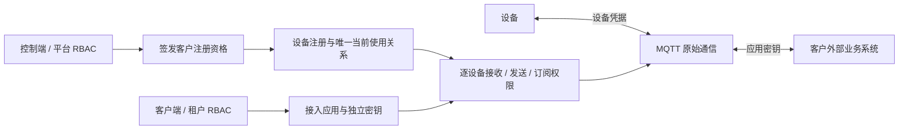
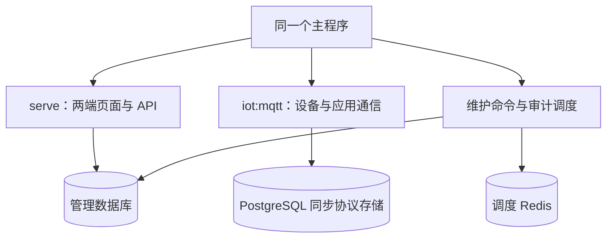
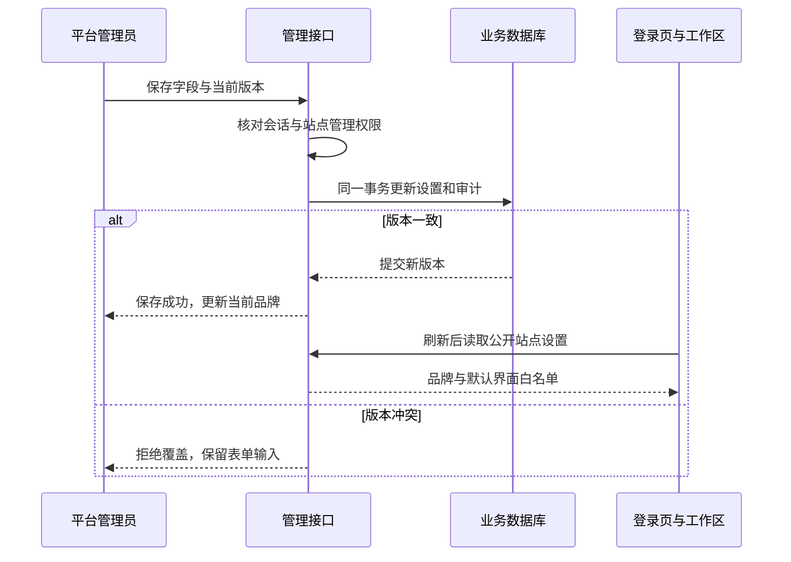
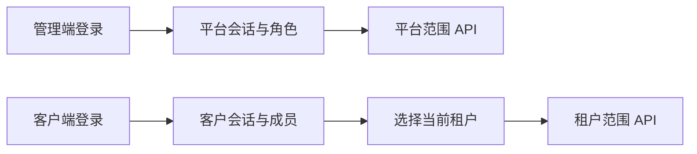
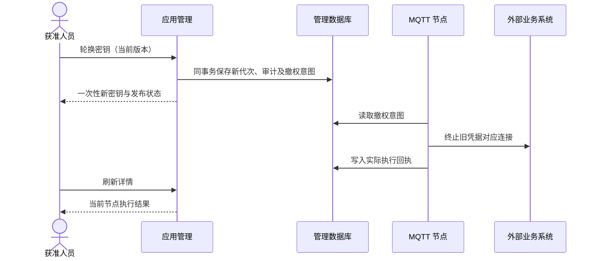
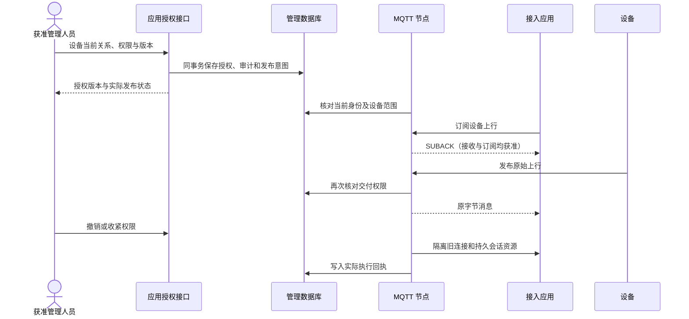
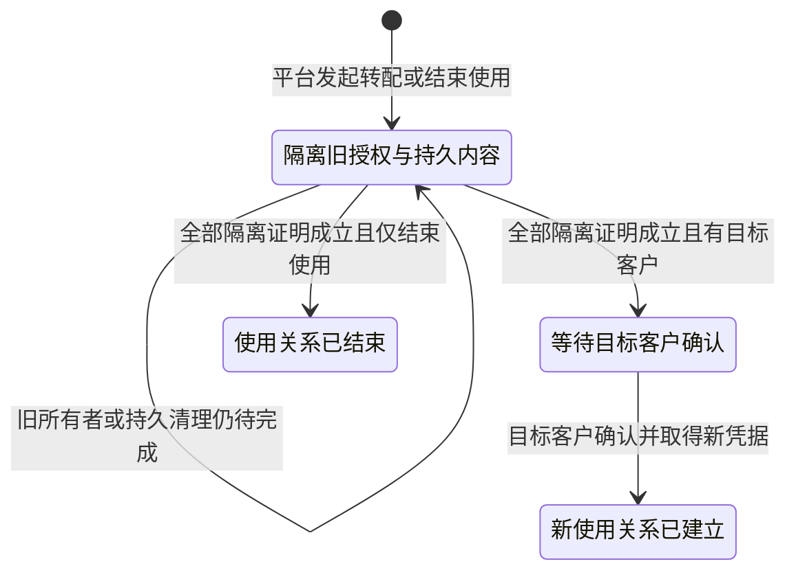
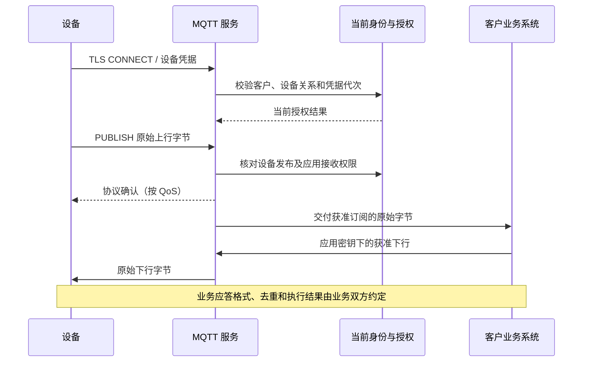

# 物联网中心

物联中心是 TypeApp 的成品案例：在同一部署中提供控制端和客户端两套独立后台，管理客户、设备注册资格、设备使用关系和接入应用。通信层负责鉴权及原始消息路由，载荷解释由客户自己的业务系统完成。

本文描述当前开发源码。旧处理链已退出代码和页面，新的整批交付仍须完成同一最终候选的原生及平台验收；已发布 RC14 保持原版本的功能和证据，不能套用本页的新接口。设计依据见[双端与设备授权设计](../development/iot-control-client-design.md)。

## 能力范围

| 范围 | 提供的能力 | 授权边界 |
| --- | --- | --- |
| 控制端 | 平台人员与完整 RBAC、客户与租户、注册资格签发、设备资产与转配、站点及运行配置 | 使用平台权限管理指定客户；平台令牌不能当作客户令牌 |
| 客户端 | 当前租户成员与 RBAC、分类资料、设备、接入应用与密钥、逐设备授权 | 只能管理当前有效成员关系内的资源，不自行扩增注册额度 |
| 原始通信 | MQTT 5 / TLS、连接观察、QoS、持久会话、retained、应用收发及订阅 | 每次动作核对当前设备关系及权限；持久后端要求 PostgreSQL 同步存储 |
| 运维 | 授权生效状态、资源元数据、审计、备份、恢复核对、审计维护调度 | 保存成功、节点执行完成、真实在线分别展示 |

当前不提供物模型编辑、遥测解析、业务历史与统计、告警、对应通知/导出或业务指令编排。旧安装的数据原件和审计通过升级保全；通用 ORM、队列、调度及通信组件继续供其他 TypeApp 应用使用。

## 业务架构

<figure class="orbit-diagram" data-src="../assets/iot-architecture.svg">
  
  <figcaption>管理账号、设备凭据和应用密钥分别授权。TypePHP 编译整个应用；Swoole 随程序提供原生通信与并发能力。</figcaption>
</figure>



控制端登录为 `/#/admin/login`，客户端为 `/#/login`，API 分别以 `/admin` 和 `/customer` 开头。同一 Vben 前端工程共享布局、表格、表单和主题，独立声明两端路由、菜单与工作区。切换账号域、租户或模拟来源时取消旧请求并清空页面上下文；后端独立检查权限。

## 如何装配 TypeApp

| 能力 | 案例中的责任 |
| --- | --- |
| TypePHP + `type-build` | 全量编译业务、组件、生产依赖和生成入口，将前端链接进程序 |
| `type-core` / `type-runtime` | HTTP、路由、命令、执行作用域及有界资源生命周期 |
| `type-orm` 与数据库驱动 | 人员、RBAC、设备关系、应用授权与事务；管理 API 支持三库 |
| `type-mqtt` | MQTT 协议、持久会话、消息路由与节点操作，不解释业务载荷 |
| `type-scheduler` / `type-redis` | 审计维护计划及执行历史；缓存仍按配置启用 |
| Swoole | 内置原生通信、线程/进程与协程运行库，不是单独部署的业务服务 |

每个部署使用一个匹配平台和数据库 profile 的主程序，加外置配置。前端在安装时写入 `public/`；数据库文件、日志和业务状态由运行产生。部署机无需另装 PHP、Composer、Node 或 Swoole。数据库、按功能使用的 Redis、证书和持久目录仍须准备，见[环境与依赖](environment.md)。同一个文件可启动多个受监督角色，不等于所有功能在一个进程中自动运行。

## 建议阅读顺序

1. 在空数据库安装双端账号和前端，校验配置并启动 HTTP。
2. 控制端创建客户工作区，分配人员权限并签发设备注册资格。
3. 设备通过公开注册入口取得独立凭据；客户端按需要维护分类和设备资料。
4. 客户创建接入应用，为当前设备关系授权，再通过 MQTT 交换原始字节。
5. 变更授权或转配时核对实际节点回执；上线前验证备份、恢复及自己的负载。

## 运行角色



HTTP、Broker 和维护角色有独立的监听、连接预算和停止责任。普通 `serve` 不会自动启动 Broker 或调度。

## 源码布局

| 位置 | 责任 |
| --- | --- |
| `app/common` | 启动、配置、身份、RBAC、审计、迁移与安装 |
| `app/admin` | 控制端人员、客户、租户和站点入口 |
| `app/iot` | 分类资料、注册资格、设备使用关系、接入应用及原始通信授权 |
| `app/broker` | Broker 节点、资源、接入策略和运维审计 |
| `web/apps/web-antd` | 两端工作区和共享 Vben 组件 |
| `docs/build-config/type-app.json` | 案例的编译、命令、服务和能力声明 |

其他业务用 `type-project` 创建独立应用，再按需安装框架组件；不将本案例业务放入通用组件。

## 准备后端与人员账号

以下步骤用于源码开发：准备 PHP CLI `>=8.4 <8.6`、Composer、匹配的 Swoole 与所选数据库的 PDO 扩展。共享库开发可复用构建组件内置模块，生产构建使用静态 SDK。只负责部署时，按[版本安装](releases.md)下载一个主程序并提供配置，无需安装 PHP、Swoole、Composer 或编译 SDK。环境分工见[环境与依赖](environment.md)。在仓库根安装依赖并准备空数据库：

```bash
git clone https://github.com/zoujingli/typeapp.git
cd typeapp
composer install --no-scripts --no-plugins
cp -n .env.example .env
composer web:build
composer typeapp:prepare
```

管理 API 支持 MySQL、PostgreSQL、SQLite；持久设备接入要求 PostgreSQL 严格同步主备。只体验管理页面时，不必把默认 SQLite 当作 MQTT 存储。

在仓库根读取命令帮助，并在空库中一次性创建两类初始账号：

```sh
php bin/typeapp help
APP_ADMIN_PASSWORD='至少12字节的管理密码' \
APP_CUSTOMER_PASSWORD='至少12字节的客户密码' \
php bin/typeapp app:install platform-admin '平台管理员' customer-admin '客户管理员' '初始租户'
```

`app:install` 只接受空数据库；管理口令和客户口令由受控进程环境提供，长度为 5–72 字节，不写入 `.env`、命令参数或日志。安装先暂存并验证页面，再建立平台角色目录、客户初始租户和两套独立会话域，最后安装页面到应用根的 `public/`。数据库成功但页面失败时单独报告，通过 `web:install --force` 修复；后续账号、角色和成员由各自端的 RBAC 接口管理。

平台人员通过 `/admin/auth/login` 登录，管理平台人员、客户账号、租户、设备资产、站点展示设置和运行配置；客户人员通过 `/customer/auth/login` 登录，选择自己所属的租户后管理成员、角色和物联业务数据。两套令牌、密码、会话和权限完全隔离，API 每次请求重新验证当前角色和租户关系。

全新安装会在数据库中保存站点设置，不需要先进入页面逐项填写。管理端“系统管理 → 站点设置”（`/#/admin/site`）维护名称、官网、Logo 地址、说明和默认界面；“系统配置”维护进程启动参数，两者分别生效。官网链接指向项目文档，不会改写本机 API 或设备接入地址。

| 初始化内容 | 默认值与用途 |
| --- | --- |
| 站点名称、官网、说明 | `TypeApp`、`https://iots.top`、物联中心管理平台 |
| Logo | 地址留空，Vben 品牌区域显示站点名称；自定义图片加载失败时使用原生头像回退 |
| 界面 | 浅色、主题色 `#1677ff`、圆角 `0.5`、侧栏导航、侧栏展开、圆润导航、启用面包屑；标签页和页脚默认关闭 |
| 时区记录 | `Asia/Shanghai`；当前页面时间仍按浏览器时区，不应把此字段的保存视为已统一时间显示 |
| 平台账号与角色 | 安装命令指定的一个平台账号，绑定受保护的最高管理员角色 |
| 客户账号与租户 | 安装命令指定的一个客户账号、一个租户及其成员关系；客户绑定该租户最高管理员 |
| 租户预设角色 | 最高管理员、操作员、只读成员；后两者初始仅含个人工作区权限，业务权限需管理员分配 |
| 业务数据 | 不预置分类、注册资格、设备或接入应用；先签发资格并完成注册，再授予应用通信权限 |

初始账号名、显示姓名、租户名由安装命令指定，密码由受控环境提供，没有通用默认密码。安装只接受空库，不会重置已有站点或替换已有业务数据。

未登录页面通过 `GET /public/site` 读取公开白名单；管理设置通过 `/admin/site` 读写，检查权限与版本并在同一事务内记录变更字段。保存成功后当前页面品牌立即更新，其他浏览器在刷新后读取最新设置；版本冲突保留输入并提示人工核对后刷新。页面标题由当前页面、站点名称和备案名称“物联开源分享”组成。



个人界面偏好保存在当前浏览器，按身份域、账号及模拟来源隔离；个人资料页可恢复本次加载的站点默认值。当前仍需完善跨页面刷新后的默认值与个人覆盖合并、Vben 设置面板的重置行为以及统一时区消费。站点尚无独立的备案号、联系信息或页脚文案管理字段，页脚仅使用站点名称和官网，不能把“页脚开关”理解为完整网站信息管理。

## 账号域与授权

管理端和客户端是两个独立的账号域，不能用请求头互相切换，也不能把其中一个域的权限当作另一个域的权限。

| 账号域 | 登录入口 | 管理范围 | 权限来源 |
| --- | --- | --- | --- |
| 控制端（admin） | `POST /admin/auth/login` | 平台人员与角色、客户与租户、注册资格、设备资产与转配、接入应用、系统设置和运行审计 | 控制端角色目录与平台范围授权 |
| 客户端（customer） | `POST /customer/auth/login` | 当前用户可见租户、成员与角色、产品分类、已分配资格、设备、接入应用及逐设备通信授权 | 客户角色、成员关系与当前租户 |



登录成功后的 `GET /admin/auth/me` 或 `GET /customer/auth/me` 返回当前用户、权限、菜单、固定目录和身份上下文。客户可以拥有多个租户，必须明确选择当前租户；管理端身份不会因为创建或查看租户而自动获得该租户的客户权限。

管理端可以为平台用户和客户用户维护账号、角色、状态、密码和会话，也可以设置租户管理员。删除、禁用、改密和撤销会话都在服务端重新校验当前权限，并使用版本字段拒绝陈旧写入。客户端只能在当前租户范围内维护成员和角色，不能通过修改 URL、`X-Tenant-Id` 或请求体扩大范围。

RBAC 的权限节点和菜单是代码中的固定目录，由 `app\common\service\RoleService` 提供。前端菜单用于导航和隐藏无权操作，真正的授权发生在每个 HTTP 请求的中间件、控制器和业务服务中；隐藏按钮不是安全边界。

- 控制端按平台人员与客户管理、系统设置、设备与应用管理、运行审计分组；设备注册资格、设备资产、转配与接入应用各有独立权限。
- 客户端保留个人工作区、组织与成员、物联管理和运维中心；物联管理包含产品分类、设备、已分配注册资格、转配和接入应用。
- 租户业务节点必须带租户标识，服务层根据当前身份和成员关系重新查询归属；平台范围的节点不复用客户范围的权限。
- 模拟身份拥有独立上下文、期限和审计记录，结束或过期后不会把权限合并回本人会话。

菜单按功能分组，不把所有页面平铺到一级。`web/` 使用锁定的 Vue Vben Admin 5.6.0 `BasicLayout`、菜单、主题和偏好机制；业务表格与表单主要直接使用 Ant Design Vue，仍有 `CrudSearchField`、`CrudTableActions`、`AppDrawer` 等应用封装。当前是已接入 Vben 布局的业务应用，尚未完全达到项目规定的原生表单、表格、抽屉及用户入口复用标准。菜单分组与路由层级也需继续对齐，才能保持完整的分组面包屑和详情父级关系。


图示来自 `v1.0.0-rc.6` macOS ARM64 原候选的隔离验收，页面由程序内资源安装后提供。图中使用专用测试账号，临时新增角色已在 CRUD 验收后删除；不是预置演示账号或生产数据。实际菜单和操作由登录身份与权限决定。

## 启动管理端

使用原生运行包时，首次 `app:install` 已从程序内安装管理端；直接启动 `./run serve`，访问 `/#/login` 或 `/#/admin/login`。升级使用 `./run web:install --dry-run --force` 预览，再执行 `./run web:install --force`。命令不会重置账号、站点设置或上传文件；完整步骤和恢复规则见[前端安装与更新](deployment.md#前端安装与更新)。

前端开发和构建使用 Node.js 20.19 以上和 `pnpm@10.28.2`，它们不是原生后端的运行依赖。以下命令从仓库根执行：

```sh
pnpm --dir web install --frozen-lockfile
IOT_API_ORIGIN=http://127.0.0.1:9501 pnpm --dir web dev
```

后端需另行启动：

```bash
composer typeapp:serve
```

默认 HTTP 监听 `127.0.0.1:9501`。也可用 `php bin/typeapp serve`。前端监听 `127.0.0.1:5173`，将 `/admin`、`/customer` 及业务 API 代理到指定后端。`IOT_API_ORIGIN` 只用于开发服务器；生产静态资源和 API 配置同源 HTTPS。`pnpm --dir web build` 只生成 `web/dist`，不部署或替换本地站点。

页面使用统一的搜索字段、表格行操作、列宽和右侧抽屉，列表默认 20 条、最多 100 条。主题与亮暗模式遵循 Vben 偏好，窄屏保留操作入口；异步提交防重，危险操作需要明确确认。切租户取消旧请求，旧响应不能覆盖当前页面。

## 页面与使用顺序

两端使用 Hash 路由，个人工作区分别为 `/#/admin/profile` 和 `/#/profile`。详情从所属列表进入，面包屑和退出地址归属当前工作区。

| 页面 | 使用方式 |
| --- | --- |
| 平台人员、客户与租户 | 控制端维护平台人员权限、客户账号和工作区；客户端选择所属租户 |
| 成员与角色 | 当前租户独立授权，禁止越权授予及删除最后一位有效管理员 |
| 设备注册授权 | 控制端签发、停用、换码；客户端只读本客户资格与绑定结果 |
| 产品分类 | 纯分类资料，可关联本客户设备；不需要发布物模型 |
| 设备及通信详情 | 资料、生命周期、连接观察、原始 Topic、使用期限及升级来源 |
| 接入应用 | 独立密钥、启停与逐设备通信授权 |
| 设备转配 | 平台发起并推进隔离，目标客户确认后建立新使用关系 |
| 运行概览与 Broker 资源 | 当前授权范围内的连接、会话、积压及节点观察 |
| 审计、站点与系统配置 | 准确人员来源与脱敏记录；配置按校验、保存、重启规则生效 |

注册与轮换的秘密仅本次返回，列表不能找回。设备首次完整成功连接后激活；生命周期和连接状态分别展示。没有新观察时保持未知，浏览器断网不能证明设备离线。禁用会撤销旧凭据，启用不会复活它，退役为终态。

撤权受理后可能显示“待完成”：必须等 Broker 隔离旧连接、会话及持久工作，才能视为生效。响应丢失时先查询原意图，不自动重复生成秘密。

## 接入应用与密钥

客户端在「物联管理 → 接入应用」维护本客户外部业务系统，控制端在「运维中心 → 接入应用」按平台权限管理。两端共用一套应用事实，分别核对人员权限和客户范围。应用凭据用于 MQTT 服务认证，后台人员令牌、设备凭据与应用密钥不能混用；创建者退出后台不会使应用身份失效。

创建时填写名称，控制端还需明确客户标识。首次成功返回随机密钥，页面关闭后无法再次查看；列表和详情只显示密钥代次及状态。请求标识 `id` 是 32 位小写十六进制值，同一客户和名称使用同一标识重试只确认原应用，不重新交付秘密。响应丢失且密钥未保存时，使用「轮换密钥」恢复。

| 操作 | 权限后缀 | 行为 |
| --- | --- | --- |
| 查看 | `applications.read` | 分页、详情和当前授权发布回执 |
| 创建、编辑 | `applications.create`、`applications.update` | 创建独立身份或修改名称，不隐式更换已有密钥 |
| 启用、停用 | `applications.enable`、`applications.disable` | 控制应用可否接入，停用保留身份与密钥代次 |
| 轮换、撤销、签发 | `applications.keys` | 旧密钥不能恢复，重新签发继续推进代次 |
| 调整设备通信授权 | `applications.authorize` | 按设备当前使用关系明确授予或撤销接收、发送和订阅能力 |

权限带所属域前缀 `admin.` 或 `customer.`。升级只给受保护的最高管理员补充权限，普通角色由管理员明确授权。模拟登录仍按目标客户权限执行，并记录真实平台人员来源。`APP_ENV=demo` 拒绝上述写操作。

例如，客户端在已认证的当前客户范围内创建应用：

```http
POST /customer/tenants/{tenant}/applications
Authorization: Bearer <客户人员令牌>
X-Tenant-Id: <与路径一致的客户标识>
Content-Type: application/json

{"id":"93c2a69096b84484bd42e52a832783ef","name":"客户业务系统"}
```

首次响应为 `201`，`data.application` 是公开应用信息，`data.credential` 是一次性交付；重试为 `200`，`credential=null`。普通详情使用 `GET /customer/tenants/{tenant}/applications/{application}`。控制端对应 `/admin/applications` 和 `/admin/applications/{application}`，创建及变更请求体包含 `tenant_id`，不携带客户工作区头。

变更入口是 `POST .../{application}/{action}`，`action` 为 `update`、`enable`、`disable`、`rotate`、`revoke` 或 `issue`，请求体携带当前 `version`；仅 `update` 另带 `name`。旧表单返回 `stale_version`；前次隔离未完成时返回 `broker_access_publish_paused`，应先核对发布详情，不能通过重试强行越过。



连接使用交付结果中的 `client_id` 和 `username`（均为 `app:<应用标识>`）、一次性 `password`，固定 MQTT 5、TLS、30 秒 keepalive 和 86400 秒 session expiry。一个应用对应一个受管 Client ID，多份独立会话应分别创建应用。完整持久 MQTT 仍要求 PostgreSQL 同步存储；三库管理能力不表示 SQLite/MySQL 可启动该通信路径。

轮换、撤销或停用先使新认证拒绝旧身份，再由现有 Broker 撤权流程处理活动连接。页面显示实际发布状态；节点不在线或隔离待处理时不宣称完成。通用 Broker 主体修改和快照回退不能绕过应用管理恢复旧密钥。未授予逐设备权限的应用，认证成功后仍拒绝设备收发和订阅。

## 应用设备授权与原始通信

在接入应用的「设备授权」中查看当前范围、选择设备并保存权限。具有设备读取权限的人员可分页搜索设备，页面自动带入当前使用关系；接口调用方也可提供准确的 `device_id` 与 `ownership_id`。授权限定同一客户和设备当前未结束的关系，同属客户、新设备注册或应用密钥有效都不会自动扩大范围。旧模型设备须先按[升级流程](deployment.md#升级与恢复)完成转换，不能直接授予新的原始通信权限。两端详情保留原产品和模型来源；标记为待核对的设备继续隔离，不能通过编辑资料或授予应用权限解除。

| 能力 | 对应行为 | 限制 |
| --- | --- | --- |
| 接收 | 允许取得该设备上行的资格 | 单独授予不会建立 MQTT 订阅，也不允许发送下行 |
| 订阅 | 建立、恢复及持续交付该设备上行订阅 | 必须同时有接收资格；通配符和其他设备 Topic 被拒绝 |
| 发送 | 向该设备当前关系的下行 Topic 发布 | 独立授权，不附带接收或订阅能力 |

查询使用 `GET .../applications/{application}/devices?page=1&per_page=20`，返回分页授权、当前关系及应用发布状态。保存示例：

```http
POST /customer/tenants/{tenant}/applications/{application}/devices/{device}
Authorization: Bearer <客户人员令牌>
X-Tenant-Id: <与路径一致的客户标识>
Content-Type: application/json

{"ownership_id":"<设备当前使用关系标识>","version":0,"receive":true,"send":false,"subscribe":true}
```

控制端对应 `/admin/applications/{application}/devices/{device}`，请求体另带 `tenant_id`。`version=0` 仅用于首次创建，后续用授权行自己的 `version`，不是应用版本。相同权限返回 `changed=false`；取消全部权限会保留撤销记录并推进版本，旧表单返回 `stale_version`。订阅缺少接收资格返回 `application_subscription_requires_receive`。应用停用、设备失效或使用关系已更改时不能新增有效授权，已失效关系仍可撤销。



设备只发布 `iot/{tenant}/devices/{device}/epochs/{ownership}/raw/up`、订阅对应 `raw/down`；应用方向相反。使用注册响应或授权列表中的精确 Topic，不自行省略关系标识。下面的外部业务示例使用 MQTT.js 5，凭据和服务地址由受控环境提供：

```js
import mqtt from 'mqtt';
import { readFileSync } from 'node:fs';

const client = await mqtt.connectAsync(process.env.MQTT_URL, {
  protocolVersion: 5,
  clientId: process.env.APPLICATION_USERNAME,
  username: process.env.APPLICATION_USERNAME,
  password: process.env.APPLICATION_PASSWORD,
  ca: readFileSync(process.env.MQTT_CA_FILE),
  rejectUnauthorized: true,
  keepalive: 30,
  clean: false,
  reconnectPeriod: 0,
  properties: { sessionExpiryInterval: 86400 },
});
client.on('message', (topic, bytes) => {
  // bytes 是原始载荷；业务系统自行解码、保存和确认执行结果。
  console.log(topic, bytes.length);
});
await client.subscribeAsync(process.env.DEVICE_UP_TOPIC, { qos: 1 });
await client.publishAsync(process.env.DEVICE_DOWN_TOPIC, Buffer.from([0x01, 0x00]), {
  qos: 1, properties: { messageExpiryInterval: 30 },
});
// publishAsync 完成表示对应协议发送流程完成，不表示设备业务执行成功。
await client.endAsync(false);
```

消息继续遵守现有大小、频率、QoS 0/1/2、有效期和持久队列预算。MQTT 协议确认、订阅方收到原字节、设备自己的业务应答是三个不同事实；平台不解析载荷，不为原始通信写入遥测、告警或指令记录。撤权不能仅靠页面隐藏，身份、当前关系与通信权限会在新动作和持续交付时重新核对。`demo` 禁止授权写入，后台不提供绕过只读模式的发送入口。

## 设备使用期限与转配

开发版原始通信设备在控制端「设备资产 → 详情」管理使用期限和归属交接。使用期限属于当前客户使用关系，默认不设置；注册资格过期只影响新注册，不会自动结束已建立的关系。设定的使用期限到达后，新认证及通信动作立即被拒绝，Broker 的撤权轮询负责收尾，无须打开页面触发。

控制端发起「转配设备」时固定设备版本、目标客户和请求标识，在同一管理事务内结束旧关系、撤销凭据和旧应用权限，并记录真实操作者。页面返回受理结果后，设备仍处于隔离阶段。平台从「设备转配」显式执行「核验并推进」，目标客户只能在隔离完成后确认接收。



隔离复用 Broker 的连接关闭、跨节点所有者隔离和持久会话清理，还会核验旧关系两个精确 Topic 的 retained 内容。设备从未认证且相关应用也没有接入历史时可使用管理账本证明；历史未知按需要真实存储核验处理。节点不可达、存储缺失或清理没有完成时保留待处理状态，不能凭离线显示或观察超时推断全部隔离成功。集群进程异常退出后先完成基础设施硬隔离，再通过既有 `iot:mqtt-fence` 登记准确节点与运行身份，详见 [MQTT 集群运维](plugins/type-mqtt.md)。

| HTTP 入口 | 权限与输入 |
| --- | --- |
| `POST /admin/devices/{device}/usage/{operation}`，`operation=expiry` | `admin.devices.expiry`；`version`、Unix 秒 `expires_at`，显式 `null` 取消期限 |
| 同一入口，`operation=end` | `admin.devices.end`；`id`、`version`，仅结束使用 |
| 同一入口，`operation=reassign` | `admin.reassignments.create`；`id`、`version`、`target_tenant_id` |
| `GET /admin/reassignments[/{id}]` | `admin.reassignments.read`；列表支持 `page`、`per_page` |
| `POST /admin/reassignments/{id}` | `admin.reassignments.advance`；`action: "advance"`、当前记录 `version` |
| `GET /customer/tenants/{tenant}/reassignments[/{id}]` | `customer.reassignments.read`；仅本客户转出或接收记录 |
| `POST /customer/tenants/{tenant}/reassignments/{id}` | `customer.reassignments.accept`；目标客户提交 `action: "accept"`、确认请求 `id`、记录 `version` |

控制端不发送 `X-Tenant-Id`，客户端该头须与路径一致。普通角色须明确取得新增权限，升级不自动增权；`demo` 拒绝发起、推进、设置期限和确认接收。

```sh
# 控制端发起；保留同一个 REQUEST_ID 与 VERSION，用于结果未知时核对原请求。
curl --fail-with-body "$APP_URL/admin/devices/$DEVICE_ID/usage/reassign" \
  -H "Authorization: Bearer $ADMIN_TOKEN" -H 'Content-Type: application/json' \
  -d "{\"id\":\"$REQUEST_ID\",\"version\":$VERSION,\"target_tenant_id\":\"$TARGET_TENANT_ID\"}"

# 先读取实际阶段及版本，再明确推进；GET 本身不启动清理。
curl --fail-with-body "$APP_URL/admin/reassignments/$REQUEST_ID" \
  -H "Authorization: Bearer $ADMIN_TOKEN"
```

目标客户确认后设备标识保持不变，使用关系、凭据和精确 Topic 更新，使用期限默认重新置空。旧应用授权不会继承，新客户须明确重新授权。首次确认响应一次性交付密码；同一确认请求重试只返回原结果，密码为 `null`，遗失时从设备管理轮换。不要将密码写入日志、工单或普通查询记录。

`pending_reasons` 表示仍缺少的证明；`stale_version` 要求读取当前记录，`reassignment_isolation_pending` 表示尚不可接收，`reassignment_store_required` 表示必须恢复正确的持久存储配置。结束旧关系后不能通过重新启用设备或轮换旧凭据绕过交接；已送达对端的消息无法撤回。

## 设备注册授权

开发版在控制端的「运维中心 → 设备注册授权」管理注册资格，客户端从「物联管理 → 设备注册授权」查看当前客户已获配的资格。每项资格有独立标识、客户、额度和注册截止时间。页面分别展示可注册、已过期、额度用完及已停用；这些状态不表示设备在线，也不等于应用获得通信权限。

控制端签发需要 `admin.enrollments.issue`，换码与停用分别需要 `admin.enrollments.reset`、`admin.enrollments.disable`。只读人员使用对应身份域的 `enrollments.read`；升级时只为现有受保护最高管理员补齐新增节点，普通角色需要明确授予权限。客户端没有签发或增额接口，`demo` 环境拒绝所有相关写操作。

签发时保留请求 `id`，相同内容重试返回原资格，不能再次取回注册码；相同 `id` 携带不同内容返回 `enrollment_request_conflict`。注册码仅在成功签发或重置时交付一次，服务端只存验证摘要，列表、详情和审计不返回秘密。丢失注册码后通过控制端重置；已停用、过期或额度用完的资格不能通过重置重新启用。重置不改变客户、注册截止时间和已用额度，设备已形成的使用关系也不被删除。

| HTTP 入口 | 行为 |
| --- | --- |
| `GET /admin/device-authorizations` | 控制端分页查询，可用 `tenant_id` 筛选客户 |
| `POST /admin/device-authorizations` | 签发，提供 `id`、`tenant_id`、`name`、`capacity`、`register_expires_at`（Unix 秒） |
| `GET /admin/device-authorizations/{authorization}` | 查询公开资格及绑定记录分页 |
| `POST /admin/device-authorizations/{authorization}/{action}` | 提供准确 `tenant_id`、`version`；`action=reset` 一次性交付新注册码，`action=disable` 禁止新的注册 |
| `GET /customer/tenants/{tenant}/device-authorizations` | 客户查看自身资格，`X-Tenant-Id` 必须与路径一致 |
| `GET /customer/tenants/{tenant}/device-authorizations/{authorization}` | 客户查看自身资格的真实绑定记录 |

列表和绑定分页使用 `page`、`per_page`，默认 20 条，单页最多 100 条。注册码的注册期限只约束新的注册，不自动限制已注册设备的使用期；已注册设备撤权继续走设备生命周期。设备通过 `POST /public/devices/register` 消费资格，不要求物模型，成功时一次性交付独立接入凭据。重复请求只确认原注册结果；秘密遗失由有权人员轮换恢复。完整请求、错误码与原始 Topic 见[设备注册教程](../development/iot-devices.md#使用控制端签发的资格注册)。签发或注册成功均不代表设备已经建立网络连接。

## 设备接入与确认

设备使用[公开注册教程](../development/iot-devices.md#使用控制端签发的资格注册)取得凭据。注册期限限制新注册，设备使用期限限制既有关系，两者独立。客户端无权签发新资格。

设备仅发布交付结果中的 `/raw/up`，仅订阅对应 `/raw/down`；应用需获得该设备当前关系下的接收/发送/订阅权限。通配符、跨客户与旧关系 Topic 被拒绝；共享订阅仍按去除组名前缀后的精确 Topic 授权，组名不扩大范围。MQTT 5、TLS、Keep Alive 30 秒和 Session Expiry 86400 秒属于本案例接入合同，具体 Topic 与身份以交付响应为准。



协议确认不代表设备执行成功，也不是遥测业务持久回执。持久会话、QoS、有效期、retained 与积压继续由协议层管理；没有业务历史查询或自动数据解析。恢复授权、物理备份及旧数据保全见[升级与恢复](deployment.md#升级与恢复)。

## 进程与维护入口

| 入口 | 用途及条件 |
| --- | --- |
| `serve` | 双端页面与 HTTP API，先完成空库安装或受控升级 |
| `iot:mqtt-install` | 显式安装协议存储，并取得同步提交证明 |
| `iot:mqtt` | 设备和接入应用的 TLS Broker；需要 PostgreSQL 同步后端、证书及唯一节点身份 |
| `iot:mqtt-statistics`、`iot:mqtt-nodes` | 有界读取持久配额和节点观察；未知不能当作零 |
| `iot:mqtt-fence`、`iot:mqtt-fence-result` | 登记并核对精确旧运行代次的硬隔离依据；命令不执行基础设施隔离 |
| `app:schedule once/history/work` | 审计维护调度及执行历史，运行计划需要持久 Redis |
| `app:audit-clean` | 双端审计的有界清理，按 `help` 指定域及批次 |
| `iot:wal`、`iot:backup`、`iot:recovery` | WAL、备份保留及恢复授权核对，见[恢复说明](../development/iot-recovery.md) |

具体配置统一在 `.env.example` 和 `config/app.php`。持久角色的 `IOT_MQTT_COMMAND` 必须指向同一个程序；内部 worker 不作为对外业务入口。未知或退役命令非零退出，旧 API 返回拒绝，不回退成首页。

`APP_ENV=demo` 的 HTTP 和命令入口均执行只读限制。允许普通登录、退出及必要安全审计，禁止业务消费、调度执行、恢复写入和 MQTT 写入角色；状态查询与内部只读统计继续可用。切换环境必须修改外置配置并重启，见[只读演示部署](deployment.md#只读演示部署)。

设备 10000、应用预留 100、物理连接 10100、会话 20000 是资源预算，不是容量验收结果。多节点、故障恢复和真实设备须按实际部署验证。

## 当前验收边界

分项已有本机三库、真实 HTTP/TLS MQTT 与 AOT 验证；退出旧链后的最终程序仍按[验收入口](../development/test-entrypoints.md)核对。PHP 成功、编译成功、本机共享 SDK 成功、静态单文件成功和四平台通过分别记录，不能互相替代。

已发布 RC14 的源码、功能、程序摘要和结果保持不变。本轮没有由新架构重新验证的目标容量、独立故障域、真实设备及其他平台不能列为通过；部署者须使用匹配版本的文档与程序。

[快速开始](quickstart.md) · [MQTT 组件](plugins/type-mqtt.md) · [构建与部署](deployment.md)
