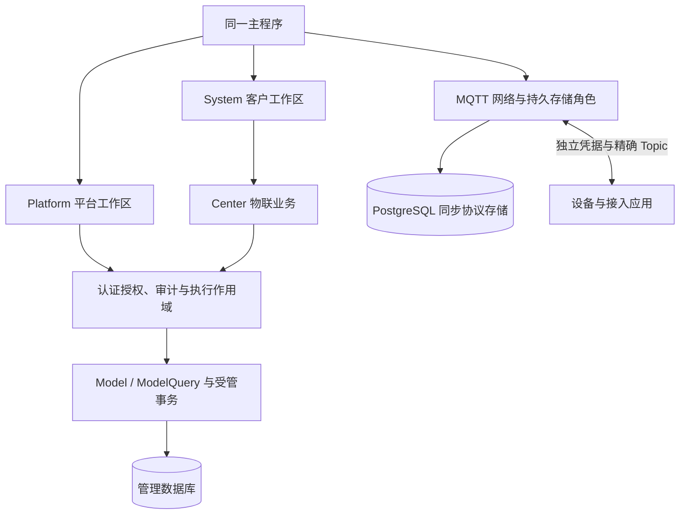
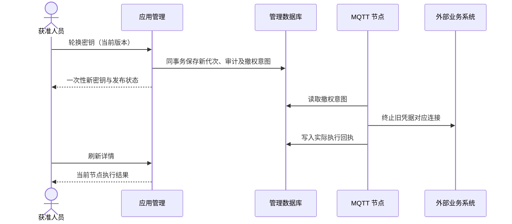
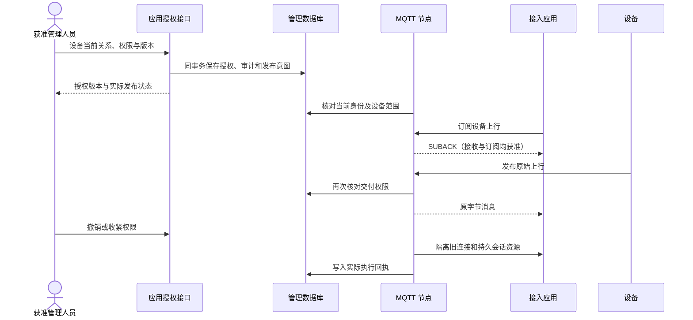
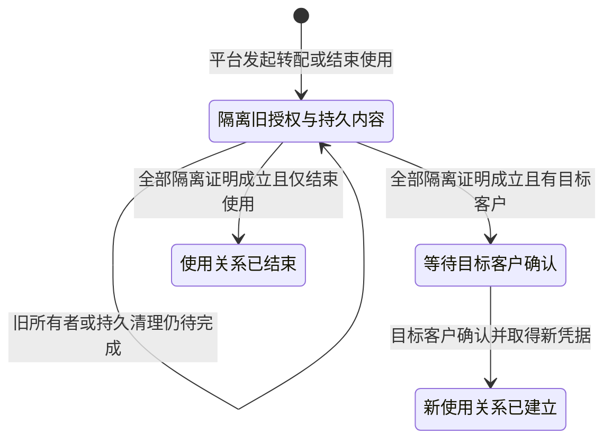
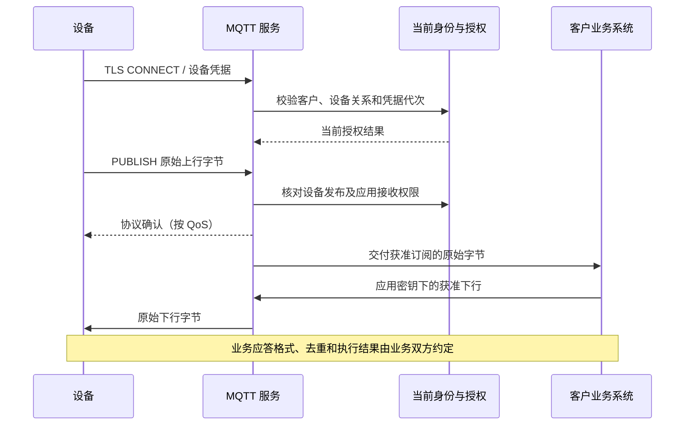

# 物联中心

物联中心是 TypeApp 的成品案例，采用单程序、多运行角色。Platform 管理平台与客户，System 管理当前 Tenant 的人员和系统设置，Center 管理该客户的设备及接入应用；通信层负责鉴权和原始消息路由，客户业务系统解释载荷。

本文对应当前开发源码。历史发布版的程序、界面和原生证据保持各自身份；当前 RC19 代码基线 `b485f0b` 已在 macOS ARM64 完成本地全量 AOT、无源码运行、真实 TLS MQTT、三库管理链路和 Platform/System/Center 业务路由 smoke；Linux 两个平台与 Windows 当前提交的正式 profile 矩阵、逐页面业务 CRUD 交互仍待验证。设计取舍见[架构与界面设计](https://github.com/zoujingli/typeapp/blob/main/docs/development/iot-control-client-design.md)，实际验证入口见[验收说明](https://github.com/zoujingli/typeapp/blob/main/docs/development/test-entrypoints.md)。

## 职责与身份

| 模块 | 管理范围 | 授权范围 |
| --- | --- | --- |
| Platform | 平台配置、Tenant 开通及超管、模拟登录、两套公共菜单、平台 RBAC、全局设备资产、注册资格签发和 MQTT 运维 | 独立平台会话与平台权限 |
| System | 当前 Tenant 的账号、角色、角色授权、会话、审计、品牌和默认主题 | 账号直接归属一个 Tenant |
| Center | 当前 Tenant 的分类、设备、注册资格查看、接入应用、通信授权、连接观察及转配接收 | 复用该 Tenant 的 System 会话 |
| 共享机制 | 可信入口、认证授权、审计、执行作用域及资源生命周期 | 按入口与真实身份确定范围 |

每个客户拥有独立 System 账号域，同名账号可以分别存在，登录后不切换客户。Platform 身份不直接取得客户业务权限；模拟登录采用目标超管的实际权限，并保留真实平台操作者与来源会话。具体认证和 RBAC 合同集中在[身份与授权](https://github.com/zoujingli/typeapp/blob/main/docs/development/iot-identity.md)。

## 登录与 API

| 访问方式 | 登录页面与字段 |
| --- | --- |
| 主域名根入口 | 默认 `/#/system/login`，先搜索、分页选择客户，再输入账号与密码 |
| 登记客户子域名 | 加载该客户品牌和主题，只输入账号与密码 |
| `/t/{tenant_id}/` 固定路径 | 固定客户，刷新和深链接保留工作区 |
| 平台入口 | `/#/platform/login`，平台账号与密码 |

平台 API 使用 `/platform/*`。客户固定路径 API 使用 `/t/{tenant_id}/system/*` 和 `/t/{tenant_id}/center/*`；子域名直接使用 `/system/*`、`/center/*`。客户来自可信入口，请求头和正文不能授予客户身份；未知域名、停用客户以及入口、会话或路径冲突均拒绝。

未登录展示接口为 `/public/tenants`、`/public/context` 和 `/platform/public/context`，只返回公开白名单。主域名选择客户后通过固定路径登录；更换客户会取消旧请求、清空账号、密码和错误，旧响应不会覆盖新客户配置。

## 安装与开通客户

源码开发使用锁文件中的 PHP、TypePHP、PHPX、Swoole、Node.js 与 pnpm，先安装依赖、准备空数据库并构建前端：

```sh
composer install --no-scripts --no-plugins
cp -n .env.example .env
composer web:build
composer typeapp:prepare
APP_PLATFORM_PASSWORD='本地受控初始口令' php bin/typeapp app:install platform-root '平台管理员'
php bin/typeapp serve
```

`app:install` 只建立平台安装身份、平台超管及公共菜单，不预置客户或业务数据。已有安装拒绝接入且不自动清库，不提供旧人员模型或业务数据转换分支。数据库初始化成功而页面安装失败时，单独运行 `web:install --force` 修复页面。

平台人员随后创建 Tenant，并在同一事务中建立该客户的系统设置、受保护超管角色和初始账号。客户初始口令随机生成并仅交付一次，丢失后由平台重置；产品没有通用默认口令。

管理 API 支持 MySQL、PostgreSQL、SQLite。持久设备通信要求 PostgreSQL 严格同步后端，三库管理能力不表示 SQLite 或 MySQL 可以替代该协议存储。原生部署使用匹配平台及数据库 profile 的单个程序和外置配置；当前候选的实际交付状态见[构建与部署](deployment.md)。

## 使用顺序

1. 平台配置品牌、公共登录缺省值和菜单，开通客户并交付超管账号。
2. 客户超管管理本系统人员、角色、品牌和默认主题。
3. 平台签发注册资格，设备通过公开注册取得独立凭据和当前使用关系。
4. 客户维护分类、设备和接入应用，逐设备授予接收、发送和订阅权限。
5. 撤权、结束使用或转配时核对实际节点及存储回执，目标客户确认后建立新关系。

## 架构与运行角色



业务采用 Controller、Service、Model：Controller 处理输入和响应，Service 执行授权与业务规则，Model 管理实体字段、关系和持久状态。TypePHP 编译业务、组件、生产依赖及生成入口，Swoole 提供原生网络、线程/进程和协程能力；不增加通用 Repository 或第二套连接池。

HTTP、MQTT 和维护角色分别拥有监听、连接预算及停止责任。`serve` 不会自动启动 MQTT 或调度；同一程序可以由监督器启动多个运行角色。资源元数据、持久会话、QoS、retained 和积压属于协议职责，设备载荷的业务应答由通信双方约定。

MQTT 运维使用 Platform 人员身份，不另行安装 Broker 人员后台。`broker:run` 及其持久工作角色只运行协议节点，复用同一应用安装、统一恢复门与 Platform 审计。管理 HTTP 统一使用 `serve`；身份与授权恢复统一使用 `center:recovery`，核对匹配后仍清除旧人员会话和未消费交接码。

## 页面、品牌与偏好

一个 Vben 前端工程分别装配平台和客户工作区，使用 Vue Vben Admin 5.7.0 正式 Ant Design Vue 应用的认证布局、应用布局、表单、VXE 表格、抽屉、弹窗和偏好机制。列表筛选放在原生表格表单内，次要行操作收进菜单，设置按职责分组；标题、文字层级、间距及窄屏规则统一遵循[Web 标准](https://github.com/zoujingli/typeapp/blob/main/docs/standards/iot-web.md)。

工具栏提供原生菜单搜索、主题切换、偏好、语言、时区、全屏、刷新、通知、锁屏和用户入口。偏好覆盖布局、侧栏、面包屑、标签页、主题色、圆角、字体、无障碍显示、动画、动态标题与水印；通知没有业务消息时显示 Vben 官方空态，接入真实通知源后再提供消息操作。

平台维护自身品牌、System 公共登录缺省值和新客户初始值，客户超管独立维护本系统品牌及默认主题。个人只保存显式修改字段，优先级为个人覆盖、当前端默认值、Vben 缺省值；恢复默认重新采用最新端配置。浏览器状态按端、Tenant、账号及模拟操作者隔离，身份变化会清理请求、导航、标签页和页面状态。

一次性口令和密钥使用业务专用展示组件，关闭后不能通过普通列表找回。锁屏使用当前标签页中绑定会话的随机盐和 PBKDF2 摘要，刷新保持锁定、退出清理；Web Crypto 需要 HTTPS 或本地可信来源。后端授权仍由会话与 RBAC 执行。

## 源码与开发

| 位置 | 责任 |
| --- | --- |
| `app/common` | 启动装配、可信 Tenant 上下文、认证授权及审计机制 |
| `app/platform` | 平台、客户、超管、模拟登录和全局资产 |
| `app/platform/mqtt` | MQTT 授权、证书、节点、资源及运行管理 |
| `app/system` | 客户独立身份和系统设置 |
| `app/center` | 客户设备、注册资格、应用授权和原始通信 |
| `web/apps/web-antd` | Platform、System、Center 路由、接口和页面 |
| `docs/build-config/type-app.json` | 案例编译、命令、服务与能力声明 |

前端开发入口：

```sh
pnpm --dir web install --frozen-lockfile
IOT_API_ORIGIN=http://127.0.0.1:9501 pnpm --dir web dev
```

后端另行运行 `php bin/typeapp serve`，默认监听 `127.0.0.1:9501`；前端代理目标由 `IOT_API_ORIGIN` 指定，生产页面与 API 使用同源 HTTPS。`pnpm --dir web build` 只生成构建产物，不部署或替换本地站点。模型声明与 MySQL 反向同步见[数据库与模型](database.md)及[源码生成](scaffolding.md)。

## 接入应用与密钥

客户工作区在「物联中心 → 接入应用」维护本客户外部业务系统，Platform 在「客户与物联 → 接入应用」按平台权限管理。两端共用一套应用事实，分别核对人员权限和客户范围。应用凭据用于 MQTT 服务认证，后台人员令牌、设备凭据与应用密钥不能混用；创建者退出后台不会使应用身份失效。

创建时填写名称，Platform 还需明确客户标识。首次成功返回随机密钥，页面关闭后无法再次查看；列表和详情只显示密钥代次及状态。请求标识 `id` 是 32 位小写十六进制值，同一客户和名称使用同一标识重试只确认原应用，不重新交付秘密。响应丢失且密钥未保存时，使用「轮换密钥」恢复。

| 操作 | 权限后缀 | 行为 |
| --- | --- | --- |
| 查看 | `applications.read` | 分页、详情和当前授权发布回执 |
| 创建、编辑 | `applications.create`、`applications.update` | 创建独立身份或修改名称，不隐式更换已有密钥 |
| 启用、停用 | `applications.enable`、`applications.disable` | 控制应用可否接入，停用保留身份与密钥代次 |
| 轮换、撤销、签发 | `applications.keys` | 旧密钥不能恢复，重新签发继续推进代次 |
| 调整设备通信授权 | `applications.authorize` | 按设备当前使用关系明确授予或撤销接收、发送和订阅能力 |

权限使用所属域的 `platform.*` 或 `center.*`。受保护超管覆盖当前域的启用目录，普通角色由管理员明确授权。模拟登录仍按目标客户权限执行，并记录真实平台人员来源。`APP_ENV=demo` 拒绝上述写操作。

例如，客户工作区在已认证的当前客户范围内创建应用：

```http
POST /t/{tenant_id}/center/applications
Authorization: Bearer <客户人员令牌>
Content-Type: application/json

{"id":"93c2a69096b84484bd42e52a832783ef","name":"客户业务系统"}
```

首次响应为 `201`，`data.application` 是公开应用信息，`data.credential` 是一次性交付；重试为 `200`，`credential=null`。普通详情使用 `GET /t/{tenant_id}/center/applications/{application}`。Platform 对应 `/platform/applications` 和 `/platform/applications/{application}`，创建及变更请求体包含 `tenant_id`，不携带客户工作区头。

变更入口是 `POST .../{application}/{action}`，`action` 为 `update`、`enable`、`disable`、`rotate`、`revoke` 或 `issue`，请求体携带当前 `version`；仅 `update` 另带 `name`。旧表单返回 `stale_version`；前次隔离未完成时返回 `broker_access_publish_paused`，应先核对发布详情，不能通过重试强行越过。



连接使用交付结果中的 `client_id` 和 `username`（均为 `app:<应用标识>`）、一次性 `password`，固定 MQTT 5、TLS、30 秒 keepalive 和 86400 秒 session expiry。一个应用对应一个受管 Client ID，多份独立会话应分别创建应用。完整持久 MQTT 仍要求 PostgreSQL 同步存储；三库管理能力不表示 SQLite/MySQL 可启动该通信路径。

轮换、撤销或停用先使新认证拒绝旧身份，再由现有 Broker 撤权流程处理活动连接。页面显示实际发布状态；节点不在线或隔离待处理时不宣称完成。通用 Broker 主体修改和快照回退不能绕过应用管理恢复旧密钥。未授予逐设备权限的应用，认证成功后仍拒绝设备收发和订阅。

## 应用设备授权与原始通信

在接入应用的「设备授权」中查看当前范围、选择设备并保存权限。具有设备读取权限的人员可分页搜索设备，页面自动带入当前使用关系；接口调用方也可提供准确的 `device_id` 与 `ownership_id`。授权限定同一客户和设备当前未结束的关系，同属客户、新设备注册或应用密钥有效都不会自动扩大范围。标记为待核对的设备继续隔离，不能通过编辑资料或授予应用权限解除；新安装不接入旧设备转换记录。

| 能力 | 对应行为 | 限制 |
| --- | --- | --- |
| 接收 | 允许取得该设备上行的资格 | 单独授予不会建立 MQTT 订阅，也不允许发送下行 |
| 订阅 | 建立、恢复及持续交付该设备上行订阅 | 必须同时有接收资格；通配符和其他设备 Topic 被拒绝 |
| 发送 | 向该设备当前关系的下行 Topic 发布 | 独立授权，不附带接收或订阅能力 |

查询使用 `GET .../applications/{application}/devices?page=1&per_page=20`，返回分页授权、当前关系及应用发布状态。保存示例：

```http
POST /t/{tenant_id}/center/applications/{application}/devices/{device}
Authorization: Bearer <客户人员令牌>
Content-Type: application/json

{"ownership_id":"<设备当前使用关系标识>","version":0,"receive":true,"send":false,"subscribe":true}
```

Platform 对应 `/platform/applications/{application}/devices/{device}`，请求体另带 `tenant_id`。`version=0` 仅用于首次创建，后续用授权行自己的 `version`，不是应用版本。相同权限返回 `changed=false`；取消全部权限会保留撤销记录并推进版本，旧表单返回 `stale_version`。订阅缺少接收资格返回 `application_subscription_requires_receive`。应用停用、设备失效或使用关系已更改时不能新增有效授权，已失效关系仍可撤销。



设备只发布 `iot/{tenant}/devices/{device}/epochs/{ownership}/raw/up`、订阅对应 `raw/down`；应用方向相反。使用注册响应或授权列表中的精确 Topic，不自行省略关系标识。下面的外部业务示例使用 MQTT.js 5，凭据和服务地址由受控环境提供：

```js
import mqtt from 'mqtt';
import { readFileSync } from 'node:fs';

const client = await mqtt.connectAsync(process.env.MQTT_URL, {
  protocolVersion: 5,
  clientId: process.env.APPLICATION_USERNAME,
  username: process.env.APPLICATION_USERNAME,
  password: process.env.APPLICATION_PASSWORD,
  ca: readFileSync(process.env.MQTT_CA_FILE),
  rejectUnauthorized: true,
  keepalive: 30,
  clean: false,
  reconnectPeriod: 0,
  properties: { sessionExpiryInterval: 86400 },
});
client.on('message', (topic, bytes) => {
  // bytes 是原始载荷；业务系统自行解码、保存和确认执行结果。
  console.log(topic, bytes.length);
});
await client.subscribeAsync(process.env.DEVICE_UP_TOPIC, { qos: 1 });
await client.publishAsync(process.env.DEVICE_DOWN_TOPIC, Buffer.from([0x01, 0x00]), {
  qos: 1, properties: { messageExpiryInterval: 30 },
});
// publishAsync 完成表示对应协议发送流程完成，不表示设备业务执行成功。
await client.endAsync(false);
```

消息继续遵守现有大小、频率、QoS 0/1/2、有效期和持久队列预算。MQTT 协议确认、订阅方收到原字节、设备自己的业务应答是三个不同事实；平台不解析载荷，不为原始通信写入遥测、告警或指令记录。撤权不能仅靠页面隐藏，身份、当前关系与通信权限会在新动作和持续交付时重新核对。`demo` 禁止授权写入，后台不提供绕过只读模式的发送入口。

## 设备使用期限与转配

开发版原始通信设备在 Platform「设备资产 → 详情」管理使用期限和归属交接。使用期限属于当前客户使用关系，默认不设置；注册资格过期只影响新注册，不会自动结束已建立的关系。设定的使用期限到达后，新认证及通信动作立即被拒绝，Broker 的撤权轮询负责收尾，无须打开页面触发。

Platform 发起「转配设备」时固定设备版本、目标客户和请求标识，在同一管理事务内结束旧关系、撤销凭据和旧应用权限，并记录真实操作者。页面返回受理结果后，设备仍处于隔离阶段。平台从「设备转配」显式执行「核验并推进」，目标客户只能在隔离完成后确认接收。



隔离复用 Broker 的连接关闭、跨节点所有者隔离和持久会话清理，还会核验旧关系两个精确 Topic 的 retained 内容。设备从未认证且相关应用也没有接入历史时可使用管理账本证明；历史未知按需要真实存储核验处理。节点不可达、存储缺失或清理没有完成时保留待处理状态，不能凭离线显示或观察超时推断全部隔离成功。集群进程异常退出后先完成基础设施硬隔离，再通过既有 `center:mqtt-fence` 登记准确节点与运行身份，详见 [MQTT 集群运维](plugins/type-mqtt.md)。

| HTTP 入口 | 权限与输入 |
| --- | --- |
| `POST /platform/devices/{device}/usage/{operation}`，`operation=expiry` | `platform.devices.expiry`；`version`、Unix 秒 `expires_at`，显式 `null` 取消期限 |
| 同一入口，`operation=end` | `platform.devices.end`；`id`、`version`，仅结束使用 |
| 同一入口，`operation=reassign` | `platform.reassignments.create`；`id`、`version`、`target_tenant_id` |
| `GET /platform/reassignments[/{id}]` | `platform.reassignments.read`；列表支持 `page`、`per_page` |
| `POST /platform/reassignments/{id}` | `platform.reassignments.advance`；`action: "advance"`、当前记录 `version` |
| `GET /t/{tenant_id}/center/reassignments[/{id}]` | `center.reassignments.read`；仅本客户转出或接收记录 |
| `POST /t/{tenant_id}/center/reassignments/{id}` | `center.reassignments.accept`；目标客户提交 `action: "accept"`、确认请求 `id`、记录 `version` |

客户范围由登记域名或固定路径确定，客户端请求头不能授予或切换范围。普通角色须明确取得新增权限；`demo` 拒绝发起、推进、设置期限和确认接收。

```sh
# Platform 发起；保留同一个 REQUEST_ID 与 VERSION，用于结果未知时核对原请求。
curl --fail-with-body "$APP_URL/platform/devices/$DEVICE_ID/usage/reassign" \
  -H "Authorization: Bearer $PLATFORM_TOKEN" -H 'Content-Type: application/json' \
  -d "{\"id\":\"$REQUEST_ID\",\"version\":$VERSION,\"target_tenant_id\":\"$TARGET_TENANT_ID\"}"

# 先读取实际阶段及版本，再明确推进；GET 本身不启动清理。
curl --fail-with-body "$APP_URL/platform/reassignments/$REQUEST_ID" \
  -H "Authorization: Bearer $PLATFORM_TOKEN"
```

目标客户确认后设备标识保持不变，使用关系、凭据和精确 Topic 更新，使用期限默认重新置空。旧应用授权不会继承，新客户须明确重新授权。首次确认响应一次性交付密码；同一确认请求重试只返回原结果，密码为 `null`，遗失时从设备管理轮换。不要将密码写入日志、工单或普通查询记录。

`pending_reasons` 表示仍缺少的证明；`stale_version` 要求读取当前记录，`reassignment_isolation_pending` 表示尚不可接收，`reassignment_store_required` 表示必须恢复正确的持久存储配置。结束旧关系后不能通过重新启用设备或轮换旧凭据绕过交接；已送达对端的消息无法撤回。

## 设备注册资格

开发版在 Platform 的「客户与物联 → 注册资格」管理注册资格，客户工作区从「物联中心 → 注册资格」查看当前客户已获配的资格。每项资格有独立标识、客户、额度和注册截止时间。页面分别展示可注册、已过期、额度用完及已停用；这些状态不表示设备在线，也不等于应用获得通信权限。

Platform 签发需要 `platform.enrollments.issue`，换码与停用分别需要 `platform.enrollments.reset`、`platform.enrollments.disable`。只读人员分别需要 `platform.enrollments.read` 或 `center.enrollments.read`，普通角色需要明确授予权限。客户工作区没有签发或增额接口，`demo` 环境拒绝所有相关写操作。

签发时保留请求 `id`，相同内容重试返回原资格，不能再次取回注册码；相同 `id` 携带不同内容返回 `enrollment_request_conflict`。注册码仅在成功签发或重置时交付一次，服务端只存验证摘要，列表、详情和审计不返回秘密。丢失注册码后通过 Platform 重置；已停用、过期或额度用完的资格不能通过重置重新启用。重置不改变客户、注册截止时间和已用额度，设备已形成的使用关系也不被删除。

| HTTP 入口 | 行为 |
| --- | --- |
| `GET /platform/enrollments` | Platform 分页查询，可用 `tenant_id` 筛选客户 |
| `POST /platform/enrollments` | 签发，提供 `id`、`tenant_id`、`name`、`capacity`、`register_expires_at`（Unix 秒） |
| `GET /platform/enrollments/{authorization}` | 查询公开资格及绑定记录分页 |
| `POST /platform/enrollments/{authorization}/{action}` | 提供准确 `tenant_id`、`version`；`action=reset` 一次性交付新注册码，`action=disable` 禁止新的注册 |
| `GET /t/{tenant_id}/center/enrollments` | 客户查看当前可信范围内的资格 |
| `GET /t/{tenant_id}/center/enrollments/{authorization}` | 客户查看自身资格的真实绑定记录 |

列表和绑定分页使用 `page`、`per_page`，默认 20 条，单页最多 100 条。注册码的注册期限只约束新的注册，不自动限制已注册设备的使用期；已注册设备撤权继续走设备生命周期。设备通过 `POST /public/devices/register` 消费资格，成功时一次性交付独立接入凭据。重复请求只确认原注册结果；秘密遗失由有权人员轮换恢复。完整请求、错误码与原始 Topic 见[设备注册教程](https://github.com/zoujingli/typeapp/blob/main/docs/development/iot-devices.md)。签发或注册成功均不代表设备已经建立网络连接。

## 设备接入与确认

设备使用[公开注册教程](https://github.com/zoujingli/typeapp/blob/main/docs/development/iot-devices.md)取得凭据。注册期限限制新注册，设备使用期限限制既有关系，两者独立。客户工作区无权签发新资格。

设备仅发布交付结果中的 `/raw/up`，仅订阅对应 `/raw/down`；应用需获得该设备当前关系下的接收/发送/订阅权限。通配符、跨客户与旧关系 Topic 被拒绝；共享订阅仍按去除组名前缀后的精确 Topic 授权，组名不扩大范围。MQTT 5、TLS、Keep Alive 30 秒和 Session Expiry 86400 秒属于本案例接入合同，具体 Topic 与身份以交付响应为准。



协议确认不代表设备执行成功。持久会话、QoS、有效期、retained 与积压由协议层管理；业务系统负责自己的载荷保存、去重及应答。备份和恢复必须按实际存储及授权状态核对，见[构建与部署](deployment.md)。

## 进程与维护入口

| 入口 | 用途及条件 |
| --- | --- |
| `serve` | Platform、System 与 Center 页面及 HTTP API，先完成全新安装 |
| `center:mqtt-install` | 显式安装协议存储，并取得同步提交证明 |
| `center:mqtt` | 设备和接入应用的 TLS Broker；需要 PostgreSQL 同步后端、证书及唯一节点身份 |
| `center:mqtt-statistics`、`center:mqtt-nodes` | 有界读取持久配额和节点观察；未知不能当作零 |
| `center:mqtt-fence`、`center:mqtt-fence-result` | 登记并核对精确旧运行代次的硬隔离依据；命令不执行基础设施隔离 |
| `app:schedule once/history/work` | 审计维护调度及执行历史，运行计划需要持久 Redis |
| `app:audit-clean` | Platform/System 审计的有界清理，按 `help` 指定域及批次 |
| `center:wal`、`center:backup`、`center:recovery` | WAL、备份保留及恢复授权核对，见[恢复说明](https://github.com/zoujingli/typeapp/blob/main/docs/development/iot-recovery.md) |

具体配置统一在 `.env.example` 和 `config/app.php`。持久角色的 `IOT_MQTT_COMMAND` 必须指向同一个程序；内部 worker 不作为对外业务入口。未知或退役命令非零退出，旧 API 返回拒绝，不回退成首页。

`APP_ENV=demo` 的 HTTP 和命令入口均执行只读限制。允许普通登录、退出及必要安全审计，禁止业务消费、调度执行、恢复写入和 MQTT 写入角色；状态查询与内部只读统计继续可用。切换环境必须修改外置配置并重启，见[只读演示部署](deployment.md#只读演示部署)。

设备 10000、应用预留 100、物理连接 10100、会话 20000 是资源预算，不是容量验收结果。多节点、故障恢复和真实设备须按实际部署验证。

## 当前验收边界

当前开发候选已有本机三库人员与 Center 管理 HTTP、前端类型检查、生产构建、全量 AOT、无源码运行、真实 PostgreSQL 同步后端和 TLS MQTT 设备链路验证；浏览器已完成登录入口、固定路径、窄屏、主题偏好和全部业务路由首屏 smoke，逐页面 CRUD、授权弹层和子域名浏览器交互仍须补验。正式平台/profile 矩阵仍须按[验收入口](https://github.com/zoujingli/typeapp/blob/main/docs/development/test-entrypoints.md)完成；单个字段或编译器探针不能代替整个产品。

旧版本的源码、程序摘要和结果保持原身份。当前 PHP 8.5.12 的 Swoole 共享模块只在 macOS ARM64 重建并核验，Linux 与 Windows 目录中的模块仍是历史 ABI，严格选择门禁会拒绝它们；不能只更新摘要放行。当前候选尚未覆盖的容量、独立故障域和其他平台不列为通过；真实设备 TLS 链路已按验收记录完成，部署者应使用同一版本的文档、配置和程序。

[快速开始](quickstart.md) · [MQTT 组件](plugins/type-mqtt.md) · [构建与部署](deployment.md)
