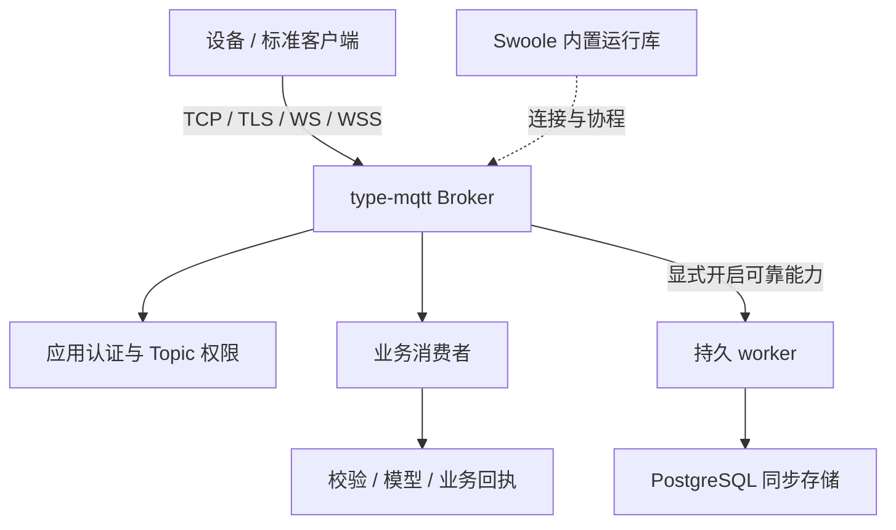
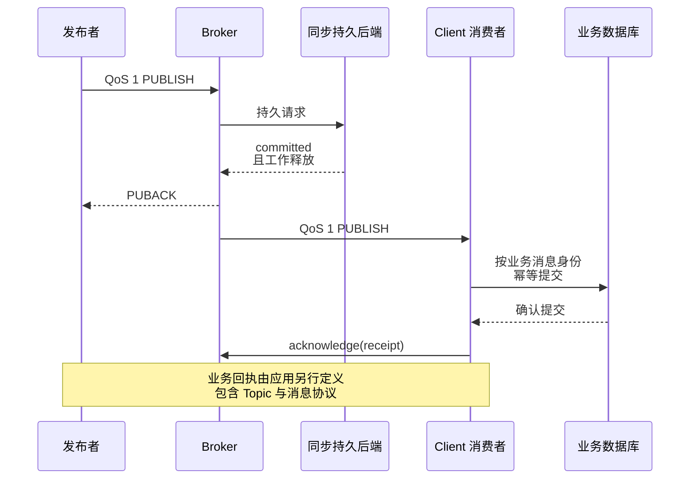

# type-mqtt · MQTT

[返回组件总览](../components.md)

`type-mqtt` 是 TypeApp 自研的独立 MQTT 服务端组件，负责连接、协议状态机和 Topic 路由。认证与 Topic 权限由消费应用提供；报文载荷的业务含义也由应用解释。运行不依赖 EMQX，也不提供 EMQX 专有管理 API。

默认只做 QoS 0 转发。QoS 1/2、持久会话、保留、遗嘱、共享订阅和跨节点路由，要另接 PostgreSQL 同步存储。当前还不能称为已完整通过标准验收的 Broker。

协议模型、基础 Broker 与标准客户端实例、TCP/WS 互通见 [MQTT 通信教程](../communications/mqtt.md)。本页集中说明独立应用的配置、部署和运维，按以下顺序使用：

| 目标 | 阅读入口 |
| --- | --- |
| 首次连接、订阅和发布 | [基础收发练习](../communications/mqtt.md#完整实例：qos-0-broker) |
| 准备支持持久化的独立应用 | [独立应用入口与配置](#独立应用入口与配置) |
| 部署一个 Broker | [持久存储前提](#持久存储与集群) → [单节点部署](#单节点部署) |
| 多个 Broker 共享会话与路由 | [多节点集群部署](#多节点集群部署) |
| 确认部署可用、处理升级和异常 | [客户端验证](#客户端验证) → [运行维护与排障](#运行维护与排障) |

## 组件在应用中的位置

MQTT 是设备与服务交换消息的协议组件。应用定义身份、Topic 权限和载荷规则，Broker 维护协议交换，Swoole 作为内置运行库提供连接与协程能力。消息进入业务后，仍由业务服务决定校验、存储和回执。



先在回环地址完成 [QoS 0 Broker 与标准客户端练习](../communications/mqtt.md#完整实例：qos-0-broker)，观察认证、订阅和转发；再配置真实 TLS，最后接入持久后端验证恢复语义。安装组件不会自动启动监听、创建数据库表或开放匿名访问。

## 安装与依赖

组件源码按 Apache-2.0 提供，位于 `plugin/type-mqtt/`。尚未发布稳定版本标签。独立消费者应核对真实安装副本并提交 `composer.lock`。当前 `main` 的 `type-core`、`type-orm`、`type-runtime` 由 Composer 自动解析；新增 `type-core` 依赖用于复用 HTTP 能力，尚未包含 RC14。启用 PostgreSQL 持久后端时应用另行安装 `type-orm-pgsql`，见[组件安装](../components.md)。以下安装命令在独立应用根执行；空项目先执行 `composer init --name=example/mqtt-broker --no-interaction`，不要覆盖已有应用的清单或入口。

```sh
composer config minimum-stability RC
composer config prefer-stable true
composer require zoujingli/type-mqtt:1.0.0-rc.19
```

这组命令对应 RC19；请先在[版本说明](../releases.md)确认公开状态，再安装同批组件并提交 `composer.lock`。当前接口以本页和所用 tag 的包 README 为准；RC14 应用继续使用原版本文档，不能混用新接口。启用 PostgreSQL 持久后端时，添加同版本驱动：

```sh
composer require zoujingli/type-orm-pgsql:1.0.0-rc.19
```

PHP 要求 `>=8.4 <8.6`，依赖 OpenSSL、PCRE、JSON 及上述组件；持久后端需要 PDO PostgreSQL。通信、线程、协程与事件循环复用 Swoole `>=6.2 <7` 的官方能力，允许固定官方内置 PHP 库按官方机制加载。Broker 优先使用经典 Server，不可用时由 Coroutine Socket 提供 TCP/TLS；客户端统一使用 Coroutine Socket，非协程调用沿现有 CoroutineRuntime 使用官方 Scheduler。持久 worker 是独立命令进程，私有 IPC 的平台机制和截止规则见[MQTT 通信](../communications/mqtt.md)。原生运行仍需对应扩展，不回退执行业务 PHP 源码。

协程 Broker 共用原协议、授权和额度控制，可用 `serve($host, $port, coroutine: true)` 显式选择。MQTT over WebSocket、客户端证书身份与服务端 SNI 目前需要经典 Server；协程入口在监听前以 `feature_unavailable` 拒绝这些配置。TLS 证书验证及账号授权继续生效，平台结果见[平台与验收](../platforms.md)。

## 最小离线示例：连接字段与消息编码

先确认安装后的公开类型能够在应用中使用。将以下代码保存为声明式 `app/main.php`，由开发启动器调用 `main()`；它解析一个完整 CONNECT 正文、编码 QoS 0 PUBLISH，并观察非法 Topic 的拒绝，不打开网络或数据库。

```php
<?php

declare(strict_types=1);

use Type\Mqtt\ConnectPacket;
use Type\Mqtt\Message;
use Type\Mqtt\ProtocolError;

/** 验证公开消息类型的离线协议边界，不启动 Broker 或认证任何客户端。 */
function main(): void
{
    $clientId = 'guide-client';
    $connectBody = pack('n', 4) . 'MQTT' . "\x05\x02" . pack('n', 30)
        . "\x00" . pack('n', strlen($clientId)) . $clientId;
    $connect = new ConnectPacket();
    $connect->decode($connectBody);

    $message = new Message('example/up', '{"temperature":23}', qos: 0);
    $packet = $message->packet(5);
    $invalidTopicRejected = false;
    try {
        new Message('example/+', '23');
    } catch (ProtocolError $error) {
        $invalidTopicRejected = $error->reason === 0x90;
    }
    echo json_encode([
        'protocol' => $connect->version,
        'client_id' => $connect->clientId,
        'topic' => $message->topic,
        'qos' => $message->qos,
        'packet_bytes' => strlen($packet),
        'publish_header' => ord($packet[0]),
        'invalid_topic_rejected' => $invalidTopicRejected,
    ], JSON_THROW_ON_ERROR) . "\n";
}
```

预期输出为 `protocol=5`、`client_id=guide-client`、`topic=example/up`、`qos=0`、`packet_bytes=33`、`publish_header=48`，且 `invalid_topic_rejected=true`。CONNECT 正文解析不代表认证通过；Topic 中的 `+/#` 用于订阅过滤器，不能作为实际发布 Topic。此例只验证离线编解码边界，不替代 TCP、TLS、持久交付或完整协议验收；没有进程、连接或状态文件需要清理。

## 认证与最小启动

消费者实现两个公开方法：

```php
authenticate(ConnectPacket $connect, string $peer, bool $secure): bool;
authorize(ConnectPacket $connect, string $topic, string $action, int $qos): bool;
```

这只是 `Type\Mqtt\AccessPolicy` 的接口签名。`peer` 与 `secure` 来自实际网络连接，`action` 为 `publish` 或 `subscribe`。每次 CONNECT 重新认证，发布、订阅及接收排队按当前规则授权；外部数据库查询必须有界。遗嘱恢复不持久保存密码，应根据保存的认证身份重新查询权限。

下面是已有应用创建 Broker 的接续片段：`$access` 必须是应用提供的 `AccessPolicy` 实例，环境中须有可读的真实证书链和匹配私钥；加密私钥用 `MQTT_PRIVATE_KEY_PASSPHRASE`，口令错误或尚未生效的服务端证书会拒绝启动。

```php
$broker = new \Type\Mqtt\Broker($access, new \Type\Mqtt\BrokerOptions(
    certificate: (string) getenv('MQTT_CERTIFICATE'),
    privateKey: (string) getenv('MQTT_PRIVATE_KEY'),
    privateKeyPassphrase: (string) getenv('MQTT_PRIVATE_KEY_PASSPHRASE'),
));
$broker->serve('127.0.0.1', 8883);
```

主仓的 `examples/mqtt/main.php` 是完整声明式消费者示例，包含 `ExampleMqttAccess`、配置校验、停止及持久 worker 分支。把它作为独立应用入口时，按[声明式示例](../components.md#运行声明式示例)准备开发启动器，并调用 `main($argc, $argv)`；生产只编译声明入口，不加载开发启动器。

示例 `example` 用户必须设置非空 `MQTT_PASSWORD`，`service` 用户须另行设置非空 `MQTT_SERVICE_PASSWORD`。两者限于 `example/` Topic 前缀，`example/read-only/` 仅允许订阅；实际应用应替换成自己的授权规则。TLS 默认开启并支持 1.2/1.3，优先 1.3，拒绝 1.1，TLS 1.2 仅 ECDHE AEAD，ECDH 限 X25519 与 P-256，不启用 0-RTT；可监听明确 IPv4 或 IPv6 地址；服务端证书可为叶加中间 CA 的 PEM 链，过期或非 serverAuth 的叶证书拒绝启动，运行中到期则断开 TLS 会话；可另配一组 SNI 主机证书；客户端验证证书链和主机名。专用 mTLS（含配置了客户端 CA 的 WSS）在校验证书链后再核 SSL 客户端用途、有效期、可选签名 CRL、平台吊销名单和换证重叠窗口；客户端 CA 文件可含根与签发中间 CA，文件更新后重载 SSL_CTX 只影响新连接；CRL 文件更新、HTTPS 源刷新、CRL 缺失或过期、平台名单增列、重叠结束或已连接证书到期后断开对应会话。`--plaintext` 仅供显式回环调试，物联网设备接入不开放此选项。

## 协议与资源配置

标准依据为 OASIS [MQTT 3.1.1](https://docs.oasis-open.org/mqtt/mqtt/v3.1.1/os/mqtt-v3.1.1-os.html) 和 [MQTT 5.0](https://docs.oasis-open.org/mqtt/mqtt/v5.0/os/mqtt-v5.0-os.html)。业务策略可以限制身份、Topic 和资源，但不能把实现差异描述成标准已经兼容。

| 能力 | 当前行为 |
| --- | --- |
| 协议与传输 | MQTT 3.1.1 / 5.0，TCP / TLS；可选 WS/WSS 与专用 mTLS（含 WSS 客户端证书）；不提供 3.1、MQTT-SN 或增强认证 |
| 普通路由 | 精确、`+`、`#` 过滤器，重叠订阅、取消及二进制载荷 |
| MQTT 5 属性 | 订阅选项与标识、Topic Alias、消息期限、内容与关联属性，受各自上下文限制 |
| 无持久 worker | QoS 0 路由；不声称提供持久会话或可靠离线交付 |
| 显式同步持久后端 | QoS 1/2 双向交付、保留、会话恢复、遗嘱及延迟遗嘱、共享订阅和跨节点路由 |
| 完整入站报文 | 最大 1 MiB；默认握手 10 秒、半包 15 秒，Keep Alive 使用实际完整控制报文刷新；Swoole 入口关闭 Nagle |
| 原生监听共享连接预算 | 上限 10100；示例默认设备 10000、服务 100，仍受物理额度限制 |

这些额度是拒绝和资源约束，不是万台在线验收结果。每连接最多 100 个订阅，重复订阅替换选项；分类必须由已认证身份确定，不能相信客户端自行申报。TLS/认证/订阅/报文或存储失败不伪造成功确认。

同一连接取消订阅后，新匹配发布不再派生投递，未开始的保留游标停止；已经开始的 QoS 1/2 交换仍须完成。MQTT 标准允许继续发送取消前已经缓冲但未开始的交付，不能用 UNSUBACK 推断全部历史输出已经清空。

## 独立应用入口与配置

### 准备完整入口

前面的离线示例和通信教程的基础 Broker 各有自己的 `main()`，只用于相应练习。下面部署流程改用主仓的[完整 MQTT 示例](https://github.com/zoujingli/typeapp/blob/main/examples/mqtt/main.php)：它同时提供 Broker、持久 worker 和管理命令。把所选版本的该文件复制到独立应用的 `app/main.php`，不要把多个示例拼接在同一入口。

示例、第一方组件、构建工具与 `toolchain.lock.json` 必须来自相容的同批版本。使用 RC 时打开对应主仓 tag 取得示例和工具链锁；上面的链接指向当前开发源码。使用开发通道时按[版本与接口依据](../components.md#版本与接口依据)选择完整依赖闭包，核对分发状态和锁文件，不能将 `main` 示例直接配给旧 RC。

完整示例使用 `type-orm-pgsql`，即使先练习无持久 QoS 0，也应安装该依赖；开发工具和目标平台静态 SDK 按[type-build](type-build.md#准备构建配置)及[构建环境](../deployment.md#检查构建环境)准备。应用根的 `composer.json` 增加 `"autoload": {"classmap": ["app/"]}`，保留其余配置后执行 `composer dump-autoload`。

在应用根保存开发启动器 `dev.php`：

```php
<?php

declare(strict_types=1);

require __DIR__ . '/vendor/autoload.php';
require_once __DIR__ . '/vendor/swoole/typephp/src/polyfills.php';
require __DIR__ . '/app/main.php';

main($argc, $argv);
```

开发时在应用根的干净终端运行以下命令。此时不设置 worker、证书或私钥变量，明文仅绑定回环地址：

```bash
export MQTT_PASSWORD=local-example-only
php dev.php --plaintext --host=127.0.0.1 --port=1883
```

成功后进程保持前台监听；标准客户端用用户名 `example`、同一密码订阅和发布 `example/check`，应收到原载荷。停止用 Ctrl-C。通信教程中的用户名是 `guide`、Topic 是 `example/telemetry`，切换到完整示例时须同步更换客户端凭据。真实 TLS 和持久交付按下文继续验证。

### 编译生产程序

在应用根保存最小 `type-app.json`；以下部署示例以 Linux 为目标：

```json
{
  "name": "mqtt-broker",
  "version": "1.0.0-dev",
  "entry": "app/main.php",
  "sources": ["app"],
  "runtime": {"Linux": {"extensions": ["swoole", "pdo_pgsql"]}},
  "output": "build/mqtt-broker",
  "build-directory": "build/compiler"
}
```

源码、输出路径相对应用根；`dev.php` 不加入生产源码。准备同批工具链锁、安装对应开发依赖，并设置 `TYPE_STATIC_RUNTIME` 指向已校验、包含 Swoole 与 PostgreSQL 能力的目标静态 SDK 清单，然后执行：

```bash
: "${TYPE_STATIC_RUNTIME:?先配置目标平台已校验的静态SDK清单}"
php vendor/bin/type doctor type-app.json build
php vendor/bin/type build type-app.json
php vendor/bin/type --inspect build/mqtt-broker
php vendor/bin/type package build/mqtt-broker build/mqtt-broker-release
```

依次检查 doctor 结果、编译退出码、当前产物身份及单程序打包结果；目录存在或旧程序可运行不能证明本轮构建成功。全量编译包含应用及实际生产依赖；共享库开发产物不满足这里的单程序交付前提。

将经过目标平台验证的 `build/mqtt-broker-release` 复制到专用部署目录，命名为 `mqtt-broker` 并保留执行权限，核对交付摘要。目录由部署账号管理，布局如下；后续运行命令都在该目录执行：

```text
mqtt-broker/              # 部署目录
  mqtt-broker            # 当前平台的单程序
  config/broker.env      # 外置环境配置，仅部署账号可读
  tls/server-chain.pem   # 服务端证书链
  tls/server.key         # 匹配私钥，仅部署账号可读
```

生产不复制 `app/`、`vendor/` 或 `dev.php`，也不要求部署机安装 PHP、Composer 或编译器。其他平台须准备其对应产物；Linux 的静态配置和结果不替代其他平台验收。

### 加载运行配置

完整示例只通过 `getenv()` 读取进程环境，**不会自动加载 `.env` 或 `config/broker.env`**。下面是由部署者维护的 `config/broker.env` 内容，先替换账号、密码、数据库地址及证书文件：

```dotenv
MQTT_USERNAME=example
MQTT_PASSWORD='REPLACE_WITH_DEVICE_PASSWORD'
MQTT_SERVICE_PASSWORD='REPLACE_WITH_SERVICE_PASSWORD'
MQTT_CERTIFICATE=tls/server-chain.pem
MQTT_PRIVATE_KEY=tls/server.key
MQTT_WORKER_COMMAND='["./mqtt-broker"]'
TYPE_PGSQL_HOST=pg-write.example.internal
TYPE_PGSQL_PORT=5432
TYPE_PGSQL_DATABASE=mqtt
TYPE_PGSQL_USER=mqtt_app
TYPE_PGSQL_PASSWORD='REPLACE_WITH_DATABASE_PASSWORD'
MQTT_STANDBY=pg_a,pg_b,pg_c
```

| 配置或参数 | 使用方式 |
| --- | --- |
| `MQTT_USERNAME` / `MQTT_PASSWORD` | 示例设备账号，用户名默认 `example`；密码必须非空 |
| `MQTT_SERVICE_PASSWORD` | 可选服务账号 `service` 的密码；空值不开放该账号 |
| `MQTT_CERTIFICATE` / `MQTT_PRIVATE_KEY` | TLS 服务端证书链和私钥；路径相对部署工作目录，客户端须信任其 CA 并验证主机名 |
| `MQTT_PRIVATE_KEY_PASSPHRASE` | 私钥加密时另设的口令；未加密时省略 |
| `MQTT_WORKER_COMMAND` | JSON 参数数组，指向同一程序；worker 自动附加 `--store-worker-pipe`，配置中不要重复添加 |
| `TYPE_PGSQL_*` | 持久 worker 访问同一个数据库写入口的连接参数；Broker 不从这些值推测备库 |
| `MQTT_STANDBY` | 实际复制 `application_name` 的白名单，默认 `iot_sync`；示例三个名字须改为真实名称，不是 Broker 的 `nodeId` |
| `--host` / `--port` | 数字监听 IP 与端口，默认 `127.0.0.1:8883`；跨主机接入须明确绑定相应网卡或 `0.0.0.0` |
| `--clustered` / `--node-id` | 集群开关及稳定节点身份，由命令行传入；独立示例不读取 `IOT_MQTT_*` |

手动运行和管理命令前，在部署目录将配置导出到当前 shell；各个新终端都要加载：

```bash
set -a
. ./config/broker.env
set +a
```

文件使用可同时供 shell 与 systemd 读取的简单 `KEY=value` 格式，不写 `export`、变量展开或命令替换。部署程序、证书和 worker 的相对路径依赖此工作目录；进程托管时也必须固定它。只启动同名文件但未导出环境，worker 不会取得这些配置。

开发时可在应用根将 `MQTT_WORKER_COMMAND` 改为 `'["php","dev.php"]'`，并让该 PHP 具备同样的扩展和连接环境；生产使用上面的原生程序数组，不从 `PHP_BINARY` 自动推测，也不经过 shell 启动。

服务端 MQTT TLS 与 PostgreSQL TLS 是两段连接。原始完整示例的五参数 `PgsqlDriver` **未开启数据库 TLS**；若数据库要求 TLS，在编译前为应用 worker 分支的该构造器增加已有参数 `caFile: 'tls/postgresql-ca.pem'`，部署对应 CA，驱动将使用 `verify-full`，数据库证书须覆盖稳定写入口主机名。示例没有读取数据库 CA 的环境变量，不能只增加一个变量就认为 TLS 已开启。正式应用还须在编译前用自己的身份与 Topic 授权替换示例账号策略，所有集群节点使用一致的身份和权限来源。

## 持久存储与集群

完整示例通过 `MQTT_WORKER_COMMAND` 指定同一应用的 JSON 命令参数数组，使用 `TYPE_PGSQL_*`、`MQTT_STANDBY` 配置实际 PostgreSQL 主备。监听前显式执行 `--install-store`；运行时不自动迁移。参数数组不经 shell，生产应指向当前原生产物，不从 `PHP_BINARY` 猜测入口。

`PostgresStore` 使用指定同步备库、`remote_apply` 及真实 WAL 提交与重放证明。`CommitResult` 区分 `committed/rejected/unknown`，只有确认提交且工作释放后才能给出对应成功。超时、同步取消或未知结果保留不确定性；数据库行可见、进程退出或本地主库写成功都不能代替同步证明。

| 示例预算 | 默认上限 |
| --- | --- |
| `MQTT_MAX_SESSIONS` | 20000 个持久会话 |
| `MQTT_DEVICE_MAX_MESSAGES/BYTES` | 单设备 10000 条 / 16 MiB |
| `MQTT_APPLICATION_MAX_MESSAGES/BYTES` | 单应用 1000000 条 / 2 GiB |
| `MQTT_PENDING_MAX_MESSAGES/BYTES` | 全局待投递原件及副本 2000000 条 / 4 GiB |
| `MQTT_RETAINED_MAX_MESSAGES/BYTES` | 保留原件独立 2000000 条 / 4 GiB |
| `MQTT_SHARED_MAX_MESSAGES/BYTES` | 每共享组 1000000 条 / 2 GiB，包含已分配在途 |

条数与逻辑字节先满者生效，不能通过增加共享成员扩大组额度。降低配置不会删除已确认的未完成消息。`--store-statistics` 返回同一事务快照的分类用量，失败或未知不能当作零积压。

即使只部署一个 Broker，QoS 1/2、保留、遗嘱和持久会话也要求真实 PostgreSQL 同步主备，不能以单库、MySQL、SQLite 或 Redis 替代当前 `PostgresStore`。由数据库运维先准备库、账号及复制：

- 写入口必须指向可写主库，开启 `fsync`、`full_page_writes`；存储操作设置 `synchronous_commit=remote_apply`。
- `synchronous_standby_names` 当前须明确选定白名单中恰好一个同步备库，例如 `FIRST 1 (pg_b)`；对应复制连接真实处于 `streaming/sync`。通配 `*`、`ANY` 和多同步选择不被当前存储接受。
- 应用角色须能完成组件表迁移和读写、读取复制统计，并清理自身操作后端；无须将应用账号设为数据库超级用户。

PostgreSQL/Patroni、DCS、数据库写入口和旧主硬隔离的准备沿用[严格同步与受控切换](https://github.com/zoujingli/typeapp/blob/main/docs/deployment/iot-ha/README.md)。该文档中的 `IOT_*` 配置属于物联中心，独立应用仍使用本页的 worker 及 `TYPE_PGSQL_*` 配置。备库不可用时不自动退化为异步成功；数据库高可用和 Broker 集群分别部署、分别验收。

## 单节点部署

先满足上述数据库前提，在专用数据库初始化；同一套存储只安排一个初始化进程：

```bash
./mqtt-broker --install-store
```

命令输出 JSON。成功须同时满足 `state="committed"`、`released=true`，并含非空 `proof.wal_lsn` 和 `proof.replicas`；仅退出码为零不够。`rejected` 或 `unknown` 时停止上线，保留 `operation_id` 和诊断，核对复制、权限及连接；未知写入不自动重试。该命令安装或升级组件表，不启动监听，运行时也不会隐式执行迁移。

确认初始化成功后前台启动：

```bash
./mqtt-broker --host=0.0.0.0 --port=8883 --node-id=broker-single
```

单节点不带 `--clustered`，但仍使用已配置的持久 worker；保留 `broker-single` 作为其稳定身份，确保只有这一个 Broker 独占该单节点部署。完成[客户端验证](#客户端验证)中的 TLS 收发与离线恢复后再接业务流量。若仅需无持久 QoS 0，可不设置 `MQTT_WORKER_COMMAND`，也无需初始化存储；这种模式不提供上文可靠能力。

## 多节点集群部署

### 拓扑与节点配置

支持多个 Broker 共享一套 PostgreSQL 同步存储，提供跨节点路由及会话接管。它不是 Broker 之间独立复制数据的无共享架构，吞吐与容量仍受共享数据库约束；当前最多登记 32 个稳定节点名。


在两台主机分别准备相同版本程序和各自的部署目录、环境文件与 TLS 材料；公共数据库配置和授权规则一致，每个进程的 `nodeId` 不同且重启保持不变。两个主机可以都监听各自的 `8883`；同机练习则分配不同端口，不能作为独立故障域验收。

| 项目 | Broker A | Broker B |
| --- | --- | --- |
| 客户端可验证的节点 DNS | `broker-a.example.internal` | `broker-b.example.internal` |
| 启动节点身份 | `--node-id=broker-a` | `--node-id=broker-b` |
| 集群开关 | `--clustered` | `--clustered` |
| 存储 | 同一套写入口、数据库及同步备库白名单 | 同左 |
| 证书 | 覆盖本节点 DNS 及公共 MQTT 入口 DNS | 覆盖本节点 DNS 及公共 MQTT 入口 DNS |

以上域名是部署示例，须替换为实际 DNS、地址和证书 SAN。无需新增 Broker 互联监听端口；当前节点协调、关闭意图和交付就绪检查通过共享存储完成。

### 初始化与启动两个节点

新数据库按[单节点部署](#单节点部署)中的 `--install-store` 步骤初始化一次即可，不要先启动 legacy 单节点 Broker。已有单节点数据则先按[迁移与升级](#迁移与升级)处理。分别在 A、B 的部署目录加载本节点环境后启动：

```bash
# 主机 A
./mqtt-broker --host=0.0.0.0 --port=8883 --clustered --node-id=broker-a
```

```bash
# 主机 B
./mqtt-broker --host=0.0.0.0 --port=8883 --clustered --node-id=broker-b
```

在另一个已加载环境的管理终端查询：

```bash
./mqtt-broker --node-statistics
./mqtt-broker --store-statistics
```

先检查每个 JSON 的 `state`、`released` 和提交证明，再查看 `value`：节点列表应有 `broker-a`、`broker-b` 的不同 `run_id`，状态为 `active`。这说明持久注册存在，**不等于节点网络仍在线**；仍须完成下文真实 CONNECT、SUBACK 和跨节点收发。管理查询不会另外启动一个 Broker。

同 Client ID 转到另一节点时，新连接等待旧 owner 的精确 socket 关闭及相关工作释放；完成屏障后才发送成功 CONNACK。每次启动生成的随机运行身份不由部署者填写；同稳定节点名仍有 `active` 旧运行时，新实例拒绝注册。

### TCP/TLS 透传入口

客户端可以直连任一节点，也可使用稳定公共入口。以下 `haproxy.cfg` 是 MQTT 入口示例，与数据库写入口是两个不同服务；在入口主机替换真实后端地址：

```text
defaults
    mode tcp
    timeout connect 5s
    timeout client 5m
    timeout server 5m

frontend mqtt_tls
    bind 0.0.0.0:8883
    default_backend mqtt_brokers

backend mqtt_brokers
    balance leastconn
    server broker_a broker-a.example.internal:8883 check
    server broker_b broker-b.example.internal:8883 check
```

```bash
haproxy -c -f haproxy.cfg
haproxy -db -f haproxy.cfg
```

配置检查成功后才启动；TCP 检查只证明端口可连接，不证明认证、同步存储或路由健康。TLS 在 Broker 终止，因此各后端证书都须覆盖客户端连接的公共 DNS；不要用关闭主机名校验绕过证书问题。代理空闲预算应覆盖业务 Keep Alive，示例客户端使用 30 秒。

既有 TCP 连接不会自动迁移，断线后由客户端重连；要恢复会话，须保持 Client ID、认证主体及适用的会话参数。当前集群通过共享会话协调，不要求按 Client ID 做粘性路由。单个 HAProxy 进程不代表公共入口高可用，入口冗余和基础设施隔离由部署环境提供。

### Linux 进程托管

以下以专用非 root 部署账号的用户级 systemd 为例。将部署目录放在该账号的 `mqtt-broker/` 下，单元保存到该账号的 `.config/systemd/user/mqtt-broker.service`；`%h` 由 systemd 解析为该账号主目录，不是当前构建机路径：

```ini
[Unit]
Description=TypeApp MQTT Broker
After=network-online.target
Wants=network-online.target

[Service]
Type=simple
WorkingDirectory=%h/mqtt-broker
EnvironmentFile=%h/mqtt-broker/config/broker.env
ExecStart=%h/mqtt-broker/mqtt-broker --host=0.0.0.0 --port=8883 --clustered --node-id=broker-a
KillSignal=SIGTERM
KillMode=mixed
TimeoutStopSec=90s
Restart=no
LimitNOFILE=65536

[Install]
WantedBy=default.target
```

主机 B 改成 `--node-id=broker-b`；单节点托管去掉 `--clustered`，使用原有 `broker-single`。用户级服务的常驻运行由系统管理员配置该专用账号的 linger。环境文件使用前述格式，systemd 直接注入，不依赖交互 shell 的 `source`。

```bash
systemctl --user daemon-reload
systemctl --user enable --now mqtt-broker.service
systemctl --user status mqtt-broker.service
journalctl --user -u mqtt-broker.service -n 50
```

用下文客户端收发判定可用，`active` 只表示服务进程存在。这里保留 `Restart=no`：集群异常退出可能留下 `active` 运行，须先核对并完成关闭或硬隔离登记，再启动相同节点名，避免无限重启掩盖问题。90 秒是示例监督预算，不是 Broker 排空保证；若超时被强制终止，按异常恢复处理。

## 客户端验证

以下使用外部 Mosquitto 2.x 的 `mosquitto_pub` / `mosquitto_sub`，它们是验证工具，不是 Broker 的运行依赖。各客户端终端分别设置与示例相同的 `MQTT_USERNAME`、`MQTT_PASSWORD`、可选 `MQTT_SERVICE_PASSWORD`，并准备 `tls/broker-ca.pem` 信任实际服务端 CA；不需要复制数据库凭据。使用专属测试 Client ID 和 `example/` Topic，命令中的节点域名替换成真实值。

### TLS 收发与跨节点路由

先在终端 A 直连 Broker A 订阅，`-d` 输出应确认成功 CONNACK、SUBACK；看到 SUBACK 后再发布：

```bash
mosquitto_sub -V mqttv5 -h broker-a.example.internal -p 8883 \
  --cafile tls/broker-ca.pem -u "$MQTT_USERNAME" -P "$MQTT_PASSWORD" \
  -i guide-sub-a -t example/check -q 1 -v -C 1 -d
```

在终端 B 直连 Broker B：

```bash
mosquitto_pub -V mqttv5 -h broker-b.example.internal -p 8883 \
  --cafile tls/broker-ca.pem -u "$MQTT_USERNAME" -P "$MQTT_PASSWORD" \
  -i guide-pub-b -t example/check -q 1 -m 'cross-node-001' -d
```

发布端应收到成功 PUBACK，订阅端输出 `example/check cross-node-001`。交换 A/B 地址再做一次，最后通过公共入口验证。单节点验证时两端都连接同一节点。QoS 0 测试改为 `-q 0`，它没有 PUBACK；无 worker 的模式只运行 QoS 0 测试。错误密码或未授权 Topic 应明确拒绝；单有 TCP 连接成功不算通过。

### 持久会话与离线消息

在专用测试库和 Topic 上依次执行；`-c` 保留会话，MQTT 5 的 `-x 3600` 设置断线后保留一小时，Client ID 必须固定：

```bash
mosquitto_sub -V mqttv5 -h broker-a.example.internal -p 8883 \
  --cafile tls/broker-ca.pem -u "$MQTT_USERNAME" -P "$MQTT_PASSWORD" \
  -i guide-session -c -x 3600 -t example/offline -q 1 -v -d
```

看到成功 SUBACK 后 Ctrl-C 正常断开。在 B 发布一条不带 retained 标记的离线消息：

```bash
mosquitto_pub -V mqttv5 -h broker-b.example.internal -p 8883 \
  --cafile tls/broker-ca.pem -u "$MQTT_USERNAME" -P "$MQTT_PASSWORD" \
  -i guide-offline-pub -t example/offline -q 1 -m 'offline-001'
```

保持原 Client ID、凭据及会话参数，把第一条订阅命令的主机改为 B 再运行，应收到 `example/offline offline-001`。如验证重启恢复，先正常停止并重启原 Broker，确认退出及重新注册成功，再做这一重连步骤；不要用换 Client ID 代替恢复。单节点场景都连接同一节点。

验证结束后关闭订阅客户端，在管理终端执行 `./mqtt-broker --terminate-session=guide-session --actor=guide-test`，核对提交状态及 `value.waiting=false` 后释放本次测试会话；该命令仅针对已确认归属本次练习的 Client ID，不操作业务会话。

### 共享订阅

确认配置了非空 `MQTT_SERVICE_PASSWORD`。分别在 A、B 启动两个服务消费者，Client ID 不同，共享组和过滤器相同；过滤器的 `$share` 必须用单引号保护：

```bash
# 终端 A
mosquitto_sub -V mqttv5 -h broker-a.example.internal -p 8883 \
  --cafile tls/broker-ca.pem -u service -P "$MQTT_SERVICE_PASSWORD" \
  -i guide-shared-a -t '$share/guide/example/shared' -q 1 -v -d
```

```bash
# 终端 B
mosquitto_sub -V mqttv5 -h broker-b.example.internal -p 8883 \
  --cafile tls/broker-ca.pem -u service -P "$MQTT_SERVICE_PASSWORD" \
  -i guide-shared-b -t '$share/guide/example/shared' -q 1 -v -d
```

等待两边 SUBACK 后，第三个终端向实际 Topic 发布两条不同消息：

```bash
mosquitto_pub -V mqttv5 -h broker-a.example.internal -p 8883 \
  --cafile tls/broker-ca.pem -u "$MQTT_USERNAME" -P "$MQTT_PASSWORD" \
  -i guide-shared-pub -t example/shared -q 1 -m 'shared-001'
mosquitto_pub -V mqttv5 -h broker-b.example.internal -p 8883 \
  --cafile tls/broker-ca.pem -u "$MQTT_USERNAME" -P "$MQTT_PASSWORD" \
  -i guide-shared-pub -t example/shared -q 1 -m 'shared-002'
```

正常无重连时，每条发布只交给组内一个消费者，组整体应收到两条；不承诺严格轮询或两端各一条。QoS 1 在故障恢复中仍可能重复，业务按消息身份去重。结束后 Ctrl-C 关闭两端；这些未启用持久会话的测试连接不保留离线订阅。

以上是部署后操作步骤，不代表已在读者环境执行，也不替代完整 MQTT 标准、目标规模、真实设备或独立故障域验收。

## 运行维护与排障

### 统计与正常停止

在部署目录加载运行环境后，用 `--node-statistics` 查节点身份及待关闭意图，用 `--store-statistics` 查同一事务快照中的会话和积压。两者都先核对持久结果；查询失败不能按零积压处理。`Broker::statistics()` 是应用内的实例接口，完整示例在退出时输出计数，不提供运行中的 HTTP 健康端点。业务探针应完成认证 CONNECT 及授权消息闭环，TCP 探活只作基础检查。

正常停止用前台 Ctrl-C 或托管命令：

```bash
systemctl --user stop mqtt-broker.service
```

等待进程和所属 worker 退出、监听释放，再查询节点状态；集群正常关闭登记后应为 `fenced`。持久会话按其期限保留，已启动的持久操作沿用原截止，未知结果不改成成功。进程退出但未取得关闭登记证明时，仍按下文异常恢复处理。

### 迁移与升级

单节点转集群须保留原数据库和 Client ID：先让原独占节点用原稳定 `nodeId` 完成恢复及正常关闭，确认 legacy 在线 owner 已登记结束；停止全部旧实例后执行必要的 `--install-store` 迁移，核对提交，再按集群参数启动 A/B。首个集群注册会拒绝残留 legacy 在线会话；已存在集群节点记录的数据库也拒绝 legacy Broker 混入。不能通过删除节点表或清空会话绕过迁移。

升级前备份并验证恢复方案，保留当前程序摘要、锁文件和外置配置；先停止全部旧 Broker，再由受控管理进程显式执行新版本的 `--install-store`。迁移成功后使用同一批新程序和原稳定节点名启动，执行 TLS、跨节点和会话恢复检查，再放流量。本文不承诺跨版本滚动兼容；回退须依据该版本的身份、存储兼容说明，不能只替换旧二进制。

### 崩溃或网络分区恢复

1. 从已证明的 `--node-statistics` 结果及部署记录核对旧运行的 `node_id`、`run_id`、`generation`。停止向故障节点引入新流量，保留故障和提交结果。
2. 由资源拥有者实际停止或硬隔离旧运行及可能继承网络资源的 worker，证明其不能恢复旧输出。暂停、心跳超时、移出负载均衡都不能单独证明旧连接已经关闭。
3. 只有隔离实际完成后，才在可用管理主机、正确部署目录和同一数据库环境中登记准确的旧运行：

```bash
./mqtt-broker --fence-node=broker-a \
  --node-run-id=REPLACE_WITH_EXACT_OLD_RUN_ID \
  --actor=REPLACE_WITH_OPERATOR \
  --proof-ref=REPLACE_WITH_COMPLETED_ISOLATION_EVIDENCE
```

核对 `state="committed"`、`released=true`、同步证明及 `value.fenced=true` 后，才能启动同稳定节点名的新运行。`--fence-node` 只登记事实，本身不执行基础设施隔离；非空字符串不是隔离证据。缺少隔离证明时保持接管失败，不能靠更换节点名或 TTL 放行旧会话。

若登记返回 `unknown`，保留原 `operation_id` 和隔离事实，先对账，不盲目重新执行命令。当前完整示例 CLI 没有暴露 `node_fence_result`；需要由消费应用通过[原隔离动作对账契约](https://github.com/zoujingli/typeapp/blob/main/plugin/type-mqtt/README.md#集群会话接管与关闭证明)核对同步事实及原后端释放，不能把重新查询到的本地主库行视为成功。数据库主备切换和旧数据库主库隔离另按其运维流程完成。

### 常见问题

| 现象 | 检查与处理 |
| --- | --- |
| 完整示例认证失败 | 是否仍用基础教程的 `guide` 账号；是否导出实际密码；服务账号是否配置非空密码 |
| worker 启动失败 | JSON 是否为非空参数数组；程序路径、工作目录、执行权限和继承环境是否正确 |
| 数据库连通但持久操作拒绝 | 写入口是否指主库、复制白名单与实际 `application_name` 是否一致、是否恰好一个合格同步备库，以及角色是否有复制统计权限 |
| TLS 失败 | 服务端证书链、有效期、私钥匹配及 SAN 是否覆盖直连或公共入口 DNS；不要关闭验证 |
| 相同节点重启被拒绝 | 旧运行是否仍 `active`；先核对正常关闭或已完成隔离证明，不能删表绕过 |
| 新连接接管超时 | 旧 owner 的 socket、worker 和关闭意图是否完成；失联节点须先隔离 |
| 跨节点收不到 | 是否全部启用集群、连接同一数据库并使用不同节点名；SUBACK、Topic、授权、QoS 和配额是否符合预期 |
| 离线消息未恢复 | Client ID、认证主体、Clean Start、Session Expiry、订阅 QoS 和消息期限是否保持有效 |
| 管理命令零退出但未完成 | 检查 JSON 的 `state`、`released`、证明及该操作的 `value`，未知结果须对账 |

## 管理扩展接口

主动撤权可向 `Broker` 的可选第七参数 `invalidations` 提供 `AuthorizationInvalidations`，第六参数仍是 `classify`。来源先拒绝旧凭据并保存精确旧主体意图；Broker 完成网络关闭和持久会话终止后才回报完成。未知或失败保留意图，已进入网络的字节不能撤回。应用不得把受理成功或在线状态变化当作撤权完成证明。

精确管理断开、会话终止与清保留可向第八参数 `disconnects` 提供 `ConnectionDisconnects`。断开按 owner 与代次匹配并保留仍有效会话；终止按 `session_id` 与代次删除该会话并放弃其未完成交付；清保留按 `resource_id` 与原件代次取消未来重放，不制造普通发布，也不撤回已有交付。MQTT 5 断开与终止发送 `0x98`，不伪造客户端正常断开。完成前须取得同步提交及适用的观察消失；不能把 HTTP 受理当成已执行。

在线连接、会话与消息额度可向第九参数 `quotas` 提供 `QuotaUpdates`。降低到现有用量以下时不删除已确认积压，也不据此终止可靠会话；新的超额占用返回 `0x97`。连接立即在本进程生效，持久额度写入存储后才推进已应用版本。Swoole 连接上限保持启动值。

## MQTT 5 消费客户端

`Client` 用于独立服务消费，发布 QoS 1、接收 QoS 0/1。`receive()` 返回消息后，由业务持久处理并显式 `acknowledge()`；Broker PUBACK、客户端协议确认与应用业务回执分别定义。

客户端默认 TLS，使用明确 IP 连接，并通过 `peerName` 指定证书身份，避免同步 DNS 越过等待预算。每次公开等待大于零且不超过 60 秒；默认入站 Receive Maximum 为 32，完整包最大 1 MiB。缓冲有条数和字节界限，半包从首字节起最多等待 5 秒，消费前面的完整包不会刷新尾部半包的期限。调用方持续接收以处理保活，不能无限阻塞业务处理。

在协程内建连时，连接自动绑定到建连执行者；传入 `coroutine: true` 另要求入口已有协程。非协程入口可使用默认参数，由现有 CoroutineRuntime 在官方 Scheduler 中执行网络等待。两种调用方式共用 Coroutine Socket 与相同的连接、TLS、收发、保活、超时和关闭语义；已有事件循环的原生回调须先进入其协程，不能嵌套 Scheduler。

## 发布确认与业务回执

可靠模式至少包含两段独立确认。发布者收到 PUBACK，说明 Broker 对该协议交换给出了成功确认；消费应用何时落库、是否向设备返回业务结果，仍由消费方的处理流程决定。



如果业务提交结果未知，不要因为方法抛异常就发布“未处理”或自动生成新业务 ID。先对账；只有确认业务效果已完成时，再确认该次接收凭据。`receipt` 是当前网络交付的不透明凭据，业务幂等键应来自经过认证和校验的应用消息，不能把 receipt 当成跨重连身份。

## 练习顺序与结果检查

| 步骤 | 使用入口 | 应观察的结果 |
| --- | --- | --- |
| 1. 本地 QoS 0 互通 | [完整通信示例](../communications/mqtt.md) | 正确凭据可连接，已授权 Topic 可收发 |
| 2. 认证与权限拒绝 | 相同入口，错误密码或未授权 Topic | 明确拒绝，不出现伪造成功 |
| 3. TLS 身份核验 | 配置真实证书链、私钥与客户端信任 | 正确主机身份成功，错误身份拒绝 |
| 4. 可靠持久交付 | 显式安装同步存储并配置 worker | 按 committed/rejected/unknown 处理，未知结果不冒充成功 |
| 5. 业务恢复 | 业务先持久处理，再显式 acknowledge | 重复交付由业务身份防重，可核对业务回执 |

练习使用专属端口、Topic、客户端 ID 和持久命名空间。结束时先关闭 Client、停止 Broker，再处理测试进程和存储；业务会话及未完成交付不能通过“清空数据库”恢复。高级功能的验收范围按实际平台和故障场景记录。

## 验证与使用边界

专题回归不能当作完整标准验收。WS/WSS、mTLS、持久后端、多节点接管及协议容量均由 MQTT 组件按目标平台独立验证。物联中心另验证设备注册、应用逐设备授权、原始收发和撤权，见[物联网中心](../iot-center.md)；真实设备及客户业务处理结果仍须由对应集成验证。

`IOT_MQTT_*` 是物联中心的业务配置，与本页独立示例的 `MQTT_*` 不同。独立应用按安装副本的 `vendor/zoujingli/type-mqtt/README.md` 核对接口；主仓维护位置是 `plugin/type-mqtt/README.md`。
