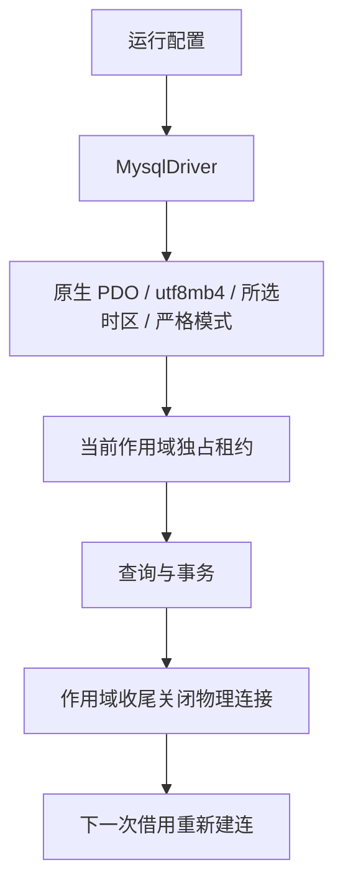

# type-orm-mysql · MySQL 驱动

[返回组件总览](../components.md)

通过 PDO 连接 MySQL，复用 ORM 的查询、模型、事务与迁移。驱动只保存配置，实际连接由当前执行作用域借用时建立。

## 安装与依赖

需要 PHP `>=8.4 <8.6`、`ext-pdo_mysql`、`type-orm` 和 `type-runtime`。先准备数据库、应用账号与相应权限，安装包不会创建数据库或账号。

在消费应用根执行以下命令，源码与完整 API 说明也随包安装：

```bash
composer config minimum-stability RC
composer config prefer-stable true
composer require zoujingli/type-orm-mysql:1.0.0-rc.18
```

这组命令对应 RC18；请先在[版本说明](../releases.md)确认公开状态，再安装同批组件并提交 `composer.lock`。当前接口以本页和所用 tag 的包 README 为准；RC14 应用继续使用原版本文档，不能混用新接口。

## 最小使用示例

将下例保存为独立应用的 `app/main.php`，从进程环境读取连接配置。按[运行声明式示例](../components.md#运行声明式示例)使用 `main()` 启动；示例只做参数绑定 SELECT。

```php
<?php

declare(strict_types=1);

use Type\Orm\Database;
use Type\Orm\Mysql\MysqlDriver;
use Type\Runtime\ExecutionScope;

/** 只在环境键不存在时采用默认值，保留合法的空字符串。 */
function databaseSetting(string $key, string $default): string
{
    $value = getenv($key);

    return $value === false ? $default : $value;
}

/**
 * 借用一个 MySQL 会话执行参数绑定查询，凭据仅在运行时读取。
 */
function main(): void
{
    $port = filter_var(databaseSetting('DB_PORT', '3306'), FILTER_VALIDATE_INT,
        ['options' => ['min_range' => 1, 'max_range' => 65535]]);
    if (!is_int($port)) {
        throw new InvalidArgumentException('DB_PORT 必须为有效整数端口');
    }
    $driver = new MysqlDriver(databaseSetting('DB_HOST', '127.0.0.1'), $port,
        databaseSetting('DB_DATABASE', 'type_example'), databaseSetting('DB_USERNAME', 'type_example'),
        databaseSetting('DB_PASSWORD', ''));
    $database = new Database($driver, 1, 0);
    $scope = new ExecutionScope();
    try {
        $connection = $database->connect($scope);
        echo json_encode($connection->query('SELECT ? AS value', [7]), JSON_THROW_ON_ERROR) . "\n";
    } finally {
        try {
            $scope->close();
        } finally {
            $database->close();
        }
    }
}
```

提供有效配置后执行 `php dev.php`，输出含 `value=7` 的 JSON 行列表。读取不创建业务表；整数的具体 PDO 返回类型应以实际驱动结果为准。

### 从连接探测进入业务开发

1. 在专属开发库执行上述只读示例，确认账号、数据库和网络可用。
2. 用版本化迁移建立实际表，确认表引擎为 InnoDB；模型声明本身不会建表。
3. 按[数据库与模型教程](../database.md)声明领域 Model、生成映射并在作用域内调用 CRUD。
4. 业务成功、约束失败和取消都验证 Scope 收尾；提交未知使用稳定业务 ID 对账。



在最小示例取得 `$connection` 后，可只读检查真实基线：

```php
$baseline = $connection->query('SELECT @@SESSION.time_zone AS timezone, @@SESSION.sql_mode AS modes');
echo json_encode($baseline, JSON_THROW_ON_ERROR) . "\n";
```

默认 timezone 为 `+00:00`，显式指定时应与所选时区一致；modes 包含 `STRICT_ALL_TABLES`。不要依赖完整 SQL 模式列表的固定顺序。此检查不证明所有 SQL 都具备相同超时，也不替代事务表检查。

## 连接配置

最小示例使用以下环境键；这是应用入口的映射，不是驱动自动读取环境。

| 环境键 | 示例默认值 | 含义 |
| --- | --- | --- |
| `DB_HOST` | 127.0.0.1 | 数据库主机 |
| `DB_PORT` | 3306 | 1–65535 整数端口 |
| `DB_DATABASE` | type_example | 已存在的数据库 |
| `DB_USERNAME` | type_example | 应用账号 |
| `DB_PASSWORD` | 空字符串 | 启动时注入的密码 |

`MysqlDriver` 还接受 `generation=1`、`role='writer'`、`caFile=null`；当前 `main` 在末尾新增 `timeZone='+00:00'`。generation 必须为正整数；role 为 writer 或 reader，reader 初始化会话只读策略。凭据轮换由 `DatabaseManager::rotate()` 搭配新驱动身份完成。

驱动设置 utf8mb4、所选时区（默认 UTC）、严格 SQL 模式、异常模式和原生预处理，连接选项的超时为 5 秒。该超时不等于所有 SQL 或任意内核 I/O 的端到端硬截止。

### 连接已有数据库时选择时区

旧应用如果继承服务器系统时区，可显式选择 `SYSTEM`；原始 RC14 没有此参数，须先安装包含该接口的固定组件版本并重新全量 AOT。

```php
$driver = new MysqlDriver($host, $port, $database, $username, $password, timeZone: 'SYSTEM');
```

`SYSTEM` 指数据库服务器的系统时区，与 PHP 默认时区无关，也不等同于 `@@GLOBAL.time_zone` 中可能另设的时区。先在旧连接查询 `@@SESSION.time_zone`，再选择一致的策略；不修改旧连接来掩盖迁移差异。时区是每个驱动的显式配置，不自动读取环境键。

支持 `SYSTEM` 及 `-13:59` 至 `+14:00` 的 `±HH:MM` 固定偏移，例如 `+08:00`、`+05:45`；`-00:00` 归一为 `+00:00`。不接受空值、简写、空白或命名时区，不要求服务器导入时区表。较旧 MySQL 的合法偏移范围可能更窄，服务器拒绝初始化时连接失败并保留 PDO 原因，不退回默认时区。

时区纳入 `identity()['session']['timezone']`。变更运行中配置须新建驱动、增加 `generation` 并通过 `DatabaseManager::rotate()` 轮换；旧租约仍使用原时区，新租约使用新时区。主库和读库应显式采用一致的业务策略，`SYSTEM` 要求各数据库服务器自身的系统时区一致。

| 列类型 | 会话时区的影响 |
| --- | --- |
| `TIMESTAMP` | 输入与输出按会话时区转换；同一存储时刻的文本可能不同 |
| `DATETIME` | 保留日期时间文本，不随会话时区自动转换 |

因此不要在模型序列化层给所有日期统一加减 8 小时。先确认列类型、旧连接会话及新连接身份；配置变更也不会纠正历史写错的数据。主仓 `composer test:mysql-timezone` 只读检查固定时间戳、DATETIME、会话隔离和代次轮换，要求显式提供回环测试端点及 `TYPE_MYSQL_DATABASE=information_schema`。

## 参数查询与主键

在最小示例的 `try` 中，取得 `$connection` 后对已迁移的业务表操作：

```php
$connection->table('users')->insert(['name' => '示例', 'age' => 20]);
$id = $connection->lastInsertId();
$user = $connection->table('users')->where('id', '=', $id)->first();
```

表的 id 必须已配置为自增主键。`lastInsertId()` 返回字符串；不要把可能超出 PHP 整数范围的值强转。MySQL 不提供 PostgreSQL 式 INSERT RETURNING，使用前检查 Query 的 `capabilities()`。

## 批量写入与事务

`upsertAnyUnique($rows, $updateColumns)` 使用 MySQL 任意唯一键冲突语义；它不能保证只针对你指定的某一唯一索引。跨库的 `upsert($rows, $uniqueBy, $updateColumns)` 要按方言支持使用。

业务 Model CRUD 使用 `Db::transaction(static function (): mixed { ... })`，无需传入连接；嵌套事务使用 savepoint。迁移和受限基础设施的显式连接使用 `$connection->transaction(static function (Connection $transaction): mixed { ... })`。业务须选择支持事务的表引擎，不能将非事务表当作有回滚保证。

迁移 DDL 必须声明 `transactional=false`。ALTER/CREATE 等操作可能隐式提交，失败之前已生效的结果保留。检查实际结构与迁移历史后再显式恢复；不能用自动重试掩盖不确定结果。

## TLS 与身份

通过 `caFile` 传入可读 CA 文件启用证书验证；驱动还检查实际协商的 TLS cipher。服务端证书及连接主机必须满足验证要求。CA 内容摘要进入连接身份，内容变化需要创建新驱动并轮换，不沿用旧身份。

身份包含端点、数据库、账号、凭据代次、角色、TLS 与会话基线，不含密码。认证失败时向业务返回受控错误，底层异常仅用于受保护的诊断。

## 生命周期和排查

| 现象 | 检查 |
| --- | --- |
| 缺少 pdo_mysql | 核对当前 PHP 或实际 embed 的模块，不能只检查另一套 CLI |
| 初始化连接失败 | 主机/端口、账号权限、数据库存在性及 TLS |
| 写入被拒绝 | 是否 reader 角色、表引擎/权限和约束 |
| 提交确认失败 | 结果可能未知，先对账，再决定恢复 |
| 同步池容量耗尽 | 在每次请求 finally 关闭 Scope，并控制工作进程总连接数 |

Scope 关闭归还租约，Database 由应用所有者关闭。MySQL 当前每次归还均关闭物理 PDO，包括成功的普通 CRUD；标准 PDO MySQL 未提供完整会话重置接口，不能只恢复时区和 SQL 模式后就把可能包含变量、临时对象或命名锁的连接交给下一请求。连接池仍管理容量、等待与租约，同一作用域内继续使用已借用的连接。不要跨请求保存 Connection；具体边界见[模型连接与主从路由](https://github.com/zoujingli/typeapp/blob/main/docs/development/model-connections.md#连接池与物理会话复用)。

## 编译与验证

生产选择 `mysql` profile 的静态 SDK，将 PDO MySQL、客户端及公共非系统库链接进主程序；部署端只需 MySQL 服务与连接配置。共享库开发 SDK 若将 mysqlnd 单独提供，还需在 `runtime.extensions` 声明它。这是构建输入约定，不是给单程序部署者安装 `.so/.dll` 的步骤。

本仓库验证入口：`composer build:mysql`、`composer test:mysql`、`composer test:mysql-consumer`。三库对照使用 `php tests/orm-suite-consumer.php mysql`，原生模式加 `--native`；这些检查需要专属数据库环境。

继续阅读：[ORM 查询与事务](type-orm.md)、[数据库指南](../database.md)、[PostgreSQL](type-orm-pgsql.md)、[SQLite](type-orm-sqlite.md)。

本文以本仓库当前公开接口为依据；安装版本请同时核对包内 README。[对应源码与包说明](https://github.com/zoujingli/type-orm-mysql)。
