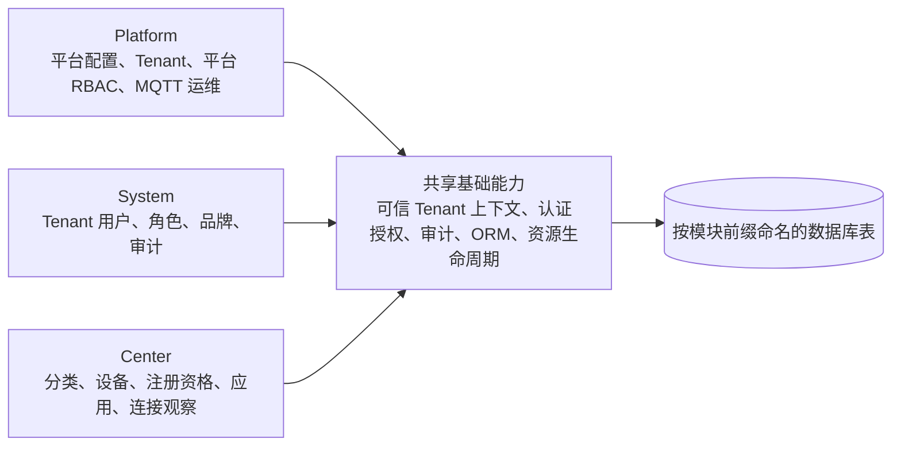
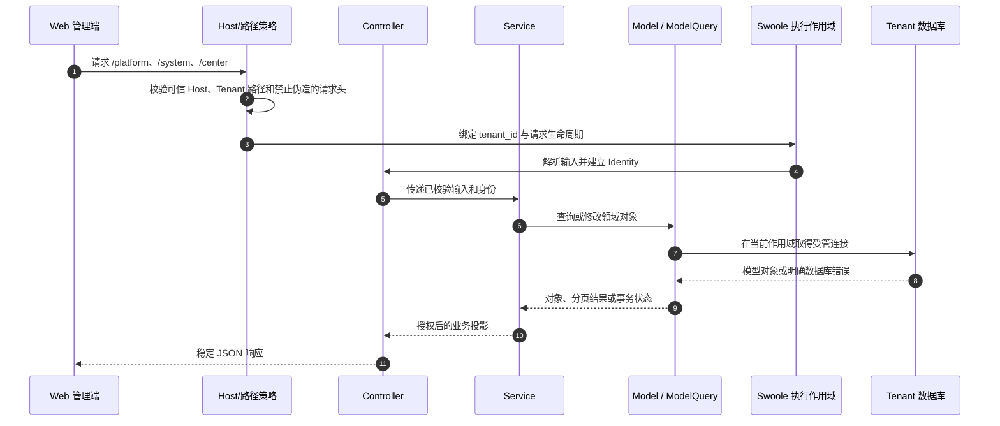
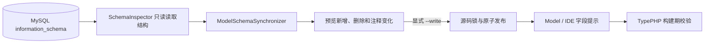

# Tenant 平台、System 与 Center 架构

TypeApp 物联中心采用一个应用、三个运行角色的装配方式。Platform 管理平台级资源和 Tenant，System 管理当前 Tenant 的人员与系统设置，Center 管理当前 Tenant 的设备与接入应用。三端共用认证、权限、审计、执行作用域和 ORM，业务代码保持 Controller、Service、Model 三层。

## 角色边界



Platform 会话与 System 会话相互独立。System 用户直接归属一个 Tenant，登录名在 `(tenant_id, login)` 范围内唯一；Center 复用当前 Tenant 的 System 会话。平台模拟登录只通过一次性交接码进入目标 Tenant 的 System 工作区，审计同时记录平台操作者、来源会话和目标账号。

## 请求处理链



Controller 只负责协议输入、输出和错误边界；Service 负责授权、事务和跨模型规则；Model 负责字段、生命周期、租户约束和对象读写。迁移、审计、恢复、MQTT 运行观测及跨 Tenant 聚合可以使用受限底层查询，并在代码审查中登记例外。

## 登录与 Tenant 隔离

```mermaid
flowchart TD
    Root[主域名 /#/system/login] --> Select[分页选择启用 Tenant]
    Select --> Context[加载公开品牌和主题]
    Context --> Login[账号密码登录]
    Login --> Fixed[/t/{tenant_id}/#/system/profile]
    Subdomain[登记 Tenant 子域名] --> Auto[自动加载 Tenant 公开配置]
    FixedEntry[/t/{tenant_id}/] --> AutoFixed[按固定路径加载 Tenant 配置]
    Auto --> Login2[账号密码登录]
    AutoFixed --> Login3[账号密码登录]
    Login2 --> System[System 会话]
    Login3 --> System
```

`/public/tenants` 只返回启用 Tenant 的标识与名称；`/public/context` 和 `/t/{tenant_id}/public/context` 只返回公开展示白名单。未知 Tenant、停用 Tenant、路径与 Host 冲突以及伪造 Tenant 请求头均拒绝。登录后不支持跨 Tenant 切换，切换必须回到登录入口重新建立上下文。

## 菜单目录

菜单目录由 `app/common/service/MenuService.php` 单一登记源生成，数据库分别保存为 `platform_menu` 和 `system_menu`。目录、页面和操作节点共用 `platform.*`、`system.*`、`center.*` 权限事实；`order_number` 决定同级排序，`icon` 表达功能语义。

| 工作区 | 分组顺序 | 页面顺序 |
| --- | --- | --- |
| Platform | 客户与物联 | 客户管理、注册资格、设备资产、接入应用、设备转配 |
| Platform | 平台权限 | 平台用户、平台角色、菜单管理 |
| Platform | 运维监控 | 运行概览、MQTT 资源、MQTT 授权、MQTT 配额、MQTT 配置、MQTT 调试、MQTT 节点、操作审计 |
| Platform | 平台设置 | 平台设置、系统登录与初始配置、运行配置 |
| System | 用户与权限 | 用户管理、角色管理 |
| System | 物联中心 | 设备分类、注册资格、设备管理、接入应用、连接观察、转配接收 |
| System | 系统管理 | 系统设置、操作审计 |

前端路由只装配页面，不复制目录排序或图标映射。目录被停用时，关联页面和操作能力同时失效；隐藏只影响导航显示。平台菜单管理不能创建未在构建期登记的页面或权限。

## 模型声明与 MySQL 反向同步

业务模型使用简单的 `protected $table` 与 `protected $schema` 声明，字段声明同时承载类型、可空性、赋值策略、可见性和字段注释。构建期将声明展开为类型化属性，IDE 可以直接提示字段和生成的访问器；运行期不扫描 PHP 源码。



使用 `php vendor/bin/type model:sync` 时，工具只读取目标表结构，不执行 DDL、不加载业务自动加载文件，也不直接写数据库。默认仅预览；显式 `--write` 才更新源码。删除字段必须显式 `--drop-missing`，生成列自动标记为不可赋值，`BIGINT` 和精确小数保留无损字符串语义，表注释与字段注释同步为类和属性文档。表结构变更仍由迁移管理，反向同步负责让模型声明与已确认的数据库事实保持一致。

## 表命名与验证

持久表按业务模块前缀命名，例如 `platform_menu`、`platform_user`、`platform_role`、`system_menu`、`system_user`、`system_role`、`center_device` 和 `center_application`。跨模块关联通过外键和复合 Tenant 约束表达，避免使用未说明来源的通用表名。

开发闭环至少执行：模型与表结构同步检查、PHP 语法和 CS-Fixer、TypePHP 应用声明检查、前端类型检查与生产构建、SQLite 真实 HTTP 隔离测试，以及目标发布矩阵中的 MySQL、PostgreSQL、AOT 和 TLS MQTT 验证。任何未执行的数据库、原生程序或现场验证都必须单独标记，不能用静态检查替代。
